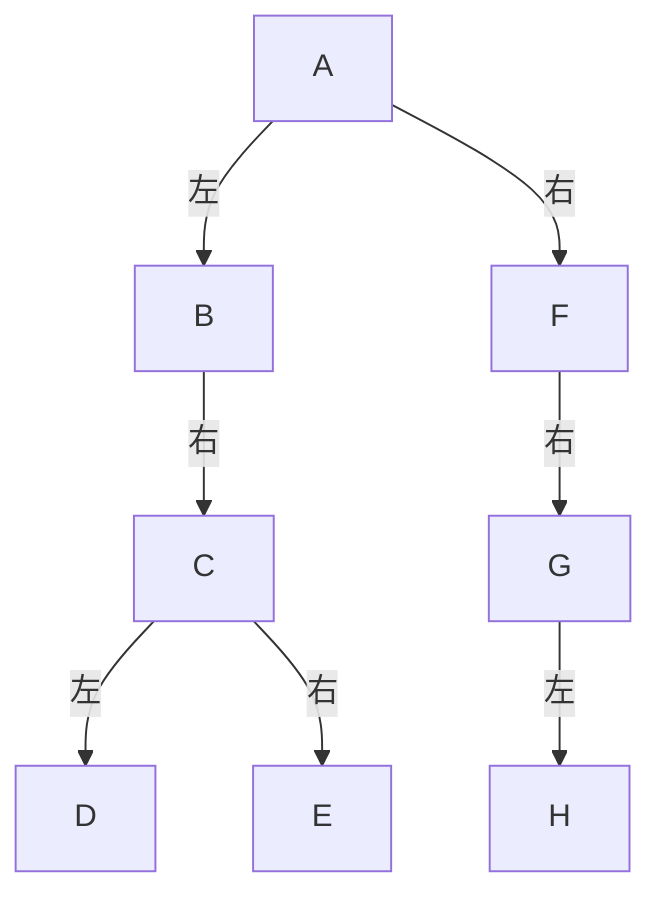

## 树和二叉树

### 本章重点

- 掌握二叉树的定义、五条基本性质，以及顺序存储和链式存储。
- 熟练掌握先序、中序、后序遍历，能建立二叉树、统计结点和由遍历序列还原二叉树。
- 理解线索化的目的，会根据遍历序列补画前驱、后继线索。
- 了解树、森林与二叉树的转换，以及遍历次序的对应关系。
- 熟练掌握哈夫曼树的构造、存储和编码，理解表达式树的建立与求值。

### 树的基本概念

#### 树的定义

- 树是由 $n\ (n\ge 0)$ 个结点组成的有限集合，$n=0$ 时称为空树。
- 非空树有且仅有一个根结点。
- 除根结点外，其余结点可分为若干个互不相交的集合，每个集合本身又是一棵树，称为根的子树。
- 树形结构反映数据元素之间的 **一对多** 关系。

#### 树的基本术语

- **结点的度：** 结点拥有的子树数。
- **树的度：** 树中所有结点度数的最大值。
- **叶子结点：** 度为 $0$ 的结点，也称终端结点。
- **分支结点：** 度不为 $0$ 的结点，也称非终端结点。
- **孩子与双亲：** 一个结点的子树的根称为它的孩子，该结点称为孩子的双亲。
- **兄弟结点：** 具有同一双亲的结点。
- **堂兄弟结点：** 双亲位于同一层、但双亲不同的结点。
- **祖先与子孙：** 从根到某结点的路径上，除该结点自身外的结点都是它的祖先；该结点下面各子树中的结点都是它的子孙。
- **结点的层次：** 根结点位于第 $1$ 层，根的孩子位于第 $2$ 层，以此类推。
- **树的深度（高度）：** 树中结点的最大层数。
- **森林：** $m\ (m\ge 0)$ 棵互不相交的树组成的集合。
- **有序树：** 结点的各棵子树从左到右有次序，不能随意交换位置。
- **无序树：** 不规定各棵子树的次序，交换子树位置不改变树所表示的关系。

删除一棵非空树的根结点后，剩余子树构成森林；给森林中的各棵树增加一个共同的根，可以得到一棵树。

#### 树的其他表示方式

除树形图外，还可以使用凹入表示法、嵌套集合表示法和广义表表示法。

例如根结点 `A` 有孩子 `B`、`C`，其中 `B` 有孩子 `D`、`E`，可以写成：

```text
A(B(D,E),C)
```

凹入表示法用缩进表示层次；广义表用括号表示子树的嵌套关系。

#### 树中的结点数关系

设非空树中有 $n$ 个结点，则整棵树共有 $n-1$ 条边。

因此所有结点的度数之和满足：

$$
\sum \text{结点的度}=n-1
$$

这是树和二叉树中经常使用的计数依据。若森林中有 $n$ 个结点、$m$ 棵非空树，则边数为 $n-m$。


### 二叉树

#### 二叉树的定义和特点

- 二叉树是由 $n\ (n\ge 0)$ 个结点组成的有限集合。
- 非空二叉树由一个根结点和两棵互不相交的二叉树组成，这两棵树分别称为左子树和右子树。
- 每个结点的度不超过 $2$。
- 二叉树的左、右子树有次序，不能任意交换。
- 即使一个结点只有一棵子树，也要区分它是左子树还是右子树。

二叉树的五种基本形态为：空二叉树、只有根结点、只有左子树、只有右子树、左右子树均非空。

**二叉树与度为 $2$ 的有序树有区别：** 二叉树的每个孩子都有确定的左、右位置；普通有序树只有一个孩子时，不区分它是左孩子还是右孩子。

例如具有 $3$ 个结点时，二叉树共有 $5$ 种形态：根有两个孩子的 $1$ 种，以及单支链的左左、左右、右左、右右共 $4$ 种；普通树不区分左、右位置时只有 $2$ 种形态。

#### 二叉树的抽象数据类型

二叉树的抽象数据类型描述数据对象、根与左右子树之间的关系，以及允许执行的操作，不限定具体存储方式。

- **建立与维护：** 初始化、按给定定义建立、清空、销毁二叉树。
- **查询与修改：** 判空、求深度、读取或修改结点值、查找双亲和孩子。
- **结构操作：** 插入或删除子树。
- **遍历：** 先序、中序、后序和层序遍历。

下面分别使用数组和链表实现这些操作中的常见部分。

#### 二叉树的基本性质

##### 第 $i$ 层的结点数

二叉树第 $i$ 层至多有：

$$
2^{i-1}
$$

个结点，其中 $i\ge 1$。

若第 $i$ 层存在，则这一层至少有 $1$ 个结点。

##### 深度为 $k$ 的二叉树结点数

深度为 $k$ 的二叉树至多有：

$$
1+2+2^2+\cdots+2^{k-1}=2^k-1
$$

个结点，至少有 $k$ 个结点。

##### 叶子结点与二度结点的关系

设度为 $0$、$1$、$2$ 的结点数分别为 $n_0$、$n_1$、$n_2$，则：

$$
n_0=n_2+1
$$

推导：

$$
n=n_0+n_1+n_2
$$

二叉树共有 $n-1$ 条边，而所有结点的孩子数之和也等于边数：

$$
n-1=n_1+2n_2
$$

联立两式可得 $n_0=n_2+1$。

#### 满二叉树

- 深度为 $k$ 且含有 $2^k-1$ 个结点的二叉树称为满二叉树。
- 每一层的结点数都达到最大值。
- 除叶子结点外，其余结点的度均为 $2$。

#### 完全二叉树

- 对一棵深度为 $k$、具有 $n$ 个结点的二叉树，从上到下、从左到右编号。
- 如果每个结点都与深度为 $k$ 的满二叉树中编号为 $1$ 至 $n$ 的结点一一对应，则称为完全二叉树。
- 前 $k-1$ 层一定是满的，最后一层的结点连续集中在左侧。
- 满二叉树一定是完全二叉树，完全二叉树不一定是满二叉树。

具有 $n$ 个结点的完全二叉树的深度为：

$$
\lfloor\log_2 n\rfloor+1
$$

因为深度为 $k$ 的完全二叉树满足：

$$
2^{k-1}\le n\le 2^k-1
$$

取对数得 $k-1\le\log_2n<k$，所以 $k=\lfloor\log_2n\rfloor+1$。

完全二叉树的叶子结点数为：

$$
\left\lceil\frac{n}{2}\right\rceil
$$

例如完全二叉树共有 $5000$ 个结点，则叶子结点数为 $2500$。

#### 完全二叉树的编号关系

若结点编号从 $1$ 开始，编号为 $i$ 的结点满足：

- 当 $i>1$ 时，其双亲编号为 $\lfloor i/2\rfloor$。
- 当 $2i\le n$ 时，其左孩子编号为 $2i$，否则没有左孩子。
- 当 $2i+1\le n$ 时，其右孩子编号为 $2i+1$，否则没有右孩子。
- 当 $i>\lfloor n/2\rfloor$ 时，该结点是叶子结点。

完全二叉树中，度为 $1$ 的结点最多只有 $1$ 个，而且只能有左孩子。$n$ 为偶数时有 $1$ 个度为 $1$ 的结点，$n$ 为奇数时没有。


### 二叉树的存储结构

#### 顺序存储

按照完全二叉树的层序编号，将结点依次存入数组。

```c++
#define MAXSIZE 100
typedef char ElemType;

typedef struct{
    ElemType data[MAXSIZE + 1]; // 0号位置不用，根结点存放在data[1]
    int length;                 // 当前结点数
}SqBiTree;
```

- 满二叉树和完全二叉树使用顺序存储时，结点关系可以由下标直接计算。
- 一般二叉树需要为空结点保留位置，可能造成较大的空间浪费。
- 单支树是顺序存储空间利用率很低的典型情况。

这里统一从下标 $1$ 开始存储。若题目从下标 $0$ 开始，则左、右孩子下标分别为 $2i+1$、$2i+2$，非根结点的双亲下标为 $\lfloor(i-1)/2\rfloor$。

#### 二叉链表

每个结点由数据域、左孩子指针和右孩子指针组成。

```c++
typedef char ElemType;

typedef struct BiNode{
    ElemType data;          // 数据域
    struct BiNode *lchild;  // 左孩子指针
    struct BiNode *rchild;  // 右孩子指针
}BiNode,*BiTree;
```

含有 $n\ge1$ 个结点的二叉链表共有 $2n$ 个指针域，其中 $n-1$ 个指针指向孩子结点，因此空指针域的个数为：

$$
2n-(n-1)=n+1
$$

#### 三叉链表

三叉链表在二叉链表的基础上增加双亲指针，适合频繁查找双亲结点的情况。

```c++
typedef struct TriTNode{
    ElemType data;
    struct TriTNode *lchild; // 左孩子
    struct TriTNode *parent; // 双亲
    struct TriTNode *rchild; // 右孩子
}TriTNode,*TriTree;
```


### 二叉树的遍历

#### 遍历的概念

遍历是按照某种次序访问二叉树中的每个结点，使每个结点被访问一次且仅访问一次。

设访问根结点为 `D`，遍历左子树为 `L`，遍历右子树为 `R`，通常规定先左后右：

- 先序遍历：`DLR`，根、左、右。
- 中序遍历：`LDR`，左、根、右。
- 后序遍历：`LRD`，左、右、根。
- 层序遍历：从上到下逐层访问，同一层从左到右访问。

#### 递归遍历

##### 先序遍历

```c++
void PreOrderTraverse(BiTree T){
    if(T==NULL)return;              // 空树直接返回
    cout<<T->data<<' ';             // 访问根结点
    PreOrderTraverse(T->lchild);    // 遍历左子树
    PreOrderTraverse(T->rchild);    // 遍历右子树
}
```

##### 中序遍历

```c++
void InOrderTraverse(BiTree T){
    if(T==NULL)return;
    InOrderTraverse(T->lchild);     // 遍历左子树
    cout<<T->data<<' ';             // 访问根结点
    InOrderTraverse(T->rchild);     // 遍历右子树
}
```

##### 后序遍历

```c++
void PostOrderTraverse(BiTree T){
    if(T==NULL)return;
    PostOrderTraverse(T->lchild);   // 遍历左子树
    PostOrderTraverse(T->rchild);   // 遍历右子树
    cout<<T->data<<' ';             // 访问根结点
}
```

三种递归遍历的访问路径相同，只是访问结点的时机不同：

- 第一次到达结点时访问，对应先序遍历。
- 第二次经过结点时访问，对应中序遍历。
- 第三次离开结点时访问，对应后序遍历。

设二叉树有 $n$ 个结点、高度为 $h$：

- 时间复杂度均为 $O(n)$。
- 递归栈空间复杂度为 $O(h)$，最坏情况下为 $O(n)$。

#### 非递归中序遍历

非递归遍历是考试和考研中的常见考点，核心是用栈保存尚未访问的祖先结点。栈的后进先出、队列的先进先出可回顾[栈和队列](knowledge:notes-data-structure-03)。

```c++
#include<stack>
using namespace std;

void InOrderTraverse(BiTree T){
    stack<BiTree> st;
    BiTree p=T;
    while(p||!st.empty()){
        while(p){
            st.push(p);      // 沿左孩子方向入栈
            p=p->lchild;
        }
        p=st.top();
        st.pop();
        cout<<p->data<<' ';  // 左子树处理完后访问根
        p=p->rchild;         // 转向右子树
    }
}
```

#### 层序遍历

层序遍历使用队列。结点出队时访问，并将其非空的左、右孩子依次入队。

```c++
#include<queue>
using namespace std;

void LevelOrderTraverse(BiTree T){
    if(T==NULL)return;
    queue<BiTree> q;
    q.push(T);
    while(!q.empty()){
        BiTree p=q.front();
        q.pop();
        cout<<p->data<<' ';
        if(p->lchild)q.push(p->lchild); // 左孩子先入队
        if(p->rchild)q.push(p->rchild); // 右孩子后入队
    }
}
```


### 二叉树的建立和遍历应用

#### 按先序序列建立二叉树

只给出普通先序序列不能确定空子树的位置，因此使用 `#` 表示空树。

例如先序序列 `AB##C##` 表示根为 `A`，左孩子为 `B`，右孩子为 `C`。

```c++
void CreateBiTree(BiTree&T){
    char ch;
    cin>>ch;
    if(ch=='#'){
        T=NULL;                    // #表示空子树
    }else{
        T=new BiNode;
        T->data=ch;
        CreateBiTree(T->lchild);   // 建立左子树
        CreateBiTree(T->rchild);   // 建立右子树
    }
}
```

#### 计算结点总数

```c++
int NodeCount(BiTree T){
    if(T==NULL)return 0;
    return NodeCount(T->lchild)+NodeCount(T->rchild)+1;
}
```

#### 计算叶子结点数

```c++
int LeafCount(BiTree T){
    if(T==NULL)return 0;
    if(T->lchild==NULL&&T->rchild==NULL)return 1; // 当前结点是叶子
    return LeafCount(T->lchild)+LeafCount(T->rchild);
}
```

#### 计算二叉树深度

```c++
int TreeDepth(BiTree T){
    if(T==NULL)return 0;
    int leftDepth=TreeDepth(T->lchild);
    int rightDepth=TreeDepth(T->rchild);
    return max(leftDepth,rightDepth)+1;
}
```

#### 复制二叉树

```c++
void CopyTree(BiTree T,BiTree&NewT){
    if(T==NULL){
        NewT=NULL;
        return;
    }
    NewT=new BiNode;
    NewT->data=T->data;
    CopyTree(T->lchild,NewT->lchild);
    CopyTree(T->rchild,NewT->rchild);
}
```

#### 交换所有结点的左右子树

```c++
void SwapChild(BiTree T){
    if(T==NULL)return;
    swap(T->lchild,T->rchild); // 交换当前结点的左右孩子
    SwapChild(T->lchild);
    SwapChild(T->rchild);
}
```

#### 由遍历序列确定二叉树

当各结点值互不相同时：

- 先序序列和中序序列可以唯一确定一棵二叉树。
- 后序序列和中序序列可以唯一确定一棵二叉树。
- 先序序列和后序序列通常不能唯一确定一棵二叉树。

##### 先序和中序还原

1. 先序序列的第一个结点是根结点。
2. 在中序序列中找到根结点，其左侧为左子树，右侧为右子树。
3. 根据左右子树的结点数切分先序序列。
4. 递归还原左右子树。

##### 后序和中序还原

1. 后序序列的最后一个结点是根结点。
2. 在中序序列中找到根结点并划分左右子树。
3. 根据左右子树的结点数切分后序序列。
4. 递归还原左右子树。

##### 例：由中序和后序序列还原

已知中序序列为 `BDCEAFHG`，后序序列为 `DECBHGFA`。

1. 后序最后一个结点为 `A`，所以根为 `A`。
2. 中序按 `A` 切分为 `BDCE | A | FHG`，左右子树分别有 $4$、$3$ 个结点。
3. 后序相应切分为 `DECB | HGF | A`，得到左子树根 `B`、右子树根 `F`。
4. 对左子树继续切分：中序为 `B | DCE`，说明 `B` 没有左孩子，右子树根为 `C`；`C` 的左右孩子分别为 `D`、`E`。
5. 对右子树继续切分：中序为 `F | HG`，说明 `F` 没有左孩子，右子树根为 `G`；`G` 的左孩子为 `H`。



还原后先序序列为 `ABCDEFGH`。注意按**子树结点数**切分后序序列，不能直接按中序中的字符位置切分。


### 线索二叉树

#### 线索化的目的

含有 $n$ 个结点的二叉链表有 $n+1$ 个空指针域。可以利用这些空指针保存某种遍历次序下结点的前驱和后继，从而方便遍历和查找。

- **线索：** 指向结点前驱或后继的指针。
- **线索化：** 按某种遍历次序建立线索的过程。
- **线索二叉树：** 加上线索后的二叉树。

#### 线索二叉树类型定义

```c++
typedef enum{Link,Thread}PointerTag;

typedef struct BiThrNode{
    ElemType data;
    struct BiThrNode *lchild,*rchild;
    PointerTag LTag,RTag;
}BiThrNode,*BiThrTree;
```

标志域的含义：

- `LTag==Link`：`lchild` 指向左孩子。
- `LTag==Thread`：`lchild` 指向遍历序列中的前驱。
- `RTag==Link`：`rchild` 指向右孩子。
- `RTag==Thread`：`rchild` 指向遍历序列中的后继。

其中 `Link` 的值为 $0$，`Thread` 的值为 $1$。只有原来为空的指针域才改作线索，原有的孩子指针必须保留。

#### 中序线索化

线索化前，所有结点的 `LTag`、`RTag` 都初始化为 `Link`，左右指针只指向真实孩子或 `NULL`。下面先使用不带头结点的版本，且只对普通二叉链表执行一次线索化。

```c++
BiThrTree pre=NULL; // 始终指向刚刚访问过的结点

void InThreading(BiThrTree p){
    if(p==NULL)return;

    InThreading(p->lchild);

    if(p->lchild==NULL){
        p->LTag=Thread;
        p->lchild=pre;       // 当前结点的前驱线索
    }
    if(pre&&pre->rchild==NULL){
        pre->RTag=Thread;
        pre->rchild=p;       // 前驱结点的后继线索
    }
    pre=p;

    InThreading(p->rchild);
}

void CreateInThread(BiThrTree T){
    pre=NULL;               // 每棵树线索化前都要重置
    InThreading(T);
    if(pre){
        pre->RTag=Thread;
        pre->rchild=NULL;   // 最后一个结点没有后继
    }
}
```

中序第一个结点的前驱线索为 `NULL`，最后一个结点的后继线索也为 `NULL`。`pre` 用来连接“刚访问过的结点”和“当前结点”。

#### 画线索和查找前驱、后继

画线索时先写出对应的遍历序列，再逐个处理原来的空指针域：左空指针指向前驱，右空指针指向后继，并把相应标志改为 $1$。

对于中序线索树中的结点 `p`：

- 若 `LTag==Thread`，则 `lchild` 直接指向前驱；否则前驱是其左子树中最右边的结点。
- 若 `RTag==Thread`，则 `rchild` 直接指向后继；否则后继是其右子树中最左边的结点。

例如中序序列为 `H D I B E A F C G`，若 `E` 的左右指针原来都为空，线索化后分别指向 `B` 和 `A`。

#### 带头结点的线索树

为统一处理首尾边界，课件的中序线索树示意图增设头结点 `head`：

- 非空树中，头结点的左指针指向根，右指针指向头结点自身。
- 中序第一个结点的前驱线索指向头结点。
- 中序最后一个结点的后继线索指向头结点。
- 头结点不保存待访问的数据，遍历时遇到头结点就应停止。

带头结点时应以 `p!=head` 判断结束；下面不带头结点的代码仍以 `p!=NULL` 判断结束，两种边界约定不能混用。

#### 中序线索树遍历

先调用 `CreateInThread(T)` 完成线索化，再执行：

```c++
void InOrderThreadTraverse(BiThrTree T){
    BiThrTree p=T;
    while(p){
        while(p->LTag==Link)p=p->lchild; // 找到当前子树最左结点

        cout<<p->data<<' ';

        while(p->RTag==Thread&&p->rchild){
            p=p->rchild;                // 沿后继线索访问
            cout<<p->data<<' ';
        }
        p=p->rchild;                     // 转向右子树
    }
}
```

- 中序线索树查找后继较方便，是线索二叉树中的常见考点。
- 先序线索树和后序线索树的基本思想相同，但后序后继的查找通常还需要双亲信息。
- 沿孩子指针递归时必须区分标志域，不能把前驱、后继线索当成孩子继续递归。


### 树和森林

#### 孩子兄弟表示法

孩子兄弟表示法又称二叉链表表示法。每个结点设置两个指针：

- `firstchild` 指向该结点的第一个孩子。
- `nextsibling` 指向该结点的下一个兄弟。

```c++
typedef struct CSNode{
    ElemType data;
    struct CSNode *firstchild;  // 第一个孩子
    struct CSNode *nextsibling; // 下一个兄弟
}CSNode,*CSTree;
```

孩子兄弟表示法把任意树转换成二叉树，因此可以复用二叉树的存储和遍历思想。

#### 树转换为二叉树

转换规则可以概括为“左孩子，右兄弟”：

1. 在所有兄弟结点之间连线。
2. 每个结点只保留它与第一个孩子之间的连线。
3. 将兄弟连线看作结点的右孩子关系。

转换后：

- 原树中结点的第一个孩子成为二叉树中的左孩子。
- 原树中结点的下一个兄弟成为二叉树中的右孩子。

单棵树的根没有兄弟，因此转换得到的二叉树根结点没有右孩子。

#### 二叉树还原为树

从二叉树还原时，按“左孩子还原为第一个孩子，沿右孩子链找到其余兄弟”处理：

1. 若结点 `p` 有左孩子，则将它作为原树中 `p` 的第一个孩子。
2. 沿这个左孩子的右孩子链，将链上的结点依次作为 `p` 的其他孩子。
3. 对各个孩子递归执行相同操作。

**二叉树中的右孩子在还原后是兄弟，不能仍画成孩子。** 转换前后的结点数相同，但树的度和高度可能改变。

#### 森林转换为二叉树

1. 分别将森林中的每棵树转换为二叉树。
2. 从第二棵树开始，依次把后一棵树的根作为前一棵树根的右孩子。

反向转换时，二叉树根结点及其右孩子链上的结点分别作为森林中各棵树的根。

#### 树和森林的遍历

树的常用遍历方式：

- **先根遍历：** 先访问根结点，再依次先根遍历各棵子树。
- **后根遍历：** 先依次后根遍历各棵子树，再访问根结点。
- **层次遍历：** 从上到下、从左到右逐层访问。

森林的常用遍历方式：

- **先序遍历森林：** 依次先根遍历森林中的每棵树。
- **中序遍历森林：** 依次后根遍历森林中的每棵树。

按递归定义，森林可以拆成“第一棵树的根、它的子树森林、剩余森林”：

- 先序遍历：访问第一棵树的根，再先序遍历它的子树森林，最后先序遍历剩余森林。
- 中序遍历：先中序遍历第一棵树的子树森林，再访问它的根，最后中序遍历剩余森林。

这里森林的“中序”不要求每个结点只有两个孩子，也不能理解为只在第一、第二棵子树之间访问根。

树或森林转换成孩子兄弟二叉树后，遍历次序存在以下对应关系：

- 树的先根遍历对应其二叉树的先序遍历。
- 树的后根遍历对应其二叉树的中序遍历。
- 森林的先序遍历对应其二叉树的先序遍历。
- 森林的中序遍历对应其二叉树的中序遍历。


### 哈夫曼树

#### 基本概念

- **路径：** 从一个结点到另一个结点之间所经过的分支序列。
- **路径长度：** 路径上的分支数。
- **结点的带权路径长度：** 结点的权值与该结点到根的路径长度之积。
- **树的带权路径长度：** 所有叶子结点的带权路径长度之和。

若叶子结点的权值为 $w_i$，到根的路径长度为 $l_i$，则：

$$
WPL=\sum_{i=1}^{n}w_i l_i
$$

在含有相同带权叶子结点的二叉树中，$WPL$ 最小的二叉树称为哈夫曼树，也称最优二叉树。

#### 哈夫曼树的特点

- 权值越大的叶子结点通常越靠近根。
- 哈夫曼树中不存在度为 $1$ 的结点。
- 含有 $n$ 个叶子结点的哈夫曼树共有 $2n-1$ 个结点。
- 对同一组权值，哈夫曼树的形态可能不唯一，但最小 $WPL$ 相同。
- 左右子树的次序不影响 $WPL$，但可能使具体编码不同。

#### 哈夫曼树的构造

1. 根据给定的 $n$ 个权值建立 $n$ 棵只有根结点的树。
2. 选择根结点权值最小的两棵树作为左右子树，建立一棵新树。
3. 新树根结点的权值等于两棵子树根结点的权值之和。
4. 删除被选中的两棵树，将新树加入森林。
5. 重复以上过程，直到森林中只剩一棵树。

考试中可以通过反复合并当前最小的两个权值计算 $WPL$。所有合并产生的新权值之和也等于最终的 $WPL$。

##### 例：合并权值并计算 $WPL$

给定叶子权值 $7,5,2,4$，每轮都重新选择当前最小的两个权值：

| 轮次 | 选出的两个权值 | 新权值 | 合并后剩余权值 |
| --- | --- | --- | --- |
| 1 | $2,4$ | $6$ | $5,6,7$ |
| 2 | $5,6$ | $11$ | $7,11$ |
| 3 | $7,11$ | $18$ | $18$ |

所以：

$$
WPL=6+11+18=35
$$

从叶子深度计算也得到 $7\times1+5\times2+2\times3+4\times3=35$。如果四个叶子都放在第 $3$ 层，则 $WPL=(7+5+2+4)\times2=36$，可见**高度最小不等于带权路径长度最小**。

#### 哈夫曼树存储结构

```c++
typedef struct{
    int weight; // 结点权值
    int parent; // 双亲下标
    int lch;    // 左孩子下标
    int rch;    // 右孩子下标
}HTNode,*HuffmanTree;
```

下标为 `1` 至 `n` 的位置存放叶子结点，下标为 `n+1` 至 `2n-1` 的位置存放合并产生的分支结点，最后一个结点是根结点。

#### 选择两个最小结点

```c++
void Select(HuffmanTree HT,int end,int&s1,int&s2){
    s1=s2=0;
    for(int i=1;i<=end;i++){
        if(HT[i].parent!=0)continue; // 已合并的结点不再选择

        if(s1==0||HT[i].weight<HT[s1].weight){
            s2=s1;
            s1=i;
        }else if(s2==0||HT[i].weight<HT[s2].weight){
            s2=i;
        }
    }
}
```

#### 构造哈夫曼树

```c++
void CreateHuffmanTree(HuffmanTree&HT,int n){
    if(n<=1)return;
    int m=2*n-1;
    HT=new HTNode[m+1]; // 0号位置不使用

    for(int i=1;i<=m;i++){
        HT[i].weight=0;
        HT[i].parent=HT[i].lch=HT[i].rch=0;
    }

    for(int i=1;i<=n;i++)cin>>HT[i].weight;

    for(int i=n+1;i<=m;i++){
        int s1,s2;
        Select(HT,i-1,s1,s2); // 选出两个尚无双亲且权值最小的结点
        HT[s1].parent=HT[s2].parent=i;
        HT[i].lch=s1;
        HT[i].rch=s2;
        HT[i].weight=HT[s1].weight+HT[s2].weight;
    }
}
```

这里按课件的常规编码情形约定 $n\ge2$，每次调用前使用新的指针变量，不能对未构造成功的 `HT` 继续生成编码。

##### 例：填写哈夫曼树的存储表

若输入权值依次为 $70,50,20,40$，按上面代码每次把较小权值结点作为左孩子，构造结果为：

| 下标 | `weight` | `parent` | `lch` | `rch` |
| --- | --- | --- | --- | --- |
| 1 | 70 | 7 | 0 | 0 |
| 2 | 50 | 6 | 0 | 0 |
| 3 | 20 | 5 | 0 | 0 |
| 4 | 40 | 5 | 0 | 0 |
| 5 | 60 | 6 | 3 | 4 |
| 6 | 110 | 7 | 2 | 5 |
| 7 | 180 | 0 | 1 | 6 |

- `parent==0` 表示当前结点尚未参与合并；构造结束后，只有根结点的 `parent` 为 $0$。
- `lch==rch==0` 表示叶子结点，不能仅凭权值判断某个结点是否为叶子。
- 一共合并 $n-1$ 次，产生 $n-1$ 个分支结点，根存放在 `HT[2*n-1]`。


### 哈夫曼编码

#### 编码原则

将哈夫曼树的左分支标记为 `0`，右分支标记为 `1`，从根到每个叶子结点的路径就是对应字符的哈夫曼编码。

- 出现频率高的字符使用较短编码。
- 出现频率低的字符使用较长编码。
- 哈夫曼编码是不等长编码。
- 哈夫曼编码是前缀编码，任何字符的编码都不是另一个字符编码的前缀，因此不会产生译码歧义。

不等长编码必须能区分字符边界。例如把 `A` 编为 `0`、`B` 编为 `00`，收到 `00` 时就无法判断是 `AA` 还是 `B`。将字符只放在二叉树的叶子上，便能保证任一字符编码都不是另一编码的前缀。

#### 例：根据频率设计编码

字符 `C、A、S、T、B` 的频率分别为 $2,4,2,3,3$。一种合并顺序为：

$$
2+2=4,\quad3+3=6,\quad4+4=8,\quad6+8=14
$$

按课件给出的左右分支安排，可以得到：

| 字符 | 频率 | 编码 | 码长 |
| --- | --- | --- | --- |
| C | 2 | `110` | 3 |
| A | 4 | `10` | 2 |
| S | 2 | `111` | 3 |
| T | 3 | `00` | 2 |
| B | 3 | `01` | 2 |

带权路径长度为：

$$
WPL=2\times3+4\times2+2\times3+3\times2+3\times2=32
$$

平均码长为 $32/14$，约为 $2.29$ 位；若使用等长二进制编码，$5$ 种字符每个至少需要 $3$ 位。同权值时的选择顺序和左右分支安排可以不同，比较最优性时应看 $WPL$，不要求编码字面完全相同。

#### 根据哈夫曼树生成编码

```c++
#include<cstring>

typedef char**HuffmanCode;

void CreateHuffmanCode(HuffmanTree HT,HuffmanCode&HC,int n){
    HC=new char*[n+1];
    char*cd=new char[n];
    cd[n-1]='\0';

    for(int i=1;i<=n;i++){
        int start=n-1;
        int child=i;
        int parent=HT[i].parent;

        while(parent!=0){
            --start;
            cd[start]=(HT[parent].lch==child)?'0':'1';
            child=parent;             // 从叶子向根回溯
            parent=HT[parent].parent;
        }

        HC[i]=new char[n-start];
        strcpy(HC[i],cd+start);
    }

    delete[]cd;
}
```

#### 哈夫曼译码

译码从根结点开始：

- 读到 `0` 时转向左孩子。
- 读到 `1` 时转向右孩子。
- 到达叶子结点时输出对应字符，然后重新从根开始。

若二进制串结束时没有回到根结点，说明编码串不完整或不合法。

例如使用前缀编码 `A:0、B:110、C:10、D:111`，报文 `ABACCDA` 编码为：

```text
0 | 110 | 0 | 10 | 10 | 111 | 0
```

实际传输时不需要分隔符，发送 `0110010101110` 即可。译码时每到一个叶子就输出字符并回到根，能够恢复出原报文。

#### 按概率优化判定次序

课件还给出了按主角生命值 `d` 决定怪物行为的例子：五个区间 `d<100`、`100≤d<200`、`200≤d<300`、`300≤d<500`、`d≥500` 的概率依次为 $5\%$、$15\%$、$40\%$、$30\%$、$10\%$。

在判定成本相同的模型下，可以让高概率结果位于较浅的位置，以减小平均判定次数；哈夫曼树的 $WPL$ 可以衡量这种代价。编写顺序判断时，例如先检查 `200<=d&&d<300`，再检查 `300<=d&&d<500`。

**调整判断顺序时要同时改写区间条件。** 不能只交换原来 `if(d<100)`、`else if(d<200)` 等分支的位置，否则结果会改变；实际运行成本还要考虑一次区间判断包含的比较操作。


### 表达式树

#### 表达式树的结构

- 叶子结点存放操作数。
- 分支结点存放运算符。
- 先序遍历得到表达式的前缀形式。
- 中序遍历配合必要的括号得到中缀形式。
- 后序遍历得到表达式的后缀形式。

例如表达式 `a+b*(c-d)-e/f` 的根为最后执行的 `-`，左子树表示 `a+b*(c-d)`，右子树表示 `e/f`。其中 `*` 的右子树继续表示 `c-d`。

#### 表达式树的建立

从左到右扫描中缀表达式时，需要考虑运算优先级和括号，不能读到一个运算符就立即把它作为根。使用两个栈：

- `OPTR`：保存尚未处理的运算符，先压入起始标志 `#`。
- `EXPT`：保存已建立的表达式子树的根指针。

处理规则如下：

1. 遇到操作数，建立叶子结点并压入 `EXPT`。
2. 遇到 `(`，压入 `OPTR`；遇到 `)`，不断合并子树，直到弹出与它匹配的 `(`。
3. 遇到运算符，若栈顶运算符优先级更高或相同，先弹出栈顶运算符并合并子树；处理完后将当前运算符入栈。
4. 扫描到结束标志 `#` 时，将剩余运算符合并完，`EXPT` 中唯一的根指针就是整棵表达式树。

每次合并时，**先弹出的子树作为右子树，后弹出的作为左子树**。减法和除法尤其不能交换左右顺序。

下面与求值代码保持一致，只处理一位非负数字和双目运算符 `+、-、*、/`，输入为非空合法中缀表达式，可包含括号和空格，不含一元运算符。结束标志由函数自动补上。

```c++
#include<stack>
#include<string>
#include<cctype>

int Priority(char op){
    if(op=='+'||op=='-')return 1;
    if(op=='*'||op=='/')return 2;
    return 0;
}

void MakeExpressionNode(stack<char>&OPTR,stack<BiTree>&EXPT){
    char op=OPTR.top();
    OPTR.pop();
    BiTree right=EXPT.top();EXPT.pop(); // 先弹出右子树
    BiTree left=EXPT.top();EXPT.pop();  // 再弹出左子树

    BiTree p=new BiNode{op,left,right};
    EXPT.push(p);                     // 合并后的树可继续作为子树
}

BiTree CreateExpressionTree(const string&s){
    stack<char> OPTR;
    stack<BiTree> EXPT;
    OPTR.push('#');

    for(char ch:s+"#"){
        if(isspace((unsigned char)ch))continue;
        if(isdigit((unsigned char)ch)){
            EXPT.push(new BiNode{ch,NULL,NULL});
        }else if(ch=='('){
            OPTR.push(ch);
        }else if(ch==')'){
            while(OPTR.top()!='(')MakeExpressionNode(OPTR,EXPT);
            OPTR.pop();              // 只去掉匹配的左括号
        }else{
            while(OPTR.top()!='#'&&OPTR.top()!='('&&
                  Priority(OPTR.top())>=Priority(ch)){
                MakeExpressionNode(OPTR,EXPT);
            }
            if(ch!='#')OPTR.push(ch);
        }
    }
    return EXPT.top();
}
```

这里四种运算都按左结合处理，例如 `8-3-2` 建成 `(8-3)-2`。对 `3+2*(5-1)`，先建立 `5-1` 子树，再建立乘法子树，最后建立加法根结点，求值结果为 $11$。

#### 表达式树求值

表达式树适合使用后序遍历求值，先计算左右子树，再对两个结果执行当前运算符。以下约定传入非空合法表达式树，且除数不为 $0$。

```c++
double Evaluate(BiTree T){
    if(T->lchild==NULL&&T->rchild==NULL){
        return T->data-'0'; // 示例仅处理一位数字
    }

    double leftValue=Evaluate(T->lchild);
    double rightValue=Evaluate(T->rchild);

    switch(T->data){
        case '+':return leftValue+rightValue;
        case '-':return leftValue-rightValue;
        case '*':return leftValue*rightValue;
        case '/':return leftValue/rightValue;
    }
    return 0;
}
```


### 时间复杂度

#### 二叉树基本操作

- 先序、中序、后序遍历：$O(n)$。
- 层序遍历：$O(n)$。
- 统计结点数、叶子数和树的深度：$O(n)$。
- 递归遍历的辅助空间：$O(h)$，$h$ 为树高。
- 顺序存储的完全二叉树查找双亲或孩子：$O(1)$。
- 中序线索化和完整遍历线索树：$O(n)$；不使用栈的中序线索树遍历只需 $O(1)$ 辅助空间。

#### 表达式树

- 建树时每个字符至多入栈、出栈一次，时间复杂度为 $O(m)$，$m$ 为表达式长度。
- 建树使用的两个栈和结点空间为 $O(m)$；后序求值时间为 $O(n)$，递归辅助空间为 $O(h)$。

#### 哈夫曼树

- 使用顺序表反复扫描选取两个最小权值结点：$O(n^2)$。
- 使用最小堆选取和合并结点：$O(n\log n)$。
- 根据已构造的哈夫曼树生成全部编码，最坏时间复杂度为 $O(n^2)$。


### 常考结论

- 二叉树第 $i$ 层至多有 $2^{i-1}$ 个结点。
- 深度为 $k$ 的二叉树至多有 $2^k-1$ 个结点。
- 任意非空二叉树满足 $n_0=n_2+1$。
- 含有 $n$ 个结点的二叉链表有 $n+1$ 个空指针域。
- 完全二叉树的深度为 $\lfloor\log_2n\rfloor+1$。
- 完全二叉树中编号大于 $\lfloor n/2\rfloor$ 的结点都是叶子结点。
- 完全二叉树最多有 $1$ 个度为 $1$ 的结点，而且只能有左孩子。
- 各结点值互不相同时，先序和中序、后序和中序可以唯一确定二叉树；先序和后序通常不能。
- 线索只替换空指针域，查找前驱、后继时先判断 `LTag`、`RTag`。
- 树的先根遍历对应孩子兄弟二叉树的先序遍历，树的后根遍历对应其中序遍历。
- 含有 $n$ 个叶子结点的哈夫曼树共有 $2n-1$ 个结点。
- 哈夫曼树每次合并当前最小的两个权值，所有合并产生的新权值之和等于 $WPL$。
- 哈夫曼编码是前缀编码，权值较大的字符通常具有较短的编码。
- 表达式建树时先弹右子树、再弹左子树，后序遍历适合进行求值。
