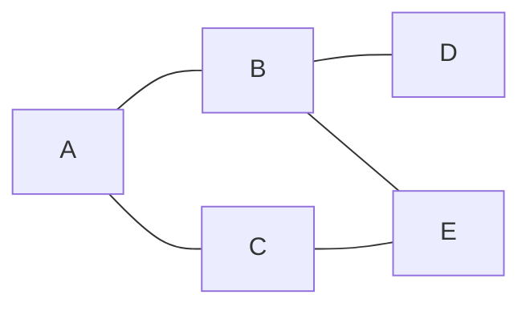
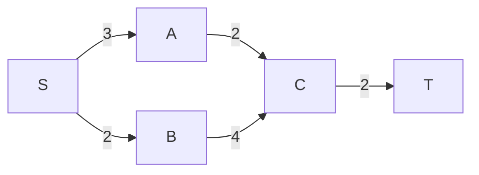

## 图的基本概念

树中的一个结点可以有多个孩子，但每个非根结点只有一个双亲。图允许顶点之间存在更一般的 **多对多关系**，例如城市之间的道路、课程之间的先修关系。

图记为：

$$
G=(V,E)
$$

其中 \(V\) 是顶点的有穷非空集合，\(E\) 是边的有穷集合。以下用 \(n=|V|\) 表示顶点数，\(m=|E|\) 表示边数，顶点下标统一从 \(0\) 开始。

### 有向图、无向图与网

- **无向图：** 边没有方向，\((u,v)\) 与 \((v,u)\) 表示同一条边。
- **有向图：** 边有方向，\(\langle u,v\rangle\) 表示从 \(u\) 指向 \(v\) 的弧，\(u\) 是弧尾，\(v\) 是弧头。
- **网：** 边或弧带有权值的图。权值可以表示距离、费用或持续时间。
- **简单图：** 不含自环，也不含重复边的图。

除专门说明外，下面的基本计数性质按简单图讨论。任意两个不同顶点之间都有边的图称为完全图。

无向完全图的边数为：

$$
m=\frac{n(n-1)}2
$$

有向完全图中，每一对不同顶点之间都有两个方向的弧，因此：

$$
m=n(n-1)
$$

边数相对较少的图称为稀疏图，边数接近完全图的图称为稠密图。选择存储结构时，边数通常比图画出来的形状更有参考价值。

### 顶点的度

无向图中，与顶点 \(v\) 关联的边数称为它的度，记为 \(TD(v)\)。每条边关联两个端点，所以：

$$
\sum_{v\in V}TD(v)=2m
$$

有向图需要区分：

- **入度 \(ID(v)\)：** 以 \(v\) 为终点的弧数。
- **出度 \(OD(v)\)：** 以 \(v\) 为起点的弧数。

每条弧分别贡献一次入度和一次出度，因此：

$$
\sum_{v\in V}ID(v)=\sum_{v\in V}OD(v)=m
$$

顶点的总度为 \(TD(v)=ID(v)+OD(v)\)。

### 路径、回路与连通性

- **路径：** 相邻顶点之间都有相应边连接的顶点序列；有向图中还要满足弧的方向。
- **路径长度：** 无权图中为边数，带权图中通常为沿途边权之和。
- **简单路径：** 顶点不重复出现的路径。
- **回路（环）：** 起点与终点相同的非零长度路径。
- **简单回路：** 除起点与终点重合外，其余顶点不重复。

无向图中，任意两个顶点之间都有路径，称为 **连通图**。有向图中，任意两个顶点之间都能沿两个方向分别到达，称为 **强连通图**。

无向图的极大连通子图称为连通分量，有向图的极大强连通子图称为强连通分量。这里的“极大”表示无法继续加入其他顶点而保持该性质，不表示顶点数在所有分量中最多。

从一个顶点出发做一次搜索，只能访问它能到达的顶点。对于有向图，这个集合通常不等于它所在的强连通分量。

### 子图、生成树与生成森林

若 \(V'\subseteq V\)、\(E'\subseteq E\)，且 \(E'\) 中边的端点都属于 \(V'\)，则 \(G'=(V',E')\) 是 \(G\) 的子图。

连通无向图的生成树包含原图全部顶点，并且连通、无环。含有 \(n\) 个顶点的生成树恰好有：

$$
n-1
$$

条边。它也是包含全部顶点的极小连通子图：再删去任何一条边都会失去连通性。

非连通图没有覆盖全部顶点的生成树，但可以分别为每个连通分量建立生成树，合起来称为生成森林。若有 \(c\) 个连通分量，生成森林的边数为 \(n-c\)。

**边数为 \(n-1\) 不能单独保证一张图是树，还需要连通或无环条件。** 类似地，有向图中“一个顶点入度为 \(0\)，其他顶点入度为 \(1\)”也不足以判断是有向树：其他顶点可能组成与根分离的有向环。若再保证从根能到达全部顶点，才得到以该根为起点的有向树。

## 图的存储结构

图的逻辑结构由顶点和边决定；邻接矩阵、邻接表是保存这些关系的不同方式。

下面的 C++ 实现共用以下定义。边权及距离使用 `long long`，约定边权和计算过程中出现的有限路径权值都严格位于 \((-INF,INF)\) 内。

```c++
#include<iostream>
#include<vector>
#include<queue>
#include<algorithm>
using namespace std;

typedef int Status;
typedef char VerTexType;
typedef long long ArcType;
const int OK=1;
const int ERROR=0;
const int MVNum=100;
const ArcType INF=(1LL<<60);
```

### 邻接矩阵

邻接矩阵用一个 \(n\times n\) 的数组保存顶点之间的边。

无权图通常用 \(1\) 表示有边、\(0\) 表示无边。带权图需要区分“边权为 \(0\)”与“没有边”，这里使用 `INF` 表示无边。

```c++
typedef struct{
    VerTexType vexs[MVNum];
    ArcType arcs[MVNum][MVNum];
    int vexnum,arcnum;
}AMGraph;

Status InitAMGraph(AMGraph&G,int n){
    if(n<1||n>MVNum)return ERROR;
    G.vexnum=n;
    G.arcnum=0;
    for(int i=0;i<n;i++){
        G.vexs[i]='?';
        for(int j=0;j<n;j++)G.arcs[i][j]=INF;
    }
    return OK;
}

Status AddEdge_AM(AMGraph&G,int u,int v,ArcType w,
                  bool directed=false){
    if(u<0||u>=G.vexnum||v<0||v>=G.vexnum||u==v)
        return ERROR;
    if(w<=-INF||w>=INF)return ERROR;
    if(G.arcs[u][v]!=INF)return ERROR; // 本实现不接收重复边
    G.arcs[u][v]=w;
    if(!directed)G.arcs[v][u]=w;
    ++G.arcnum;                       // 无向边仍只计一条
    return OK;
}
```

`InitAMGraph` 在容量合法时建立空边集；顶点信息可随后填入 `vexs`。`AddEdge_AM` 的参数是顶点下标和边权，默认加入无向边，成功返回 `OK`，下标、权值不合法或边已存在时返回 `ERROR`。同一张图应始终使用同一种有向性。

例如依次加入无向边 `A-B:500`、`A-C:200`、`A-D:150`、`B-C:400`、`C-D:600`，矩阵为：

| 顶点 | A | B | C | D |
| --- | --- | --- | --- | --- |
| A | \(\infty\) | 500 | 200 | 150 |
| B | 500 | \(\infty\) | 400 | \(\infty\) |
| C | 200 | 400 | \(\infty\) | 600 |
| D | 150 | \(\infty\) | 600 | \(\infty\) |

这里矩阵表示的是 **直接边**，所以对角线也是 `INF`。计算最短路径时，再把“顶点到自身的空路径长度”设为 \(0\)。

无向图的矩阵关于主对角线对称。有向图中，第 \(i\) 行表示从 \(i\) 出发的弧，第 \(i\) 列表示进入 \(i\) 的弧。带权矩阵求度时应统计实际边的个数，不能直接累加权值。

### 邻接表

邻接表为每个顶点保存一条边链表，只记录实际存在的边。

```c++
typedef struct ArcNode{
    int adjvex;
    ArcType weight;
    struct ArcNode *nextarc;
}ArcNode;

typedef struct VNode{
    VerTexType data;
    ArcNode *firstarc;
}VNode,AdjList[MVNum];

typedef struct{
    AdjList vertices;
    int vexnum,arcnum;
}ALGraph;

Status InitALGraph(ALGraph&G,int n){
    if(n<1||n>MVNum)return ERROR;
    G.vexnum=n;
    G.arcnum=0;
    for(int i=0;i<n;i++){
        G.vertices[i].data='?';
        G.vertices[i].firstarc=NULL;
    }
    return OK;
}

Status AddEdge_AL(ALGraph&G,int u,int v,ArcType w,
                  bool directed=false){
    if(u<0||u>=G.vexnum||v<0||v>=G.vexnum||u==v)
        return ERROR;
    if(w<=-INF||w>=INF)return ERROR;
    for(ArcNode*p=G.vertices[u].firstarc;p;p=p->nextarc)
        if(p->adjvex==v)return ERROR;

    G.vertices[u].firstarc=new ArcNode{
        v,w,G.vertices[u].firstarc
    };
    if(!directed){
        G.vertices[v].firstarc=new ArcNode{
            u,w,G.vertices[v].firstarc
        };
    }
    ++G.arcnum;
    return OK;
}

void DestroyGraph(ALGraph&G){
    for(int i=0;i<G.vexnum;i++){
        ArcNode*p=G.vertices[i].firstarc;
        while(p){
            ArcNode*q=p->nextarc;
            delete p;
            p=q;
        }
        G.vertices[i].firstarc=NULL;
    }
    G.vexnum=G.arcnum=0;
}
```

两个初始化函数都用于尚未持有有效数据的对象；邻接表重新初始化前，应先调用 `DestroyGraph` 释放旧结点。邻接表不能直接通过结构体赋值获得一份独立副本，否则两份对象会共用边结点。

`AddEdge_AL` 与矩阵版本的参数和返回约定相同，无权图可令 `w=1`。使用头插法时，后加入的边出现在链表前面，因此同一张图可以有不同的邻接表顺序。

无向图的一条边要保存为两个边结点，总共为 \(2m\) 个；有向图通常只保存出边，总共为 \(m\) 个。此时顶点的出度就是对应边链表的长度，求入度则要扫描所有出边，或另外维护入度数组、逆邻接表。

### 两种存储方式的比较

| 操作或特点 | 邻接矩阵 | 邻接表 |
| --- | --- | --- |
| 判断 \(u\) 到 \(v\) 是否有边 | \(O(1)\) | 扫描 \(u\) 的边表，\(O(d_u)\) |
| 枚举 \(u\) 的邻接点 | 扫描一行，\(O(n)\) | \(O(d_u)\) |
| 完整 DFS、BFS | \(O(n^2)\) | \(O(n+m)\) |
| 适合的图 | 稠密图、频繁判断两点间边 | 稀疏图、频繁枚举邻接点 |

这里 \(d_u\) 是 \(u\) 的出边数，无向图中就是度。上面的邻接表插边函数为了拒绝重复边，会先扫描一次边表；若已知输入没有重复边，头插本身只需 \(O(1)\)。

需要同时沿入边和出边遍历有向图时，可以使用 **十字链表**：顶点分别保存 `firstin`、`firstout`，同一个弧结点通过两条链分别串进入边表和出边表。无向图的 **邻接多重表** 则让一条边只占一个边结点，同时挂在两个端点的边表中。

如果希望用数组保存邻接表，可以进一步看[链式前向星建图](knowledge:algorithm-forward-star)。

## 图的遍历

图可能有环，也可能存在多条路径到达同一顶点。遍历时需要记录顶点是否已访问，避免重复处理。

以下使用邻接表，邻接点的访问顺序就是边表中的顺序。栈和队列的操作可以回顾[栈和队列](knowledge:notes-data-structure-03)。

### 深度优先搜索 DFS

DFS 从当前顶点出发，遇到尚未访问的邻接点就继续向下搜索，直到没有可继续的顶点，再回到上一层尝试其他分支。

```c++
void DFS(const ALGraph&G,int v,vector<bool>&visited){
    visited[v]=true;
    cout<<G.vertices[v].data<<' ';
    for(ArcNode*p=G.vertices[v].firstarc;p;p=p->nextarc){
        int w=p->adjvex;
        if(!visited[w])DFS(G,w,visited);
    }
}

void DFSTraverse(const ALGraph&G){
    vector<bool> visited(G.vexnum,false);
    for(int v=0;v<G.vexnum;v++)
        if(!visited[v])DFS(G,v,visited);
}
```

外层循环用来补上从第一个起点不可达的顶点。对无向图，每次从未访问顶点重新开始 DFS，就对应一个新的连通分量；对有向图，不能据此直接统计强连通分量。

### 广度优先搜索 BFS

BFS 先访问距离起点一条边的顶点，再访问两条边的顶点，依次向外扩展。使用队列保存已经发现、尚未展开的顶点。

```c++
void BFS(const ALGraph&G,int s,vector<bool>&visited){
    queue<int> q;
    visited[s]=true;
    q.push(s);
    while(!q.empty()){
        int u=q.front();
        q.pop();
        cout<<G.vertices[u].data<<' ';
        for(ArcNode*p=G.vertices[u].firstarc;p;p=p->nextarc){
            int v=p->adjvex;
            if(!visited[v]){
                visited[v]=true; // 入队时标记，避免重复入队
                q.push(v);
            }
        }
    }
}

void BFSTraverse(const ALGraph&G){
    vector<bool> visited(G.vexnum,false);
    for(int s=0;s<G.vexnum;s++)
        if(!visited[s])BFS(G,s,visited);
}
```

### 遍历顺序与生成树

考虑下图，并约定邻接点按字母升序访问：



- 从 `A` 开始 DFS：`A B D E C`。
- 从 `A` 开始 BFS：`A B C D E`。

这两个序列依赖给定的邻接点顺序。若直接采用前面的头插法，链表顺序可能不同，应按实际链表确定遍历结果。

每当通过一条边第一次发现新顶点，就保留这条边，最终可以得到 DFS 生成树或 BFS 生成树。BFS 生成树中，根到每个顶点的边数等于原无权图中的最短距离；DFS 生成树没有这一保证。

### BFS 求无权最短距离

无权图中，可以让 `dist[v]` 同时表示距离和访问状态，`-1` 表示尚未到达。

```c++
Status ShortestPath_BFS(const ALGraph&G,int s,vector<int>&dist){
    dist.assign(G.vexnum,-1);
    if(s<0||s>=G.vexnum)return ERROR;
    queue<int> q;
    dist[s]=0;
    q.push(s);
    while(!q.empty()){
        int u=q.front();
        q.pop();
        for(ArcNode*p=G.vertices[u].firstarc;p;p=p->nextarc){
            int v=p->adjvex;
            if(dist[v]==-1){
                dist[v]=dist[u]+1;
                q.push(v);
            }
        }
    }
    return OK;
}
```

BFS 按距离分层扩展，所以第一次到达 \(v\) 时，已经找到边数最少的路径。一般带权图中，各条边的代价不同，不能直接使用这一结论。

例如统计距离起点不超过 \(k\) 条边的其他顶点，先运行该函数，再统计满足 \(1\le dist[v]\le k\) 的顶点即可。**层数由距离决定，不能用出队次数代替。** 一层可能有多个顶点，连续取出 \(k\) 个顶点并不等于展开 \(k\) 层。

邻接表上的 DFS、BFS 都会访问 \(n\) 个顶点并扫描全部边结点，时间复杂度为 \(O(n+m)\)。无向边虽然扫描两次，但仍为同一数量级。

## 最小生成树

带权连通无向图可能有多棵生成树，其中边权总和最小的一棵称为 **最小生成树（MST）**。

最小生成树要求把全部顶点连起来，总费用尽量小；它不要求某个起点到所有顶点的路径最短。边权可以为 \(0\) 或负数，因为生成树本身不含环。

### Prim 算法：逐步扩展顶点集合

设 \(U\) 是已经进入生成树的顶点集合。每一步在连接 \(U\) 与 \(V-U\) 的边中，选择权值最小的一条，把它的另一个端点加入 \(U\)。

选择这类边是安全的：若某棵最小生成树不包含所选边，加入后会形成一个环；环中还存在另一条跨越这两个集合的边。删去它，连通性保持不变，总权值不会增加。

使用 `lowcost[v]` 保存 **顶点 \(v\) 到当前集合 \(U\) 的最小边权**，`parent[v]` 保存对应的集合内端点。

```c++
Status MiniSpanTree_Prim(const AMGraph&G,int s,
                         vector<int>&parent,ArcType&total){
    int n=G.vexnum;
    parent.assign(n,-1);
    total=0;
    if(s<0||s>=n)return ERROR;
    vector<ArcType> lowcost(n,INF);
    vector<bool> used(n,false);
    lowcost[s]=0;

    for(int i=0;i<n;i++){
        int u=-1;
        for(int v=0;v<n;v++)
            if(!used[v]&&(u==-1||lowcost[v]<lowcost[u]))u=v;
        if(u==-1||lowcost[u]==INF)return ERROR;

        used[u]=true;
        total+=lowcost[u];
        for(int v=0;v<n;v++){
            if(!used[v]&&G.arcs[u][v]<lowcost[v]){
                lowcost[v]=G.arcs[u][v];
                parent[v]=u;
            }
        }
    }
    return OK;
}
```

传入连通无向网时返回 `OK`，`parent` 给出所选边，`total` 是总权值。若不存在连接剩余顶点的边，则图不连通，返回 `ERROR`；此时输出参数只包含已经求得的部分，不能作为完整生成树使用。单顶点图的总权值为 \(0\)。

这里用 `used` 单独记录顶点是否入树，不能把 `lowcost[v]==0` 当作入树标记，否则会与零权边混淆。矩阵实现的时间复杂度为 \(O(n^2)\)。

### Kruskal 算法：按边权合并连通块

Kruskal 将全部边按权值从小到大排序。依次考察每条边：若两个端点不在同一个连通块中，就选择这条边，并合并两个连通块；否则加入它会成环，应跳过。

并查集可以判断两个顶点是否已经连通。

```c++
typedef struct{
    int u,v;
    ArcType w;
}Edge;

struct DSU{
    vector<int> parent,size;
    DSU(int n):parent(n),size(n,1){
        for(int i=0;i<n;i++)parent[i]=i;
    }
    int Find(int x){
        if(parent[x]!=x)parent[x]=Find(parent[x]);
        return parent[x];
    }
    bool Merge(int x,int y){
        x=Find(x);
        y=Find(y);
        if(x==y)return false;
        if(size[x]<size[y])swap(x,y);
        parent[y]=x;
        size[x]+=size[y];
        return true;
    }
};

Status MiniSpanTree_Kruskal(int n,vector<Edge> edges,
                            vector<Edge>&tree,ArcType&total){
    tree.clear();
    total=0;
    if(n<1)return ERROR;
    sort(edges.begin(),edges.end(),[](const Edge&a,const Edge&b){
        return a.w<b.w;
    });
    DSU dsu(n);
    for(const Edge&e:edges){
        if(dsu.Merge(e.u,e.v)){
            tree.push_back(e);
            total+=e.w;
            if((int)tree.size()==n-1)break;
        }
    }
    return (int)tree.size()==n-1?OK:ERROR;
}
```

这里 `edges` 中每条无向边只保存一次，端点下标须在 \([0,n)\) 内。返回 `OK` 时，`tree` 有 \(n-1\) 条边；返回 `ERROR` 时，图不连通，保留下来的边构成最小生成森林。

排序是主要开销，总时间可写为 \(O(n+m\log(m+1))\)；对一般连通图，常简写为 \(O(m\log m)\)。矩阵 Prim 适合稠密图，Kruskal 适合用边集给出的稀疏图。

### 构造例子

对前面的四个顶点无向网，从 `A` 开始运行 Prim：

1. 从 `A` 的出边中选择 `A-D:150`。
2. 连接集合 `{A,D}` 与其余顶点的最小边为 `A-C:200`。
3. 最后选择 `C-B:400`。

总权值为 \(150+200+400=750\)。Kruskal 按边权排序后也会选择这三条边。

若所有边权互不相同，最小生成树唯一；有相同边权时，最小生成树可能有多棵，也可能仍然唯一。

## 最短路径

最短路径关注的是两个顶点之间的路径代价。常见问题有单源最短路，以及任意两点之间的最短路。

### Dijkstra 算法

Dijkstra 适用于 **边权非负** 的有向图或无向图。维护从源点 \(s\) 到各顶点的当前最短距离估计 `dist`，每次选出尚未确定且 `dist` 最小的顶点 \(u\)，确定它的最短距离，再用它更新邻接点。

更新操作称为松弛：

$$
dist[v]=\min\bigl(dist[v],dist[u]+w(u,v)\bigr)
$$

为什么选中 \(u\) 后可以确定距离？若还存在一条更短的路径，沿这条路径第一次离开已确定集合时，会经过某个尚未确定的顶点 \(x\)。由于后续边权非负，到 \(x\) 的距离不会大于整条路径长度；而 \(u\) 已是未确定顶点中距离最小的一个，与假设矛盾。

```c++
Status ShortestPath_DIJ(const AMGraph&G,int s,
                        vector<ArcType>&dist,vector<int>&pre){
    int n=G.vexnum;
    dist.assign(n,INF);
    pre.assign(n,-1);
    if(s<0||s>=n)return ERROR;
    for(int u=0;u<n;u++)
        for(int v=0;v<n;v++)
            if(G.arcs[u][v]!=INF&&G.arcs[u][v]<0)return ERROR;

    vector<bool> used(n,false);
    dist[s]=0;
    for(int i=0;i<n;i++){
        int u=-1;
        for(int v=0;v<n;v++)
            if(!used[v]&&(u==-1||dist[v]<dist[u]))u=v;
        if(u==-1||dist[u]==INF)break; // 剩余顶点均不可达
        used[u]=true;

        for(int v=0;v<n;v++){
            if(!used[v]&&G.arcs[u][v]!=INF&&
               dist[u]+G.arcs[u][v]<dist[v]){
                dist[v]=dist[u]+G.arcs[u][v];
                pre[v]=u;
            }
        }
    }
    return OK;
}

vector<int> RestorePath(int s,int t,const vector<ArcType>&dist,
                        const vector<int>&pre){
    if(dist[t]==INF)return {};
    vector<int> path;
    for(int v=t;v!=-1;v=pre[v])path.push_back(v);
    reverse(path.begin(),path.end());
    if(path.empty()||path.front()!=s)return {};
    return path;
}
```

`ShortestPath_DIJ` 在起点合法且无负权边时返回 `OK`，即使某些顶点不可达；不可达距离保持为 `INF`。恢复路径时，`s`、`t` 应为合法下标，并使用同一次成功调用得到的 `dist`、`pre`。

例如有向边为 `A→B:10`、`A→C:3`、`C→B:2`、`B→D:1`、`C→D:8`：

| 已确定顶点 | 到 B 的估计 | 到 C 的估计 | 到 D 的估计 |
| --- | --- | --- | --- |
| A | 10 | 3 | \(\infty\) |
| A、C | 5 | 3 | 11 |
| A、C、B | 5 | 3 | 6 |
| A、C、B、D | 5 | 3 | 6 |

最短路径为 `A→C→B→D`，长度为 \(6\)。`pre[D]=B`、`pre[B]=C`、`pre[C]=A`，反向追溯后再逆置即可恢复路径。

矩阵版本时间复杂度为 \(O(n^2)\)。稀疏图可以使用邻接表与最小堆优化。存在负权边时，应改用适用的最短路算法，不能继续使用 Dijkstra 的贪心结论。

### Floyd 算法

Floyd 同时计算任意两点间的最短距离。设 \(D^{(k)}[i][j]\) 表示只允许编号 \(0\) 至 \(k\) 的顶点充当中间点时，从 \(i\) 到 \(j\) 的最短距离，则：

$$
D^{(k)}[i][j]=\min\left(D^{(k-1)}[i][j],
D^{(k-1)}[i][k]+D^{(k-1)}[k][j]\right)
$$

即最短路径要么不经过 \(k\)，要么可以由 \(i\) 到 \(k\)、\(k\) 到 \(j\) 的两段路径拼成。

```c++
Status ShortestPath_Floyd(const AMGraph&G,
                          vector<vector<ArcType>>&dist){
    int n=G.vexnum;
    dist.assign(n,vector<ArcType>(n,INF));
    for(int i=0;i<n;i++){
        for(int j=0;j<n;j++)dist[i][j]=G.arcs[i][j];
        dist[i][i]=0;
    }
    for(int k=0;k<n;k++)
        for(int i=0;i<n;i++)
            for(int j=0;j<n;j++)
                if(dist[i][k]!=INF&&dist[k][j]!=INF)
                    dist[i][j]=min(dist[i][j],dist[i][k]+dist[k][j]);

    for(int i=0;i<n;i++)
        if(dist[i][i]<0)return ERROR;
    return OK;
}
```

**中间点 \(k\) 必须在最外层循环。** 这样当前阶段才能利用前一阶段已经求出的距离。

Floyd 可以处理负权边，但不能为经过负权回路的路径给出有限的最短距离。上面的函数检测到负权回路时返回 `ERROR`，此时不应把整个结果当作有效距离表。时间复杂度为 \(O(n^3)\)。

### Prim 与 Dijkstra 的区别

两种算法都可能写成“选择最小值，再更新”，但数组保存的含义不同：

| 比较项 | Prim | Dijkstra |
| --- | --- | --- |
| 目标 | 连接全部顶点，边权总和最小 | 从固定源点到各点的路径最短 |
| 数组含义 | 顶点到已入树集合的最小边权 | 源点到该顶点的当前最短距离估计 |
| 更新值 | \(w(u,v)\) | \(dist[u]+w(u,v)\) |
| 负权边 | 允许 | 不允许 |

## 有向无环图与拓扑排序

有向无环图简称 **DAG**。例如 `A→B` 表示必须先完成任务 `A` 才能开始 `B`，若存在有向环，就会出现循环依赖。

**AOV 网** 用顶点表示活动，用弧表示活动之间的先后约束。拓扑排序要给出一个顶点序列，使每条弧 \(u\to v\) 都满足 \(u\) 在 \(v\) 前面。

### 按入度进行拓扑排序

1. 计算每个顶点的入度，将所有入度为 \(0\) 的顶点入队。
2. 取出一个顶点加入序列，删除它发出的弧，也就是把相应终点的入度减一。
3. 若某个终点入度变为 \(0\)，将其入队。
4. 队列为空后，检查是否输出了全部顶点。

```c++
Status TopologicalSort(const ALGraph&G,vector<int>&order){
    int n=G.vexnum;
    vector<int> indegree(n,0);
    order.clear();
    for(int u=0;u<n;u++)
        for(ArcNode*p=G.vertices[u].firstarc;p;p=p->nextarc)
            ++indegree[p->adjvex];

    queue<int> q;
    for(int v=0;v<n;v++)
        if(indegree[v]==0)q.push(v);
    while(!q.empty()){
        int u=q.front();
        q.pop();
        order.push_back(u);
        for(ArcNode*p=G.vertices[u].firstarc;p;p=p->nextarc)
            if(--indegree[p->adjvex]==0)q.push(p->adjvex);
    }
    return (int)order.size()==n?OK:ERROR;
}
```

该函数用于有向图，只修改局部入度数组，不实际删除图中的边。返回 `ERROR` 表示存在有向环，`order` 只是已经完成的部分序列。

如果仍有顶点未输出，却找不到入度为 \(0\) 的顶点，从任意剩余顶点不断追溯前驱，有限步内一定会遇到重复顶点，因此剩余图中存在有向环。

拓扑序通常不唯一。例如 `A→C`、`B→C` 同时存在时，`A B C` 和 `B A C` 都合法。每一步只有一个可选的零入度顶点时，拓扑序才唯一。邻接表实现的时间复杂度为 \(O(n+m)\)。

## AOE 网与关键路径

**AOE 网** 用顶点表示事件，用有向边表示活动，边权表示持续时间。事件发生表示它的所有前置活动都已完成，后继活动才能开始。

这里讨论活动持续时间非负、具有统一起点和终点的 DAG，并假设活动只受依赖关系约束，不受人员、设备数量等额外资源限制。若有多个起点或终点，可以增加虚拟源点、汇点，并用零权边连接。

### 事件的最早与最迟发生时间

设活动 \(u\to v\) 的持续时间为 \(w(u,v)\)。

事件 \(v\) 必须等待全部前置活动完成，所以最早发生时间为：

$$
ve[v]=\max_{u\to v}\bigl(ve[u]+w(u,v)\bigr)
$$

源点的 \(ve\) 为 \(0\)。按拓扑序计算，汇点的最早发生时间就是最短工期 \(T\)。

为了不延误工期，事件 \(u\) 必须为所有后继活动留下足够时间，所以最迟发生时间为：

$$
vl[u]=\min_{u\to v}\bigl(vl[v]-w(u,v)\bigr)
$$

汇点的 \(vl\) 为 \(T\)，其余顶点按逆拓扑序计算。前者取最大值是为了等齐全部前驱，后者取最小值是为了满足全部后继的期限。

### 活动的时间与关键活动

对于活动 \(a=(u,v)\)：

$$
e(a)=ve[u]
$$

$$
l(a)=vl[v]-w(u,v)
$$

其中 \(e(a)\) 是最早开始时间，\(l(a)\) 是最迟开始时间。时间余量为：

$$
slack(a)=l(a)-e(a)
$$

满足 \(e(a)=l(a)\) 的活动称为 **关键活动**。从源点到汇点、全部由关键活动组成的路径称为关键路径，其长度等于工期。

### 实现

下面在同一张出边邻接表上正向和反向扫描拓扑序，不需要额外建立逆邻接表。实现也允许多个起点、终点，等价于补上前述零权虚拟边。

```c++
Status CriticalPath(const ALGraph&G,vector<ArcType>&ve,
                     vector<ArcType>&vl,vector<Edge>&critical,
                     ArcType&duration){
    int n=G.vexnum;
    ve.assign(n,0);
    vl.clear();
    critical.clear();
    duration=0;
    if(n<1)return ERROR;
    for(int u=0;u<n;u++)
        for(ArcNode*p=G.vertices[u].firstarc;p;p=p->nextarc)
            if(p->weight<0)return ERROR;

    vector<int> order;
    if(!TopologicalSort(G,order))return ERROR;
    for(int u:order){
        for(ArcNode*p=G.vertices[u].firstarc;p;p=p->nextarc){
            int v=p->adjvex;
            ve[v]=max(ve[v],ve[u]+p->weight);
        }
    }
    for(int v=0;v<n;v++)duration=max(duration,ve[v]);
    vl.assign(n,duration);
    for(int i=n-1;i>=0;i--){
        int u=order[i];
        for(ArcNode*p=G.vertices[u].firstarc;p;p=p->nextarc){
            int v=p->adjvex;
            vl[u]=min(vl[u],vl[v]-p->weight);
        }
    }
    for(int u=0;u<n;u++){
        for(ArcNode*p=G.vertices[u].firstarc;p;p=p->nextarc){
            int v=p->adjvex;
            if(ve[u]==vl[v]-p->weight)
                critical.push_back({u,v,p->weight});
        }
    }
    return OK;
}
```

成功返回 `OK`，输出事件时间、工期和关键活动；有环或存在负持续时间时返回 `ERROR`。`critical` 保存的是边的集合，没有枚举所有完整关键路径。整个过程时间复杂度为 \(O(n+m)\)。

### 一个计算例子



`C` 必须等待 `A→C` 与 `B→C` 都结束，最早发生时间为 \(\max(3+2,2+4)=6\)，因此工期为 \(6+2=8\)。

| 事件 | S | A | B | C | T |
| --- | --- | --- | --- | --- | --- |
| \(ve\) | 0 | 3 | 2 | 6 | 8 |
| \(vl\) | 0 | 4 | 2 | 6 | 8 |

| 活动 | 持续时间 | 最早开始 \(e\) | 最迟开始 \(l\) | 余量 |
| --- | --- | --- | --- | --- |
| S→A | 3 | 0 | 1 | 1 |
| S→B | 2 | 0 | 0 | 0 |
| A→C | 2 | 3 | 4 | 1 |
| B→C | 4 | 2 | 2 | 0 |
| C→T | 2 | 6 | 6 | 0 |

关键路径为 `S→B→C→T`。将 `S→A` 缩短一单位不会改变工期，因为 `C` 仍要等待另一条分支。

关键路径可能不止一条。要缩短工期，调整后所有原先限制工期的路径都必须变短；只缩短某一条关键路径上的活动，未必足够。持续缩短关键活动后，还要重新计算，因为原本非关键的路径也可能成为新的限制。
