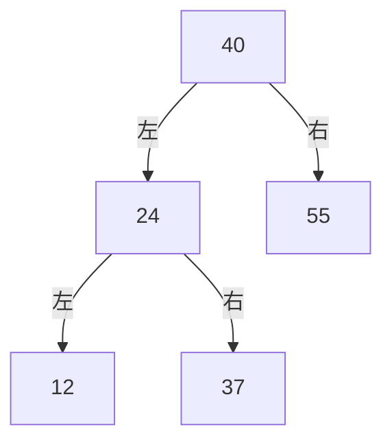

## 查找的基本概念

查找是在一组记录中，寻找关键字满足给定条件的记录。例如按学号找学生、按书号找图书，都可以归结为按关键字查找。

- **查找表：** 由同一类型记录构成的集合。
- **关键字：** 用来标识或检索记录的数据项。
- **主关键字：** 能唯一标识一条记录的关键字，例如学号。
- **次关键字：** 可以对应多条记录的关键字，例如班级。
- **查找成功：** 表中存在符合条件的记录。
- **查找失败：** 表中不存在符合条件的记录。

只查询已有记录而不修改表的，称为静态查找；还需要插入、删除记录的，称为动态查找。选择方法时，要同时考虑数据是否有序、能否随机访问，以及更新是否频繁。

### 平均查找长度 ASL

平均查找长度表示一次查找中，关键字比较次数的期望值：

$$
ASL=\sum_{i=1}^{n}p_i c_i
$$

其中 $p_i$ 是查找第 $i$ 条记录的概率，$c_i$ 是找到它需要的比较次数。讨论成功查找时，$p_i$ 是在查找成功条件下的概率，满足 $\sum p_i=1$。

若各条记录等概率，则：

$$
ASL_{\text{成功}}=\frac1n\sum_{i=1}^{n}c_i
$$

失败查找需要按失败位置及其概率单独计算，不能直接套成功查找的公式。以下将一次目标关键字与表中关键字的大小比较视为一次判定，不逐条累计 C++ 中 `==`、`<` 的执行次数。

## 线性表的查找

### 查找表的类型定义

顺序查找和折半查找共用下面的顺序表。记录从下标 $1$ 开始保存，下标 $0$ 留作哨兵；查找成功返回位置，失败返回 $0$。

```c++
#include<iostream>
#include<vector>
#include<algorithm>
using namespace std;

typedef int Status;
typedef int KeyType;
const int OK=1;
const int ERROR=0;

typedef struct{
    KeyType key;
    // 其他记录信息可放在这里
}ElemType;

typedef struct{
    vector<ElemType> R;
    int length;
}SSTable;

void CreateSSTable(SSTable&ST,const vector<KeyType>&keys){
    ST.length=(int)keys.size();
    ST.R.resize(ST.length+1);
    for(int i=1;i<=ST.length;i++)ST.R[i].key=keys[i-1];
}
```

`CreateSSTable` 按给定顺序保存关键字，不自动排序。即使表为空，`R[0]` 也存在。

### 顺序查找

顺序查找逐条比较记录，找到目标就返回；全部比较后仍未找到，则查找失败。不要求关键字有序，顺序表和链表都可以使用。

```c++
int Search_Seq(const SSTable&ST,KeyType key){
    for(int i=1;i<=ST.length;i++)
        if(ST.R[i].key==key)return i;
    return 0;
}
```

表中存在重复关键字时，这个版本返回第一个匹配位置。链表的做法相同，只需沿 `next` 指针逐个检查结点。

#### 带哨兵的顺序查找

将待查关键字放在 `R[0]`，从表尾向前查找。即使目标不存在，也一定会在下标 $0$ 停下，不需要在循环中反复判断是否越界。

```c++
int Search_Seq_Sentinel(SSTable&ST,KeyType key){
    ST.R[0].key=key;
    int i=ST.length;
    while(ST.R[i].key!=key)--i;
    return i;
}
```

该函数会修改哨兵位置，正式记录不变。空表会直接返回 $0$；存在重复关键字时，由于从后向前扫描，会返回最后一个匹配位置。

#### 查找长度

含 $n\ge1$ 条记录且成功查找等概率时，比较次数依次为 $1,2,\ldots,n$，所以：

$$
ASL_{\text{成功}}=\frac{1+2+\cdots+n}{n}=\frac{n+1}{2}
$$

普通顺序查找失败时，要比较全部 $n$ 条记录；哨兵版本还要与 `R[0]` 比较一次，共 $n+1$ 次。二者时间复杂度均为 $O(n)$。

如果各条记录的查询概率不同，可将高频记录放在更早被比较的位置，以减小 ASL。对于不利用大小关系提前停止的普通顺序查找，在等概率条件下，仅把关键字排序不会改变成功查找的 ASL。

### 折半查找

折半查找也称二分查找，要求关键字 **有序**，并且能够按下标快速访问中间记录。下面约定按关键字非递减排列。

维护可能包含目标的闭区间 `[low,high]`：

1. 取中间位置 `mid`。
2. 若目标等于中间关键字，查找成功。
3. 若目标更小，将右边界改为 `mid-1`；若目标更大，将左边界改为 `mid+1`。
4. 当 `low>high` 时，候选区间为空，查找失败。

```c++
int Search_Bin(const SSTable&ST,KeyType key){
    int low=1,high=ST.length;
    while(low<=high){
        int mid=low+(high-low)/2;
        if(ST.R[mid].key==key)return mid;
        if(key<ST.R[mid].key)high=mid-1;
        else low=mid+1;
    }
    return 0;
}
```

每次更新边界都排除了已经比较过的 `mid`，区间会严格缩小。表中存在重复关键字时，该函数返回其中一个位置，不保证是第一个或最后一个。

单链表虽然也可以保持有序，但不能在 $O(1)$ 时间内访问中间结点，因此不能直接获得数组折半查找的时间复杂度。

#### 查找过程

对有序表：

```text
位置： 1   2   3   4   5   6   7   8   9  10  11
关键字：5  13  19  21  37  56  64  75  80  88  92
```

查找 `75`：

| 候选区间 | mid | 中间关键字 | 下一步 |
| --- | --- | --- | --- |
| [1,11] | 6 | 56 | 查找 [7,11] |
| [7,11] | 9 | 80 | 查找 [7,8] |
| [7,8] | 7 | 64 | 查找 [8,8] |
| [8,8] | 8 | 75 | 成功 |

查找 `70` 时，比较 `56、80、64、75` 后得到 `low=8,high=7`，区间为空，返回 $0$。

#### 判定树与 ASL

把每一次中间位置的选择画成二叉树，就得到折半查找的判定树。根结点是第一次比较的记录，左右子树分别表示较小、较大的候选区间。

若根位于第 $1$ 层，查找成功的比较次数就是目标结点所在的层数。对 $n\ge1$，最多比较：

$$
\lfloor\log_2n\rfloor+1
$$

次，因此时间复杂度为 $O(\log n)$。

上面 $11$ 条记录的判定树，各层分别有 $1、2、4、4$ 个结点，等概率成功查找的 ASL 为：

$$
ASL_{\text{成功}}=
\frac{1\times1+2\times2+3\times4+4\times4}{11}=3
$$

当 $n=2^h-1$，判定树恰好是满二叉树时：

$$
ASL_{\text{成功}}=
\frac{\sum_{i=1}^{h}i2^{i-1}}{n}
=\frac{(n+1)\log_2(n+1)}n-1
$$

这个精确公式有满二叉树条件；一般表长应按实际判定树统计各层结点数。

#### 找第一个不小于目标的位置

插入有序表、处理重复值时，常需要找到边界，而不只是任意一个相等位置。

```c++
int LowerBound(const SSTable&ST,KeyType key){
    int low=1,high=ST.length+1; // 在半开区间[low,high)中查找
    while(low<high){
        int mid=low+(high-low)/2;
        if(ST.R[mid].key<key)low=mid+1;
        else high=mid;
    }
    return low;
}
```

返回值位于 $[1,n+1]$，`n+1` 表示所有记录都小于目标，不能直接访问 `R[n+1]`。如果返回位置不超过表长，且关键字等于目标，它就是第一个匹配位置。

这里 `mid` 在循环执行时一定不超过 `n`，不会读取作为右边界的 `n+1`。与普通查找相比，右边界和失败返回值的约定发生了变化，不能混用两套边界更新规则。

### 分块查找

分块查找在记录表之外增加一个索引表，每个索引项保存对应块的最大关键字和位置范围。要求 **块间有序，块内可以无序**，即前一块的全部关键字小于后一块的全部关键字。

例如：

| 块 | 块内记录 | 最大关键字 |
| --- | --- | --- |
| 第 1 块 | 12、8、20、13 | 20 |
| 第 2 块 | 38、24、44、33 | 44 |
| 第 3 块 | 60、53、74、58 | 74 |

查找 `33` 时，先在索引中找到第一个最大关键字不小于 `33` 的块，也就是第 $2$ 块，再在该块内顺序查找。

平均查找长度由两部分组成：

$$
ASL=ASL_{\text{索引}}+ASL_{\text{块内}}
$$

若共有 $b$ 块、每块最多 $s$ 条记录，索引使用折半查找，则查找时间为 $O(\log b+s)$。动态更新时仍需保持块间范围和索引正确；数组中插入记录是否需要移动，也取决于块的实际存储方式。

## 二叉排序树

有序数组可以快速查找，但插入、删除可能需要移动大量记录。二叉排序树通过指针连接结点，使记录的位置随插入、删除而调整。

二叉排序树也称二叉搜索树（BST）。它是一棵空树，或者满足：

- 左子树所有关键字都小于根关键字。
- 右子树所有关键字都大于根关键字。
- 左、右子树本身也是二叉排序树。

下面统一采用 **关键字不重复，重复插入返回 `ERROR`** 的约定。如果需要保存相同关键字，可以在结点中增加计数，或保存对应记录的集合。按该约定，中序遍历得到严格递增的关键字序列。

### 类型定义与查找

复用前面的 `KeyType`、`ElemType` 和状态定义，二叉链表的结构可回顾[树和二叉树](knowledge:notes-data-structure-05)。

```c++
typedef struct BSTNode{
    ElemType data;
    struct BSTNode *lchild,*rchild;
}BSTNode,*BSTree;

BSTree SearchBST(BSTree T,KeyType key){
    while(T&&T->data.key!=key){
        if(key<T->data.key)T=T->lchild;
        else T=T->rchild;
    }
    return T;
}
```

查找时每次根据大小关系选择一棵子树，不需要同时搜索左右两侧。成功返回结点指针，失败返回 `NULL`。

### 插入与建立

插入沿查找路径进行，直到遇到空指针，再把新结点接在这个位置。已有结点之间的大小关系保持不变。

```c++
Status InsertBST(BSTree&T,const ElemType&e){
    if(T==NULL){
        T=new BSTNode{e,NULL,NULL};
        return OK;
    }
    if(e.key==T->data.key)return ERROR;
    if(e.key<T->data.key)return InsertBST(T->lchild,e);
    return InsertBST(T->rchild,e);
}
```

参数 `T` 使用引用，因此既能修改根指针，也能修改递归过程中对应的孩子指针。从 `BSTree T=NULL` 开始，依次插入记录就能建立整棵树。

例如依次插入 `40、24、12、37、55`：



如果改成按 `12、24、37、40、55` 插入，所有新结点都进入右子树，树会退化为单链。相同的关键字集合，插入顺序不同，树的形态可能不同。

### 删除

删除结点后仍要保持二叉排序树的大小关系，按孩子数分三种情况：

1. **叶子结点：** 释放结点，把指向它的指针置空。
2. **只有一个孩子：** 用唯一的孩子接替该结点。
3. **有两个孩子：** 用中序前驱或后继的记录替换它，再删除相应的前驱或后继结点。

中序前驱是左子树中关键字最大的结点，也就是沿左子树不断向右走得到的结点。它没有右孩子，因此删除它会归入前两种情况。

```c++
Status DeleteBST(BSTree&T,KeyType key){
    if(T==NULL)return ERROR;
    if(key<T->data.key)return DeleteBST(T->lchild,key);
    if(key>T->data.key)return DeleteBST(T->rchild,key);

    BSTree p=T;
    if(T->lchild==NULL){
        T=T->rchild;             // 也包含叶子结点的情况
        delete p;
    }else if(T->rchild==NULL){
        T=T->lchild;
        delete p;
    }else{
        BSTree q=T->lchild;
        while(q->rchild)q=q->rchild;
        T->data=q->data;          // 替换整条记录
        DeleteBST(T->lchild,q->data.key);
    }
    return OK;
}

void DestroyBST(BSTree&T){
    if(T==NULL)return;
    DestroyBST(T->lchild);
    DestroyBST(T->rchild);
    delete T;
    T=NULL;
}
```

删除成功返回 `OK`，不存在目标时返回 `ERROR`。例如在上图中删除 `40`，可以先用前驱 `37` 替换根记录，再删除左子树中原来的 `37`。

记录含有其他字段时，应一起复制，不能只修改关键字而让其与原记录信息错配。

### 查找性能

若树高为 $h$，查找、插入和删除都只沿一条或相邻的查找路径进行，时间复杂度为 $O(h)$。

- 树较均衡时，$h=O(\log n)$。
- 退化为单链时，$h=n$，操作最坏为 $O(n)$。

对前面五个结点的均衡形态，等概率成功查找的 ASL 为：

$$
\frac{1+2+2+3+3}{5}=\frac{11}{5}
$$

若退化为五个结点的单链，ASL 为 $(1+2+3+4+5)/5=3$。这里的平均比较次数不能与一次最坏查找的比较次数混为一谈。

## 平衡二叉树

为了避免二叉排序树随插入顺序退化，可以在更新后调整结构，使树高保持在对数级别。

### AVL 树与平衡因子

AVL 树是一棵二叉排序树，并且每个结点的左右子树高度差不超过 $1$。定义空树高度为 $0$、叶子高度为 $1$，平衡因子为：

$$
BF(v)=h(v_{\text{left}})-h(v_{\text{right}})
$$

AVL 树的每个结点都必须满足：

$$
BF(v)\in\{-1,0,1\}
$$

这要求检查每个结点，不能只比较整棵树根结点的左右高度。AVL 树的高度为 $O(\log n)$，查找、插入和删除的最坏时间也为 $O(\log n)$。

### 四种失衡与旋转

插入后，从新结点向上寻找第一个失衡祖先 `A`。根据插入位置相对 `A` 的方向，分为四类：

| 类型 | 插入方向 | 调整方式 |
| --- | --- | --- |
| LL | A 的左孩子的左子树 | 对 A 右旋 |
| RR | A 的右孩子的右子树 | 对 A 左旋 |
| LR | A 的左孩子的右子树 | 先对左孩子左旋，再对 A 右旋 |
| RL | A 的右孩子的左子树 | 先对右孩子右旋，再对 A 左旋 |

LL、RR 描述的是失衡方向，不是旋转方向。

以右旋为例，设 `B` 是 `A` 的左孩子，旋转后 `B` 成为这棵子树的新根，`A` 成为 `B` 的右孩子，而 `B` 原来的右子树转交给 `A` 作为左子树。

```text
        A                   B
       / \                 / \
      B   T3     →        T1  A
     / \                    / \
    T1  T2                 T2  T3
```

旋转前后始终满足 `T1 < B < T2 < A < T3`，因此中序次序不变。旋转只调整局部指针，不破坏二叉排序树的性质。

### 保存高度的插入实现

下面使用独立的 AVL 结点类型，在结点中保存高度。每次递归返回时更新高度、检查失衡并旋转，不重复遍历整棵子树计算高度。

```c++
typedef struct AVLNode{
    KeyType key;
    int height;
    struct AVLNode *lchild,*rchild;
}AVLNode,*AVLTree;

int Height(AVLTree T){
    return T?T->height:0;
}

void UpdateHeight(AVLTree T){
    T->height=max(Height(T->lchild),Height(T->rchild))+1;
}

void RotateRight(AVLTree&T){
    AVLTree p=T->lchild;
    T->lchild=p->rchild;
    p->rchild=T;
    UpdateHeight(T);       // 先更新下降的旧根
    UpdateHeight(p);       // 再更新上升的新根
    T=p;
}

void RotateLeft(AVLTree&T){
    AVLTree p=T->rchild;
    T->rchild=p->lchild;
    p->lchild=T;
    UpdateHeight(T);
    UpdateHeight(p);
    T=p;
}

Status InsertAVL(AVLTree&T,KeyType key){
    if(T==NULL){
        T=new AVLNode{key,1,NULL,NULL};
        return OK;
    }
    if(key==T->key)return ERROR;
    Status result;
    if(key<T->key)result=InsertAVL(T->lchild,key);
    else result=InsertAVL(T->rchild,key);
    if(result==ERROR)return ERROR;

    UpdateHeight(T);
    int balance=Height(T->lchild)-Height(T->rchild);
    if(balance>1){
        if(key>T->lchild->key)RotateLeft(T->lchild); // LR
        RotateRight(T);                           // LL或LR的第二步
    }else if(balance<-1){
        if(key<T->rchild->key)RotateRight(T->rchild);// RL
        RotateLeft(T);                            // RR或RL的第二步
    }
    return OK;
}

void DestroyAVL(AVLTree&T){
    if(T==NULL)return;
    DestroyAVL(T->lchild);
    DestroyAVL(T->rchild);
    delete T;
    T=NULL;
}
```

从 `AVLTree T=NULL` 开始调用即可；重复关键字返回 `ERROR`。例如依次插入 `13、24、37、90、53`：

1. 插入 `37` 后，`13` 发生 RR 失衡，左旋后得到根 `24`，左右孩子为 `13`、`37`。
2. 插入 `90` 后仍然平衡。
3. 插入 `53` 后，`37` 发生 RL 失衡，先对 `90` 右旋，再对 `37` 左旋。

最终根为 `24`，左孩子为 `13`，右子树根为 `53`，其左右孩子分别为 `37`、`90`。

这里实现的是插入调整。删除时也可通过旋转恢复平衡，但失衡情况需要根据孩子的平衡因子判断，并可能继续影响多层祖先，不能照搬按插入关键字判断的分支。

### 红黑树

红黑树同样是保持树高为 $O(\log n)$ 的二叉搜索树，通过颜色约束维持平衡。通常使用黑色的空叶子 `NIL` 来描述其性质：

- 每个结点为红色或黑色。
- 根结点和所有 `NIL` 叶子为黑色。
- 红结点的两个孩子均为黑色，不能出现相邻的红结点。
- 从任一结点出发，到其各个后代 `NIL` 叶子的路径包含相同数量的黑结点。

黑结点数量相同，加上红结点不能连续出现，使最长路径不会超过最短路径的两倍。红黑树不要求每个结点的左右高度差都不超过 $1$，它与 AVL 树使用的是不同的平衡条件。

使用有序集合或键值映射时，通常可以直接采用现成的平衡树容器；手写 AVL 时则要同时维护搜索次序、指针关系和高度信息。

## 散列表

顺序查找、折半查找和搜索树都通过比较关键字逐步缩小范围。散列表（哈希表）先通过散列函数计算关键字对应的桶或初始地址，再在该位置附近处理冲突。

记散列函数为：

$$
H(key)
$$

若两个不同关键字满足 $H(key_1)=H(key_2)$，就发生 **冲突**，这两个关键字称为同义词。散列值相同只表示它们落在同一位置，查找时仍要比较完整关键字。

### 散列函数

#### 直接定址

当整数关键字集中在较小、连续的范围内时，可以直接映射到数组下标，例如学号尾号为 $1$ 至 $31$，直接使用该尾号作为下标。

一般形式为：

$$
H(key)=a\cdot key+b
$$

只有当该映射在实际关键字集合上不重复，且结果都处于合法地址范围时，才能保证无冲突。关键字范围很大或很稀疏时，直接定址会浪费大量位置。

#### 除留余数

$$
H(key)=key\bmod p
$$

若表长为 $m$，需要 $1\le p\le m$，使初始地址落在表内。通常选择合适的素数以减少某些规律性数据的冲突，但素数本身不能保证均匀，也不能消除冲突。

例如 $H(key)=key\bmod7$：

| key | 14 | 23 | 39 | 9 | 25 | 11 |
| --- | --- | --- | --- | --- | --- | --- |
| H(key) | 0 | 2 | 4 | 2 | 4 | 4 |

`23、9` 发生冲突，`39、25、11` 也发生冲突。

若允许负整数关键字，C++ 的 `%` 可能得到负结果，可以写为 `(key%p+p)%p`。下面实现采用这一处理，并要求表长为正。

### 开放定址法

开放定址法把记录都放在同一个数组内。初始地址已占用时，按确定的探测序列继续寻找其他位置。

一般形式为：

$$
H_i(key)=\bigl(H(key)+d_i\bigr)\bmod m
$$

其中 $m$ 是表长，$d_i$ 为第 $i$ 次探测的增量。**插入和查找必须使用相同的探测序列。**

#### 线性探测

线性探测取 $d_i=i$，从初始地址开始逐个向后检查，到数组末尾后回到开头。

例如表长为 $7$，依次插入 `10、17、24`，初始地址都是 $3$，最终占据位置 $3、4、5$。

| 下标 | 0 | 1 | 2 | 3 | 4 | 5 | 6 |
| --- | --- | --- | --- | --- | --- | --- | --- |
| 记录 | 空 | 空 | 空 | 10 | 17 | 24 | 空 |

只要还有空位，线性探测就能找到它。但连续占用区域会使后来的记录也落入同一段探测链，产生 **聚集**，增加探测次数。

#### 删除为什么要保留标记

若直接把位置 $4$ 的 `17` 改成“从未使用过的空位”，查找 `24` 时会在位置 $4$ 提前停止，误判目标不存在。

因此需要区分三种状态：

- `Empty`：从未使用过，到此可以判定查找失败。
- `Occupied`：当前保存有效记录，需要比较关键字。
- `Deleted`：曾保存记录但已删除，查找必须继续，插入可以复用。

下面保存整数关键字，拒绝重复插入。函数名中的 `LinearHash` 表示线性探测散列表。

```c++
enum SlotState{Empty,Occupied,Deleted};

typedef struct{
    KeyType key;
    SlotState state;
}HashSlot;

typedef struct{
    vector<HashSlot> elem;
    int count;
}LinearHash;

Status InitLinearHash(LinearHash&H,int m){
    if(m<=0)return ERROR;
    H.elem.assign(m,HashSlot{0,Empty});
    H.count=0;
    return OK;
}

int HashAddress(KeyType key,int m){
    int r=key%m;
    return r<0?r+m:r;
}

int SearchLinearHash(const LinearHash&H,KeyType key){
    int m=(int)H.elem.size();
    if(m==0)return -1;
    int start=HashAddress(key,m);
    for(int i=0;i<m;i++){
        int pos=(start+i)%m;
        if(H.elem[pos].state==Empty)return -1;
        if(H.elem[pos].state==Occupied&&H.elem[pos].key==key)
            return pos;
    }
    return -1;
}

Status InsertLinearHash(LinearHash&H,KeyType key){
    int m=(int)H.elem.size();
    if(m==0)return ERROR;
    int start=HashAddress(key,m),firstDeleted=-1;
    for(int i=0;i<m;i++){
        int pos=(start+i)%m;
        if(H.elem[pos].state==Occupied){
            if(H.elem[pos].key==key)return ERROR;
        }else if(H.elem[pos].state==Deleted){
            if(firstDeleted==-1)firstDeleted=pos;
        }else{
            if(firstDeleted!=-1)pos=firstDeleted;
            H.elem[pos]={key,Occupied};
            ++H.count;
            return OK;
        }
    }
    if(firstDeleted!=-1){
        H.elem[firstDeleted]={key,Occupied};
        ++H.count;
        return OK;
    }
    return ERROR; // 全表都是有效记录
}

Status DeleteLinearHash(LinearHash&H,KeyType key){
    int pos=SearchLinearHash(H,key);
    if(pos==-1)return ERROR;
    H.elem[pos].state=Deleted;
    --H.count;
    return OK;
}
```

初始化成功后，查找返回下标，失败返回 `-1`；插入、删除成功返回 `OK`。插入遇到重复关键字或表满时返回 `ERROR`，删除不存在的关键字也返回 `ERROR`。

遇到第一个删除位置时，插入函数只记住它，仍继续检查后面是否已经存在相同关键字。确认不存在后才复用该位置，避免重复记录。

每次操作最多探测 $m$ 个位置，表满、全是删除标记时也能结束。该实现使用固定表长，不自动扩容；大量删除标记会拖慢查询，可以重新建表清理。

#### 二次探测与伪随机探测

二次探测使用平方增量，例如 $1,-1,4,-4,9,-9,\ldots$，以减少线性探测中的连续聚集。实际探测范围取决于表长与增量序列的配合，不能对任意表长都假设“有空位就一定找得到”。

伪随机探测使用事先确定的伪随机增量。查找时必须能复现插入时的序列，不能在每次操作中临时生成一套无关的随机数。

### 链地址法

链地址法也称拉链法，为每个散列地址维护一条链表，同义词放入同一个桶。

对表长为 $7$、关键字为 `10、17、24` 的情况，三条记录都放入第 $3$ 个桶。查找只扫描这个桶，不占用其他桶的位置。

```c++
typedef struct HashNode{
    KeyType key;
    struct HashNode *next;
}HashNode;

typedef struct{
    vector<HashNode*> buckets;
    int count;
}ChainHash;

Status InitChainHash(ChainHash&H,int m){
    if(m<=0)return ERROR;
    H.buckets.assign(m,NULL);
    H.count=0;
    return OK;
}

HashNode* SearchChainHash(const ChainHash&H,KeyType key){
    int m=(int)H.buckets.size();
    if(m==0)return NULL;
    int pos=HashAddress(key,m);
    for(HashNode*p=H.buckets[pos];p;p=p->next)
        if(p->key==key)return p;
    return NULL;
}

Status InsertChainHash(ChainHash&H,KeyType key){
    int m=(int)H.buckets.size();
    if(m==0||SearchChainHash(H,key))return ERROR;
    int pos=HashAddress(key,m);
    H.buckets[pos]=new HashNode{key,H.buckets[pos]};
    ++H.count;
    return OK;
}

Status DeleteChainHash(ChainHash&H,KeyType key){
    int m=(int)H.buckets.size();
    if(m==0)return ERROR;
    int pos=HashAddress(key,m);
    HashNode **link=&H.buckets[pos];
    while(*link&&(*link)->key!=key)link=&(*link)->next;
    if(*link==NULL)return ERROR;
    HashNode*p=*link;
    *link=p->next; // 同时适用于删除桶内第一个结点
    delete p;
    --H.count;
    return OK;
}

void DestroyChainHash(ChainHash&H){
    for(HashNode*&head:H.buckets){
        while(head){
            HashNode*p=head;
            head=head->next;
            delete p;
        }
    }
    H.buckets.clear();
    H.count=0;
}
```

链地址法查找成功返回结点指针，失败返回 `NULL`；插入和删除使用相同的状态约定。删除后直接重连链表即可，不需要开放定址法中的删除标记。

`InitChainHash` 用于尚未持有结点的对象，重新初始化前先调用 `DestroyChainHash`。该结构也不能通过普通赋值获得一份独立链表副本。

### 装填因子与查找性能

设记录数为 $n$，开放定址表的槽位数或链地址表的桶数为 $m$，装填因子为：

$$
\alpha=\frac{n}{m}
$$

对开放定址法，$\alpha\le1$，接近填满时探测通常明显变慢；对链地址法，一个桶可以存多条记录，因此 $\alpha$ 可以大于 $1$。

在散列分布较均匀时，链地址法每个桶平均有 $\alpha$ 条记录，查找的期望时间为 $O(1+\alpha)$。保持装填因子有界，才可以将其写为期望 $O(1)$。如果全部记录落入同一个桶，链表查找仍会退化为 $O(n)$。

开放定址法还会受到聚集、删除标记和探测方式的影响。散列表的效率取决于散列函数、冲突处理和装填情况，不能只由“使用了哈希”就断言每次操作一定为常数时间。

### 一个 ASL 例子

仍以 `10、17、24` 和 $H(key)=key\bmod7$ 为例。

线性探测中，它们分别需要比较 $1、2、3$ 条记录才能找到。若成功查找等概率，则：

$$
ASL_{\text{成功}}=\frac{1+2+3}{3}=2
$$

链地址法头插后，第 $3$ 个桶为 `24→17→10`，等概率成功查找的 ASL 仍为 $2$。这个例子并不说明两种方法总是性能相同，只是当前记录都集中在同一个初始地址。

查找不存在的 `31` 时，线性探测依次检查位置 $3、4、5、6$，共访问 $4$ 个槽位，其中只与 $3$ 条有效记录比较关键字；链地址法则比较链上的 $3$ 条记录。计算失败 ASL 时，应先说明统计的是关键字比较次数还是槽位访问次数，以及各个失败地址的概率。

## 查找方法的选择

| 方法 | 前提或维护条件 | 查找时间 | 更新特点 |
| --- | --- | --- | --- |
| 顺序查找 | 不要求有序 | $O(n)$ | 不必维护关键字次序 |
| 折半查找 | 有序且可随机访问 | $O(\log n)$ | 数组插删通常需要移动记录 |
| 二叉排序树 | 满足搜索树次序 | $O(h)$，最坏 $O(n)$ | 沿搜索路径修改指针 |
| AVL 树、红黑树 | 更新后维持平衡约束 | 最坏 $O(\log n)$ | 需旋转或调整辅助信息 |
| 散列表 | 散列函数与冲突处理一致 | 良好条件下期望 $O(1)$ | 扩容时需要重新散列 |

只查询变化很少的有序数据，可以使用数组与折半查找；频繁更新并需要有序遍历、前驱后继或范围查询时，平衡搜索树更合适；主要按完整关键字做等值查询时，可以使用散列表。

散列地址不保留关键字之间的大小顺序，因此不能通过相邻桶直接得到关键字的前驱、后继。需要同时支持等值查询与范围查询时，应按实际操作需求选择结构，不能只比较一次查找的平均代价。
