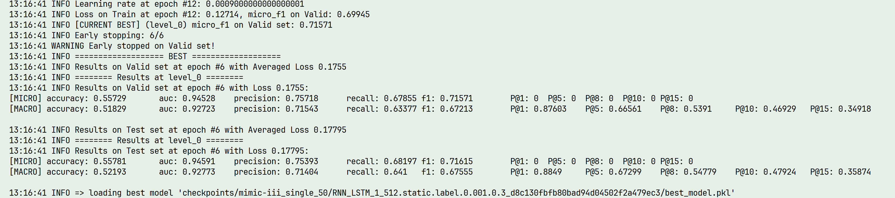
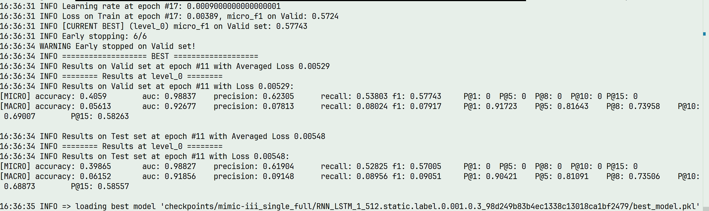

读分类模型的结果时，首先要分清三个问题：预测出的标签有多少正确，真实标签找回了多少，以及模型能否把正确标签排在前面。Precision、Recall、F1 和 AUC 关注的侧重点不同，同一个模型在这些指标上的表现也可能并不一致。

以下以多标签分类为主，先说明各项指标及其聚合方式，再用 LAAT 的运行日志说明怎样核对实现、分析分数和比较复现结果。单标签分类只在需要区分任务约束的地方讨论。

## 一、基本符号与混淆矩阵

### 1.1 预测分数与预测标签

设样本数为 \(N\)，候选标签数为 \(L\)。对于多标签分类任务，定义：

| 符号                      | 含义                                   |
| ------------------------- | -------------------------------------- |
| \(y_{ij}\in\{0,1\}\)      | 第 \(i\) 个样本是否具有第 \(j\) 个标签 |
| \(z_{ij}\in\mathbb R\)    | 模型输出的原始分数，即 logit           |
| \(p_{ij}=\sigma(z_{ij})\) | 经 sigmoid 转换的预测概率估计          |
| \(\hat y_{ij}\in\{0,1\}\) | 根据决策规则得到的预测标签             |
| \(\tau\)                  | 分类阈值                               |

采用统一阈值时，预测标签可定义为：

\[
\hat y_{ij}=\mathbf 1(p_{ij}\ge\tau).
\]

实际代码可能使用严格大于，也可能直接舍入。分数恰好落在阈值上时，这些规则会给出不同预测，比较结果前需要核对。

Precision、Recall、F1 根据预测标签计算，会受到阈值影响；ROC-AUC 和 P@k 根据分数排序计算，不依赖某个固定阈值。

### 1.2 混淆矩阵

对一个二分类任务，或多标签任务中的单个标签，预测结果可分为：

| 真实类别 | 预测为正         | 预测为负         |
| -------- | ---------------- | ---------------- |
| 正类     | TP：真正例       | FN：假负例，漏检 |
| 负类     | FP：假正例，误报 | TN：真负例       |

其中，\(TP+FN\) 为真实正例数，\(TP+FP\) 为预测正例数。

**计算示例。** 真实标签集合为 \(\{A,B,C\}\)，预测集合为 \(\{A,C,D,E\}\)，则：

\[
TP=2,\qquad FP=2,\qquad FN=1.
\]

TN 的数量取决于完整候选标签集合，不能仅由上述两个集合确定。

## 二、基于离散预测的评价指标

### 2.1 准确率：Accuracy

准确率表示全部判断中预测正确的比例：

\[
Accuracy=\frac{TP+TN}{TP+TN+FP+FN}.
\]

Accuracy 同时统计正类和负类。负类远多于正类时，即使漏掉大部分正例，只要负类判断正确，准确率仍可能很高。

例如，100 个样本中仅有 1 个正例，全部预测为负即可获得 99% 的准确率，但正类 Recall 为 0。

### 2.2 精确率：Precision

精确率表示预测正例中真实正例的比例：

\[
P=\frac{TP}{TP+FP}.
\]

分母是模型预测出的正例数。在 TP 不变时，误报 FP 越多，Precision 越低。

对于第 1 节示例：

\[
P=\frac{2}{2+2}=0.5.
\]

### 2.3 召回率：Recall

召回率表示真实正例中被正确检出的比例：

\[
R=\frac{TP}{TP+FN}.
\]

分母是真实正例数。在 TP 不变时，漏检 FN 越多，Recall 越低。它也称真正例率 TPR。

对于第 1 节示例：

\[
R=\frac{2}{2+1}=\frac23\approx0.6667.
\]

因此，Precision 高只能说明预测出的正例较可靠；还要结合 Recall，才能判断有多少真实正例被遗漏。

### 2.4 F1 分数

F1 为 Precision 与 Recall 的调和平均：

\[
F1=\frac{2PR}{P+R}
=\frac{2TP}{2TP+FP+FN}.
\]

调和平均更容易受到较小一项的影响。例如，Precision 很高而 Recall 很低时，F1 仍然会偏低。

对于第 1 节示例：

\[
F1=\frac{2\times2}{2\times2+2+1}
=\frac47\approx0.5714.
\]

若需要对 Precision 和 Recall 设置不同权重，可使用 \(F_\beta\)：

\[
F_\beta=(1+\beta^2)\frac{PR}{\beta^2P+R}.
\]

\(\beta>1\) 时更重视 Recall，\(0<\beta<1\) 时更重视 Precision；\(\beta=1\) 时退化为 F1。

没有预测正例时，Precision 的分母为 0；没有真实正例时，Recall 的分母为 0；两者都没有时，F1 的混淆计数形式也会出现零分母。实现中可以约定相应指标为 0，但这会影响标签平均，比较实验时要使用相同规则。

### 2.5 交并比：Jaccard / IoU

交并比衡量真实正例集合与预测正例集合的重合程度：

\[
J=\frac{TP}{TP+FP+FN}.
\]

对同一组混淆计数，有：

\[
F1=\frac{2J}{1+J}.
\]

交并比与普通 Accuracy 的定义不同，前者不使用 TN。

## 三、多标签指标的聚合方式

设标签 \(j\) 的混淆计数为 \(TP_j,FP_j,FN_j\)，对应指标为 \(P_j,R_j,F1_j\)。同一批预测可以先汇总计数，也可以先计算标签级或样本级指标。不同聚合方式改变了各标签和样本对最终分数的影响。

### 3.1 Micro：汇总计数后计算

Micro 将所有样本与标签的判断合并：

\[
P_{micro}=\frac{\sum_{j=1}^LTP_j}
{\sum_{j=1}^L(TP_j+FP_j)},
\]

\[
R_{micro}=\frac{\sum_{j=1}^LTP_j}
{\sum_{j=1}^L(TP_j+FN_j)},
\]

\[
F1_{micro}=\frac{2\sum_{j=1}^LTP_j}
{2\sum_{j=1}^LTP_j+\sum_{j=1}^LFP_j+\sum_{j=1}^LFN_j}.
\]

高频标签通常对汇总计数具有更大影响，因此 Micro-F1 主要反映整体正例预测表现。其计算不包含 TN。

### 3.2 Macro：逐标签计算后等权平均

常用的 Macro-F1 定义为：

\[
F1_{macro}=\frac1L\sum_{j=1}^LF1_j,
\qquad
F1_j=\frac{2TP_j}{2TP_j+FP_j+FN_j}.
\]

同理：

\[
P_{macro}=\frac1L\sum_{j=1}^LP_j,
\qquad
R_{macro}=\frac1L\sum_{j=1}^LR_j.
\]

Macro 给每个标签相同权重，低频标签不会因正例少而被明显弱化。不过，它只是让低频标签更充分地参与平均，并不专门衡量低频标签。一般有：

\[
F1_{macro}\ne
\frac{2P_{macro}R_{macro}}{P_{macro}+R_{macro}}.
\]

F1 是非线性函数，所以“先逐标签计算 F1 再平均”和“先平均 P、R 再计算 F1”会得到不同结果。后面的 LAAT 日志正好涉及这一差别。

### 3.3 Weighted：按真实正例数加权

设标签 \(j\) 的真实正例数为 \(n_j=TP_j+FN_j\)，则：

\[
F1_{weighted}=\frac{\sum_{j=1}^Ln_jF1_j}
{\sum_{j=1}^Ln_j}.
\]

Weighted-F1 按标签支持数加权，通常更受高频标签影响，但其计算方式仍不同于 Micro-F1。

### 3.4 Samples：逐样本计算后平均

设样本 \(i\) 的真实标签集合为 \(Y_i\)，预测集合为 \(\hat Y_i\)，则：

\[
F1_{samples}=\frac1N\sum_{i=1}^N
\frac{2|Y_i\cap\hat Y_i|}{|Y_i|+|\hat Y_i|}.
\]

Samples-F1 让每份样本具有相同权重，适合关注一份样本的整体预测情况。真实标签和预测标签同时为空时，分母为 0，需要单独约定取值。

若要求每个样本的全部标签完全一致，则使用子集准确率：

\[
Accuracy_{subset}=\frac1N\sum_{i=1}^N
\mathbf1(Y_i=\hat Y_i).
\]

子集准确率比逐标签判断更严格，不能与普通二分类 Accuracy 或交并比混用。

### 3.5 聚合计算示例

| 样本 | 真实标签 | 预测标签 |
| ---- | -------- | -------- |
| 1    | A、B     | A、C     |
| 2    | A        | 无       |
| 3    | C        | C        |

按标签统计：

| 标签 |   TP |   FP |   FN | Precision | Recall |   F1 |
| ---- | ---: | ---: | ---: | --------: | -----: | ---: |
| A    |    1 |    0 |    1 |         1 |    1/2 |  2/3 |
| B    |    0 |    0 |    1 |         0 |      0 |    0 |
| C    |    1 |    1 |    0 |       1/2 |      1 |  2/3 |

采用零分母返回 0 的约定，有：

\[
F1_{micro}=\frac47\approx0.5714,
\qquad
F1_{macro}=\frac49\approx0.4444.
\]

若先平均 Precision、Recall，二者都是 0.5，再取调和平均仍为 0.5。同一批预测因此可以得到 0.4444 或 0.5 两个被称为“Macro-F1”的值，区别在于计算顺序。

## 四、排序指标：ROC-AUC

### 4.1 ROC 曲线

在不同分类阈值下计算真正例率和假正例率：

\[
TPR=\frac{TP}{TP+FN},
\qquad
FPR=\frac{FP}{FP+TN}.
\]

ROC 曲线以 FPR 为横轴、TPR 为纵轴，ROC-AUC 为曲线下面积：

\[
AUC=\int_0^1TPR(FPR)\,dFPR.
\]

对按 FPR 升序排列的曲线点 \((x_q,y_q)\)，可使用梯形法计算：

\[
AUC\approx\sum_q
(x_{q+1}-x_q)\frac{y_q+y_{q+1}}2.
\]

### 4.2 成对排序解释

设正例与负例数量分别为 \(n_+\)、\(n_-\)，对应预测分数为 \(s_a^+\)、\(s_b^-\)。经验 AUC 可写为：

\[
AUC=\frac1{n_+n_-}\sum_{a=1}^{n_+}\sum_{b=1}^{n_-}
\left[\mathbf1(s_a^+>s_b^-)
+\frac12\mathbf1(s_a^+=s_b^-)\right].
\]

也就是说，随机取一对正负例，AUC 衡量正例排在负例之前的概率；分数相同时计半次。

**计算示例。** 正例分数为 \(\{0.9,0.4\}\)，负例分数为 \(\{0.8,0.1\}\)。四组正负例比较中有三组排序正确，因此：

\[
AUC=\frac34=0.75.
\]

若使用 0.5 阈值，则 TP、FP、FN 均为 1，此时 F1=0.5。AUC 与 F1 分别衡量排序质量和特定决策规则下的分类表现，二者不能互相替代。

### 4.3 多标签 AUC

- **Micro-AUC**：将所有样本—标签对展开后计算。
- **Macro-AUC**：先按标签计算 AUC，再对有效标签平均。

标签在评估集中缺少正例或负例时，其 ROC-AUC 无法正常定义。Macro-AUC 的报告应说明有效标签集合与筛选规则。

ROC 的横轴以全部负例为分母。负例很多时，较小的 FPR 仍可能对应较多误报，因此可以结合直接反映 Precision 与 Recall 的 PR 曲线。Average Precision（AP）与梯形积分得到的 PR-AUC 计算方式不同，报告时要写清使用哪一种。

## 五、前 k 项指标：P@k 与 Recall@k

设 \(TopK_i\) 为样本 \(i\) 预测分数最高的 k 个标签，且 \(1\le k\le L\)。

### 5.1 Precision@k

\[
P@k=\frac1N\sum_{i=1}^N
\frac{|TopK_i\cap Y_i|}{k}.
\]

P@k 表示前 k 个预测标签中的平均正确比例。例如，前 5 项中有 3 项正确，该样本的 P@5 为 0.6。

P@k 基于排序，不要求前 k 项分数均超过固定阈值。当真实标签数少于 k 时，即使全部真实标签均已检出，该样本的 P@k 仍可能小于 1。

### 5.2 Recall@k

\[
Recall@k=\frac1N\sum_{i=1}^N
\frac{|TopK_i\cap Y_i|}{|Y_i|}.
\]

Recall@k 表示前 k 项对真实标签的覆盖程度。真实标签集合为空时，需要规定处理方式。

P@k 与 Recall@k 使用相同的命中数，但分母不同。比较不同数据集时，还应考虑每个样本的真实标签数量分布。

## 六、损失函数与评价指标

### 6.1 多标签二元交叉熵

采用逐元素平均时，多标签二元交叉熵为：

\[
\mathcal L_{BCE}=-\frac1{NL}\sum_{i=1}^N\sum_{j=1}^L
\left[y_{ij}\log p_{ij}+(1-y_{ij})\log(1-p_{ij})\right].
\]

BCE 对每个标签分别计算二分类损失，多个标签可以同时为正；这并不要求标签在统计上相互独立。实现中，`BCEWithLogitsLoss` 直接接收 logits，内部合并 sigmoid 与交叉熵以提高数值稳定性，不需要先手动做 sigmoid。

### 6.2 单标签多分类交叉熵

当每个样本仅属于一个类别，且 \(p_{ij}\) 为 softmax 概率时：

\[
\mathcal L_{CE}=-\frac1N\sum_{i=1}^N\sum_{j=1}^L
y_{ij}\log p_{ij}.
\]

这里各类别互斥，softmax 概率之和为 1；多标签任务允许多个标签同时存在，通常使用逐标签 sigmoid 与 BCE。选择损失时，先看标签是否互斥。

### 6.3 损失值的解释

损失函数用于优化模型，评价指标用于衡量目标表现。BCE 衡量概率估计与真实标签的偏差，F1 统计阈值决策后的 TP、FP、FN。分数变化如果没有跨过阈值，loss 可以下降而 F1 不变；一些变化还可能使 F1 下降。

损失值比较需要保持任务、标签集合、样本权重和归约方式一致。标签数量及正负例比例改变后，平均 BCE 的尺度也可能变化；跨数据集的 loss 大小不宜直接作为性能优劣依据。

## 七、实验结果分析

### 7.1 模型选择与测试报告

训练集用于参数学习，验证集用于模型与超参数选择，测试集用于最终评估。采用验证集主指标选择模型时，最佳轮次可表示为：

\[
e^*=\arg\max_eM_{valid}(e).
\]

最终报告对应模型的 \(M_{test}(e^*)\)。若以损失为选择依据，应使用最小化规则。

早停轮次表示训练终止位置，最佳轮次表示验证集最优模型的位置，两者通常不同。测试集不参与轮次、阈值或超参数选择。

### 7.2 常见指标组合

| 结果特征                    | 分析方向                                       |
| --------------------------- | ---------------------------------------------- |
| Precision 较高，Recall 较低 | 检查漏检标签、预测标签数、阈值与标签频次       |
| Micro-F1 明显高于 Macro-F1  | 按训练标签频次分组，检查低频标签表现           |
| AUC 较高，F1 较低           | 检查排序与当前阈值决策的差异，以及分组分数分布 |
| P@k 较高，Recall 较低       | 检查前 k 项之外的真实标签及真实标签数分布      |
| 训练损失下降，验证表现恶化  | 检查同轮曲线、模型复杂度、正则化与重复运行     |

这些组合可以帮助确定下一步检查什么，但还不能单独解释原因。例如，Micro-F1 高于 Macro-F1 时，可以按训练标签频次分组，再检查低频组的漏检和误报。

### 7.3 百分点与相对变化

设两个指标值按百分数记为 \(a\%\)、\(b\%\)，则：

\[
\Delta_{pp}=b-a\quad\text{（个百分点）},
\]

\[
\Delta_{relative}=\frac{b-a}{a}\times100\%\qquad(a\ne0).
\]

例如，从 71.5% 变为 71.615%，绝对变化为 0.115 个百分点，相对变化约为 0.161%。

### 7.4 重复实验与波动

设 \(R\) 次运行的指标为 \(m_1,\ldots,m_R\)，样本均值和样本标准差为：

\[
\bar m=\frac1R\sum_{r=1}^Rm_r,
\qquad
s=\sqrt{\frac1{R-1}\sum_{r=1}^R(m_r-\bar m)^2}
\quad(R>1).
\]

方法比较应保持数据划分、评估实现和随机种子集合一致。均值反映平均表现，标准差描述运行波动；判断差异是否稳定，还需要结合重复次数与适当的统计检验。只挑最好的一次，容易高估改进。

## 八、LAAT 多标签分类案例

LAAT 实验包含 MIMIC-III-50 与 MIMIC-III-full 两种任务规模。以下数值来自两次单层 LAAT 运行截图，均为验证集选出模型的测试集结果。

| 指标                 | MIMIC-III-50 | MIMIC-III-full |
| -------------------- | -----------: | -------------: |
| Micro-Precision      |      75.393% |        61.904% |
| Micro-Recall         |      68.197% |        52.825% |
| Micro-F1             |      71.615% |        57.005% |
| Macro-F1（仓库口径） |      67.555% |         9.051% |
| Micro-AUC            |      94.591% |        98.827% |
| Macro-AUC            |      92.773% |        91.856% |
| P@5                  |      67.299% |        81.091% |
| P@8                  |      54.779% |        73.506% |

### 8.1 计算与结果解释

full 任务的 Micro-F1 可由 Precision 与 Recall 复核：

\[
\frac{2\times0.61904\times0.52825}{0.61904+0.52825}
\approx0.57005.
\]

P@5=0.81091 表示每个样本前 5 个推荐标签平均约有 \(5\times0.81091=4.05455\) 个正确。Micro-AUC=98.827% 表示汇总排序质量，不能解释为完整病历编码正确率。

full 任务的 Micro-F1 与仓库口径的 Macro-F1 差距较大，说明整体计数与标签等权聚合给出了不同结果。要判断低频编码具体差在哪里，还需要按标签频次分组。50 标签任务与 full 的样本和标签集合不同，二者差值不属于同一任务下的方法改进幅度。

### 8.2 仓库评估口径

[LAAT 仓库的 `src/util/util.py`](https://github.com/aehrc/LAAT/blob/master/src/util/util.py) 中，有几项定义与常见名称的直觉不同：

| 日志项           | 实际定义或处理                                  |
| ---------------- | ----------------------------------------------- |
| `macro_f1`       | 先平均标签级 P、R，再计算二者的调和平均         |
| `micro_accuracy` | 汇总交并比 \(TP/(TP+FP+FN)\)                    |
| `macro_accuracy` | 标签级交并比的平均                              |
| `[MICRO] P@k`    | 未计算，保留初始值 0；实际值输出在 `[MACRO]` 行 |
| 二值预测         | 使用 `np.rint`；分数恰为 0.5 时预测为 0         |

因此，表中的 Macro-F1 保留“仓库口径”标注，不能直接当作第 3.2 节的逐标签 F1 平均。P@k 虽然输出在 `[MACRO]` 行，计算本身仍是第 5.1 节的逐样本 top-k 精确率；日志行名并不改变它的统计对象。

### 8.3 最佳轮次与论文对照

50 标签任务在第 12 轮停止，最佳模型为第 6 轮；full 在第 17 轮停止，最佳模型为第 11 轮。停止前均连续 6 轮未超过验证集最佳 Micro-F1。

| 任务与指标    | 论文 LAAT | 本次单次运行 | 差值（百分点） |
| ------------- | --------: | -----------: | -------------: |
| 50 Micro-F1   |     71.5% |      71.615% |         +0.115 |
| 50 Macro-F1   |     66.6% |      67.555% |         +0.955 |
| full Micro-F1 |     57.5% |      57.005% |         -0.495 |
| full Macro-F1 |      9.9% |       9.051% |         -0.849 |

两次运行的 Micro-F1 都接近论文值，但这只能说明本次配置取得了接近的单次分数。判断复现是否一致，还要继续核对参数和重复运行方式。

首先是参数差异。本次两个任务的模型路径都记录了 hidden size=512，而[论文第 4.3 节](https://www.ijcai.org/Proceedings/2020/0461.pdf)中，50 标签任务的 hidden size 和注意力维度均为 256，full 均为 512。因此，50 标签这次运行采用了更大的隐藏维度，高出的 0.115 个百分点不能说明方法有改进。

其次是统计方式。论文 Table 1、Table 2 报告 10 个随机种子的平均结果，本次每个任务只有一次运行。要比较平均表现和波动，需要先核对配置，再按论文设置重复运行。其中，50 标签任务的 hidden size 与注意力维度都应设为 256；其他参数可从启动命令或日志开头核对。

## 九、计算成本指标

### 9.1 墙钟时间与 GPU 工时

全流程墙钟时间为：

\[
T_{wall}=t_{end}-t_{start}.
\]

应明确计时边界是否包含数据加载、验证、测试和模型保存。仅统计训练 batch 的时间时，应单独记为训练时间。

设运行区间 \(q\) 分配 GPU 数为 \(g_q\)，时长为 \(\Delta t_q\) 小时，则：

\[
GPU\text{-}hours=\sum_qg_q\Delta t_q.
\]

例如，2 张 GPU 同时运行 3 小时，对应 6 GPU-hours。GPU-hours 记录设备分配时长，不反映利用率。不同型号的 GPU 即使工时相同，完成的计算也可能不同，因此还要注明硬件。

### 9.2 吞吐量

\[
Throughput=\frac{\text{实际处理样本数}}{\text{对应时间（秒）}}.
\]

训练吞吐量与包含评估、I/O 的全流程吞吐量应分别标注。不同序列长度、batch size 和硬件条件下，吞吐量不能脱离设置直接比较。

上述 LAAT 截图仅包含结束阶段时间，缺少起始记录，无法据此计算实际总耗时与 GPU 工时。

## 十、读实验结果时的几个问题

### 10.1 为什么 AUC 很高，F1 仍然不高？

AUC 看分数排序，F1 看某个阈值下的离散预测。排序较好时，阈值仍可能让模型漏掉不少正例；多标签 Micro-AUC 还会把全部样本—标签对放在一起比较。分析时需要同时看阈值、Precision、Recall 和标签分组，不能把高 AUC 理解为整份样本的编码都正确。

### 10.2 Micro、Macro 和 Samples 应该选哪一个？

Micro 汇总全部判断，Macro 让每个标签等权，Samples 让每个样本等权。它们回答的侧重点不同。长尾多标签任务通常需要结合 Micro 与 Macro，再按标签频次查看结果；如果关心每份样本的预测完整程度，可以补充 Samples-F1 或子集准确率。比较前还要确认同名指标的公式一致。

### 10.3 一次运行超过论文值，能说明改进吗？

需要先确认任务、数据划分、参数、模型选择和评估实现一致，再比较重复运行的平均表现与波动。LAAT 的 50 标签案例采用了更大的隐藏维度，而且单次结果对照的是论文的多次均值，因此目前只能报告分数差异，不能把它解释为方法改进。

## 参考资料

1. [LAAT 原论文](https://www.ijcai.org/Proceedings/2020/0461.pdf)：实验设置与结果表。
2. [LAAT 作者仓库](https://github.com/aehrc/LAAT)：评估函数与模型选择实现。
3. [scikit-learn：F1 score](https://scikit-learn.org/stable/modules/generated/sklearn.metrics.f1_score.html)：F1 定义及聚合方式。
4. [scikit-learn：ROC-AUC](https://scikit-learn.org/stable/modules/generated/sklearn.metrics.roc_auc_score.html)：ROC-AUC 与多标签聚合。
5. [《动手学深度学习》3.6：softmax 回归的从零开始实现](https://zh-v2.d2l.ai/chapter_linear-networks/softmax-regression-scratch.html)：损失、准确率计算与训练统计。
6. [《动手学深度学习》4.4：模型选择、欠拟合和过拟合](https://zh-v2.d2l.ai/chapter_multilayer-perceptrons/underfit-overfit.html)：数据划分与泛化评估。

## 附：LAAT 实验日志

图：50 标签任务的运行截图，对应第八节的测试集结果和早停记录。

图：完整标签任务的运行截图；P@k 读取 `[MACRO]` 行。截图未包含起始时间，不能据此计算全程耗时。
