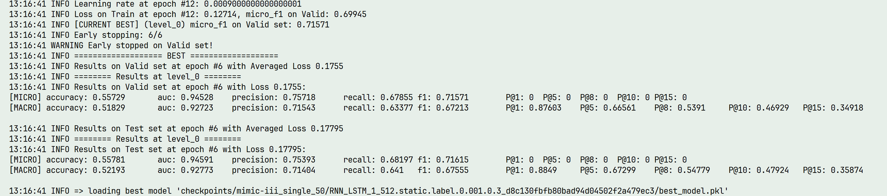
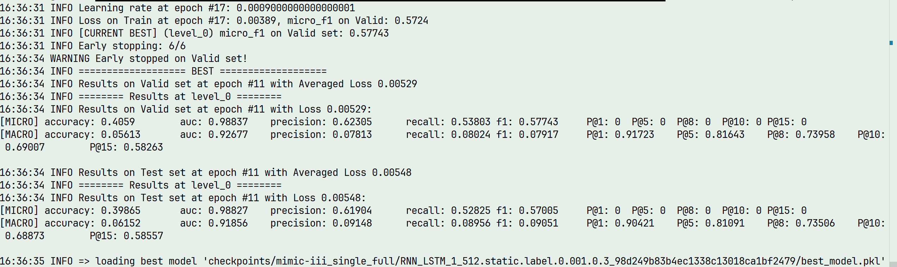

这次记录有两次单层 LAAT 运行，分别用 MIMIC-III-50 和 MIMIC-III-full 预测出院小结的 ICD 编码。日志保存了验证集最佳轮次和对应的测试结果。50 标签的 Micro-F1 为 71.615%，full 为 57.005%。这两个设置使用的病历和标签范围不同，各自与论文的同名设置对照。模型内部怎样用不同位置预测不同编码，见 [LAAT 论文精读](knowledge:research-paper-laat)。

**对应论文**

| 项目 | 内容 |
| --- | --- |
| 论文 | *A Label Attention Model for ICD Coding from Clinical Text* |
| 作者 | Thanh Vu、Dat Quoc Nguyen、Anthony Nguyen |
| 发表 | IJCAI 2020 主会，3335–3341 页 |
| 所读版本 | [arXiv:2007.06351v1](https://arxiv.org/abs/2007.06351v1) |
| 原文 | [正式论文](https://ijcai.org/proceedings/2020/461) · [DOI 10.24963/ijcai.2020/461](https://doi.org/10.24963/ijcai.2020/461) |

## 一、数据准备与训练入口

### 1.1 划分和数据文件

作者的 MIMIC-III 预处理脚本 `src/util/mimiciii_data_processing.py` 从 PostgreSQL 读取数据，按 CAML 提供的 ID 构建 full 与 50 的训练、验证和测试 CSV。`configuration/config.json` 里的 `mimic-iii_single_full` 和 `mimic-iii_single_50` 分别指向 `data/mimicdata/mimic3/full` 和 `data/mimicdata/mimic3/50`。三个 CSV 的列名为 `Admission_Id`、`Text` 和 `Full_Labels`，多个编码在最后一列用 `|` 分隔。带 `_2_` 的配置还读取 `Three_Character_Labels`，供粗细两层的 JointLAAT 使用。

```text
项目根目录运行 python -m src.run
  → src/run.py 调用 training.prepare_data()
  → configuration/config.json 定位 CSV，读入病历、标签和 ID
  → TextDataset / TextDataLoader 构建批次
  → src/models/rnn.py 做词嵌入、双向 LSTM 和编码分类
  → src/trainer.py 训练与选模，src/evaluator.py 生成评估结果
  → src/util/util.py 计算日志中的 Micro、Macro 和 P@k
```

例如一行写着“heart failure”，进入模型时会先变成两个词表下标，每个下标再查出对应的词向量。双向 LSTM 为每个位置补入前后词语的信息。标签注意力根据编码重新加权这些位置，接着得到一组逐编码分数。真实标签列则被转成同一词表顺序下的多热向量，训练时用于计算二元交叉熵。训练入口会为配置生成 checkpoint 路径。调换数据后，先核对输出日志里的样本数和标签数，避免同一路径下的 pickle 缓存继续指向旧数据。

### 1.2 在服务器上启动前

作者依赖清单约束了旧版 PyTorch、Transformers 和 Gensim。先用独立环境装依赖并核对解释器，旧依赖如果找不到与当前 Python、平台相符的包，应重新核对解释器和编译环境。接着配置 NLTK 的分词资源、准备三份 CSV 和 Word2Vec 文件。以上都在服务器会话内检查，显卡可见但 `torch.cuda.is_available()` 为假时，优先检查这个环境实际装的 PyTorch 构建和驱动。依赖源不通时可按 [Linux 服务器的依赖与权重排查](knowledge:research-experiment-less-is-more#server-downloads) 逐项验证。

下例根据源码和作者命令给出 full 单层 LAAT 的启动入口，供后续重复运行。它没有还原两次日志的完整命令。运行前，确认词向量的实际路径，以及要对照的学习率、随机种子和评估设置。

```bash
python -m src.run \
  --problem_name mimic-iii_single_full --max_seq_length 4000 \
  --main_metric micro_f1 --attention_mode label --d_a 512 \
  --embedding_mode word2vec --embedding_file data/embeddings/word2vec_sg0_100.model \
  RNN --rnn_model LSTM --n_layers 1 --bidirectional 1 --hidden_size 512
```

复核 50 标签时，将 `--problem_name` 改为 `mimic-iii_single_50`。若以论文的 50 标签超参数为目标，`--d_a` 与 `--hidden_size` 应设为 256。命令里 `RNN` 前是公共参数，后面是 RNN 子命令自己的参数。作者实现的随机种子调用默认在注释中，做重复实验需要先显式接入并逐次记录。 [LAAT 项目与入口](https://github.com/aehrc/LAAT) · [论文第 4 节](https://arxiv.org/pdf/2007.06351)

## 二、两次运行的测试结果

下表取自两次运行的测试日志。checkpoint 按验证集 Micro-F1 选出。

| 指标                 | MIMIC-III-50 | MIMIC-III-full |
| -------------------- | -----------: | -------------: |
| Micro-Precision      |      75.393% |        61.904% |
| Micro-Recall         |      68.197% |        52.825% |
| Micro-F1             |      71.615% |        57.005% |
| Macro-F1（仓库口径） |      67.555% |         9.051% |
| Micro-AUC            |      94.591% |        98.827% |
| Macro-AUC            |      92.773% |        91.856% |
| P@5                  |      67.299% |        81.091% |
| P@8                  |      54.779% |        73.506% |

### 2.1 计算与结果解释

full 任务的 Micro-F1 可由 Precision 与 Recall 复核：

\[
\frac{2\times0.61904\times0.52825}{0.61904+0.52825}
\approx0.57005.
\]

P@5=0.81091 表示每个样本前 5 个推荐标签平均约有 \(5\times0.81091=4.05455\) 个正确。Micro-AUC=98.827% 表示汇总排序质量，不能解释为完整病历编码正确率。

full 任务的 Micro-F1 与仓库口径的 Macro-F1 差距较大，说明整体计数与标签等权聚合给出了不同结果。要判断低频编码具体差在哪里，还需要按标签频次分组。50 标签任务与 full 的样本和标签集合不同，二者差值不属于同一任务下的方法改进幅度。

### 2.2 仓库评估口径 {#evaluation-protocol}

[LAAT 仓库的 `src/util/util.py`](https://github.com/aehrc/LAAT/blob/master/src/util/util.py) 中，有几项定义与常见名称的直觉不同：

| 日志项           | 实际定义或处理                                  |
| ---------------- | ----------------------------------------------- |
| `macro_f1`       | 先平均标签级 P、R，再计算二者的调和平均         |
| `micro_accuracy` | 汇总交并比 \(TP/(TP+FP+FN)\)                    |
| `macro_accuracy` | 标签级交并比的平均                              |
| `[MICRO] P@k`    | 未计算，保留初始值 0；实际值输出在 `[MACRO]` 行 |
| 二值预测         | 使用 `np.rint`；分数恰为 0.5 时预测为 0         |

结果表和运行截图采用 LAAT 仓库的口径。这里的 Macro-F1 先平均各标签的 Precision 和 Recall，再求调和平均。P@k 读取标为 `[MACRO]` 的日志行，分数按病历计算后取平均。公式和示例见[宏平均](knowledge:research-experiment-multilabel-metrics#macro-f1)与[前 k 项精确率](knowledge:research-experiment-multilabel-metrics#precision-at-k)。

### 2.3 最佳轮次与论文对照

50 标签任务在第 12 轮停止，最佳模型为第 6 轮；full 在第 17 轮停止，最佳模型为第 11 轮。停止前均连续 6 轮未超过验证集最佳 Micro-F1。

| 任务与指标    | 论文 LAAT | 本次单次运行 | 差值（百分点） |
| ------------- | --------: | -----------: | -------------: |
| 50 Micro-F1   |     71.5% |      71.615% |         +0.115 |
| 50 Macro-F1   |     66.6% |      67.555% |         +0.955 |
| full Micro-F1 |     57.5% |      57.005% |         -0.495 |
| full Macro-F1 |      9.9% |       9.051% |         -0.849 |

本次两个任务的模型路径都记录了 hidden size=512，而[论文第 4.3 节](https://arxiv.org/pdf/2007.06351)中，50 标签任务的 hidden size 和注意力维度均为 256，full 均为 512。因此，50 标签这次运行采用了更大的隐藏维度，高出的 0.115 个百分点不能说明方法有改进。

论文表 1、表 2 报告 10 个随机种子的平均结果，本次每个任务只有一次运行。要比较平均表现和波动，需要先核对配置，再按论文设置重复运行。其中，50 标签任务的 hidden size 与注意力维度都应设为 256；其他参数可从启动命令或日志开头核对。

重算时记下 Macro-F1 的平均顺序，以及测试集无正例的编码是否计入分母。旧截图只保存了汇总值，重算需要逐病历预测和参考标签。 [MIMIC 基准复核](knowledge:research-paper-mimic-replicability)

## 参考资料

- [LAAT 原论文](https://arxiv.org/pdf/2007.06351)，第 4 节和表 1、表 2。
- [LAAT 作者仓库](https://github.com/aehrc/LAAT)，数据准备、训练与评价实现。

## 附：LAAT 实验日志



图：50 标签任务的运行截图，对应第二节的测试集结果和早停记录。



图：完整标签任务的运行截图；P@k 读取 `[MACRO]` 行。截图未包含起始时间，不能据此计算全程耗时。
