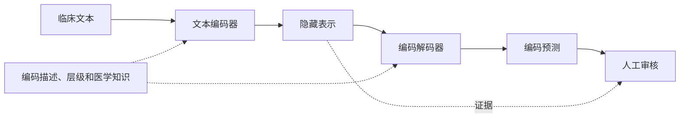

## 一、论文与阅读问题

| 项目 | 内容 |
|---|---|
| 论文 | *A Unified Review of Deep Learning for Automated Medical Coding* |
| 作者 | Shaoxiong Ji、Xiaobo Li、Wei Sun、Hang Dong、Ara Taalas、Yijia Zhang、Honghan Wu、Esa Pitkänen、Pekka Marttinen |
| 发表 | *ACM Computing Surveys*，56(12)，Article 306，2024 年 10 月，41 页 |
| 原文 | [正式发表版](https://doi.org/10.1145/3664615)；[正式版开放 PDF](https://eprints.gla.ac.uk/326943/1/326943.pdf)；[作者预印本](https://arxiv.org/abs/2201.02797) |
| 类型 | 自动医学编码领域的技术综述 |

自动医学编码将病历文字转换为标准诊断与操作编码。模型既要从长文本中寻找证据，也要在大量候选编码中识别少见标签。已有研究从不同环节处理这些困难，模型名称本身却很难说明它们的联系。

Ji 等人的综述把模型拆成编码器、深层连接、解码器和辅助信息四部分，再据此整理已有研究。阅读时可以围绕三个问题展开：

1. 长病历、大标签空间和长尾分布，分别给预测带来了什么困难？
2. 不同模型改动了哪个环节，为什么这样改？
3. 已有实验能支持哪些判断，哪些问题还需要单独验证？

下文的章节、公式、图表编号和“306:页码”以 2024 年正式版为准，参考编号也沿用该版。预印本的部分表格和文献编号不同；原始论文与综述有出入的地方，在相应位置注明。

## 二、任务定义与主要困难

### 2.1 自动医学编码

自动医学编码将临床记录转换为标准编码集合。输入主要来自电子健康记录（Electronic Health Records，EHRs）中的出院小结、放射学报告、病程和操作记录；输出包括诊断与医疗操作等标签。本文重点讨论国际疾病分类（International Classification of Diseases，ICD），同时涉及将 ICD 聚合为较粗类别的临床分类软件（Clinical Classifications Software，CCS）等体系。（§1）

同一份病历可能对应多个诊断和操作，所以该任务属于多标签分类。标签达到数千乃至更多时，具有极端多标签分类（Extreme Multi-label Classification，XML）的特点。常见分类模型为每个编码分别计算 sigmoid 得分，多个编码可以同时被预测为正，所有得分也不要求加起来等于 1。

医学编码还受到记录内容和编码规范限制。疾病词语的出现，并不自动意味着应分配对应编码；历史情况、假设性描述和不同编码条件都可能改变标签。因此，模型需要学习病历内容与编码规则之间的对应关系；自动编码的目标也有别于即时临床诊断。（§1，306:2—3）

### 2.2 三项主要困难

| 困难 | 原文中的具体表现 | 对模型的影响 |
|---|---|---|
| 文本长且有噪声 | 病历有大量缩写、拼写变体、非标准同义表达和专业术语，常含数百至数千词 | 局部词语不足以决定编码，证据可能跨句跨段分布 |
| 编码空间大 | 目标标签可达数千乃至更多，一份记录只包含少量编码 | 需要在大量候选中匹配证据，并处理编码依赖与计算扩展 |
| 标签长尾 | 常见编码拥有较多样本，罕见编码只有少量正例，部分编码在训练中未出现 | 独立训练标签参数容易偏向高频类别，稀有编码缺少稳定监督 |

原文图 2 展示了 MIMIC-III 中明显偏斜的编码频率。（§1，306:4）这些困难相互影响：低频编码本就样本少，如果证据又分散在长病历中，模型更难学到可靠模式；高频标签主导的总体分数还可能掩盖这一不足。

早期基于规则与人工特征工程的方法主要依赖术语匹配、人工特征以及支持向量机（Support Vector Machine，SVM）、贝叶斯岭回归等分类器。深度学习减少了人工特征设计，但没有消除数据稀疏和语义歧义。原文转述的放射学报告研究甚至发现，适当配置的 CNN 在部分稀疏、偏斜数据上与传统分类器表现相近。（§1，§3.1.2）

## 三、统一框架与处理流程

已有综述有的侧重编码应用，有的按算法介绍方法。这篇论文关注的是模型内部的设计联系：临床文本如何形成表示，表示如何传递，编码如何产生，以及标签语义和医学知识从哪里进入模型。（原文 §2—§3，图 3、表 1—2）

### 3.1 四个组成部分

| 维度 | 模型中的职责 | 主要方法 |
|---|---|---|
| 编码器 | 将临床文本转换为隐藏表示 | 循环网络、卷积、Transformer、图网络、层次编码 |
| 深层连接 | 在深层网络中传递表示与梯度 | 堆叠、残差连接、嵌入注入 |
| 解码器 | 将隐藏表示映射为编码预测 | 全连接、标签注意力、层次、多任务、少样本/零样本及生成式解码 |
| 辅助信息 | 提供文本之外的语义、结构或监督 | 编码描述、编码层级、维基百科、医学本体、结构化数据与人类反馈 |

这四项描述同一个模型的不同部分。CAML 使用 CNN 编码器与标签注意力解码器；DR-CAML 在这一主体上增加描述正则；MultiResCNN 则改用多卷积核与残差连接。同一项技术也可能出现在多个位置，例如注意力既能用于文本编码，也能用于标签聚合。这些类别可以组合，并非互斥的模型分组。

辅助信息还可以通过不同方式起作用：编码描述可以作为注意力查询，也可以约束训练参数；编码层级可以进入图网络，也可以决定粗到细的预测顺序。因此，比较模型时要同时看信息来源和实际计算位置。

### 3.2 从病历到编码的处理流程

图：根据原文图 3 整理的概念流程。深层连接位于网络内部；辅助信息可以进入编码器、解码器或训练目标。人工审核属于使用与反馈环节。

模型先把临床记录映射为隐藏表示，再形成各编码的预测分数。作者把多任务、少样本等学习方式也放在解码器一节讨论，所以这些类别可以与标签注意力、层次预测或生成机制同时出现。

这篇综述的贡献在于用共同的结构比较已有方法，并将模型设计与长文本、长尾标签、评估和人工编码场景联系起来。它没有提出一套共享参数和损失函数的新预测模型，也没有统一重训全部方法；阅读其中的性能结论，仍要回到对应研究的设置。

## 四、各类方法的设计思路

以下按四个组成部分比较方法。公式中，\(n\) 表示文本位置数，\(m\) 表示候选编码数，\(d_e\) 和 \(d_h\) 分别表示词向量维度与隐藏表示维度。

### 4.1 文本编码器：怎样表示长病历

#### 编码方法与代表研究

| 方法 | 主要机制 | 代表模型和论文 | 对应的困难 |
|---|---|---|---|
| 循环神经网络（Recurrent Neural Network，RNN） | 按词序更新状态，双向结构结合两个方向的上下文 | [Attentive LSTM](https://arxiv.org/abs/1711.04075)、[HA-GRU](https://arxiv.org/abs/1709.09587)、[LAAT](https://www.ijcai.org/proceedings/2020/461) | 词序、上下文与非相邻证据之间的依赖 |
| 普通与多尺度卷积 | 在局部窗口提取模式，不同卷积核覆盖不同长度 | [TextCNN](https://aclanthology.org/D14-1181/)、[CAML](https://aclanthology.org/N18-1100/)、[MVC-LDA](https://arxiv.org/abs/1811.01468)、[MultiResCNN](https://arxiv.org/abs/1912.00862) | 临床短语长度和表达形式变化 |
| 空洞卷积 | 在采样位置间增加间隔，扩大感受野 | [DCAN](https://aclanthology.org/2020.clinicalnlp-1.8/)、[DACNM](https://aclanthology.org/2020.acl-demos.33/) | 普通局部卷积难以覆盖远距离上下文 |
| 门控与压缩卷积 | 控制信息流，或将多个位置压缩为较少表示 | [GatedCNN-NCI](https://aclanthology.org/2021.findings-acl.89/)、[Fusion](https://aclanthology.org/2021.findings-acl.184/) | 深层信息丢失和长文档处理成本 |
| Transformer 与预训练编码 | 通过注意力建立上下文联系，迁移大语料知识 | [Transformer](https://arxiv.org/abs/1706.03762)、[TransICD](https://arxiv.org/abs/2104.10652)、[BERT-XML](https://aclanthology.org/2020.clinicalnlp-1.3/) | 上下文表示和临床语言建模 |
| 长文本 Transformer | 使用稀疏连接或跨片段信息处理长序列 | [Longformer](https://arxiv.org/abs/2004.05150)、[BigBird](https://arxiv.org/abs/2007.14062)、[Transformer-XL](https://aclanthology.org/P19-1285/)、[ICDBigBird](https://aclanthology.org/2022.bionlp-1.32/) | 常规输入长度限制与全注意力的二次成本 |
| 层次编码 | 从词到句子、从文本块到文档逐级聚合 | [HLAN](https://arxiv.org/abs/2010.15728)、[BERT-hier 相关研究](https://arxiv.org/abs/2103.06511)、[MD-BERT](https://arxiv.org/abs/2204.09600) | 长病历及其内部文档结构 |
| 图编码 | 把临床实体、句子和患者信息转为节点，沿关系聚合 | [GMAN](https://www.ijcai.org/proceedings/2020/469)、[CMGE](https://aclanthology.org/2021.naacl-main.156/) | 文本证据和医学关系的显式组织 |

#### 循环与卷积的差异

RNN 通过内部状态保留序列信息。长短期记忆网络（Long Short-Term Memory，LSTM）和门控循环单元（Gated Recurrent Unit，GRU）用门控缓解普通 RNN 的梯度与信息传播问题，BiLSTM和 BiGRU表示相应双向形式。Attentive LSTM 联合处理临床描述和 ICD 长标题，并用注意力匹配诊断片段；HA-GRU 将句子和文档分层组织。（§3.1.1）

卷积神经网络（Convolutional Neural Network，CNN）重点提取局部表达。MultiResCNN 使用多个卷积核以捕捉不同长度的模式，并用残差卷积扩大覆盖；DCAN 则通过空洞采样扩展感受野。后者的标量机制可解释为：

\[
z_s=\sum_{j=0}^{k-1}f_jx_{s-d_lj}.
\]

其中 \(x_t\) 是位置 \(t\) 的输入，\(f_j\) 是卷积核第 \(j\) 个权重，\(k\) 是卷积核长度，\(d_l\) 是第 \(l\) 层的采样间隔，\(s\) 是当前位置。增大间隔可使同样长度的卷积核接触更远位置。此处是对原文式（2）的解释性改写；原式的索引和求和上界不一致，改写后明确了卷积核的采样范围。

GatedCNN 通过门控制信息流；Fusion 使用注意力软池化压缩卷积特征；[EffectiveCAN](https://aclanthology.org/2021.emnlp-main.481/)使用残差压缩与激励模块，其基础[压缩与激励网络](https://openaccess.thecvf.com/content_cvpr_2018/html/Hu_Squeeze-and-Excitation_Networks_CVPR_2018_paper.html)通过学习通道权重重标定特征。[BiCapsNetLE](https://doi.org/10.1186/s12911-021-01426-9)在 BiLSTM 后接胶囊网络进一步提取特征，其路由细节需要结合模型原论文阅读。（§3.1.2，§3.2）

#### 预训练与长文本编码

BERT 通过预训练学习双向上下文表示，基本结构可参考 [BERT 原始论文](https://aclanthology.org/N19-1423/)。综述讨论的常规 BERT 配置最多处理 512 个输入位置，难以直接覆盖长病历；标准自注意力还需要构造随序列长度二次增长的交互矩阵。（§3.1.3）

BERT-XML 在临床语料上训练自监督编码器，并将预训练序列长度设为 1,024。BERT-hier 先编码文本块，再用另一个 Transformer 聚合块表示；MD-BERT 进一步同时组织词元、句子与文档表示，可在不同粒度连接输出。[时序文档建模](https://aclanthology.org/2023.eacl-main.120/)还利用时间和记录类型组织病历序列。原文也提到 [FLASH](https://proceedings.mlr.press/v162/hua22a.html)、[ClinicalplusXLNet](https://www.sciencedirect.com/science/article/pii/S1532046422001733)等编码器，但对其内部实现介绍有限。（§3.1.3、§3.1.5，图 6）

这些方法处理的是不同约束：领域预训练适配临床语言，长序列注意力调整计算方式，层次编码改变信息聚合单位。作者转述的研究中，早期 BERT 方法未超过先进 CNN/RNN，后续研究则通过调整配置改善了结果，但仍不足以确定哪类编码器普遍更好。（§3.1.6）

#### 图表示与层次表示

图卷积网络（Graph Convolutional Network，GCN）沿图关系传播特征；图注意力网络（Graph Attention Network，GAT）进一步学习邻居聚合权重。[GCN](https://arxiv.org/abs/1609.02907)和[GAT](https://arxiv.org/abs/1710.10903)是基础组件论文。GMAN 构造疾病—疾病、疾病—临床发现图；CMGE 将年龄、性别等一般信息，以及句子、子句和实体组织为多粒度图，再用 GAT 聚合。（§3.1.4，图 5）

层次编码与图编码不完全相同。前者利用“词—句子—文档”等组织结构，后者允许由实体和关系构造更一般的连接。图能让分散的信息沿关系直接交互，但实体抽取错误或不合适的边也会影响传播结果。图中使用疾病关系先验，只能说明模型引入了这些关系，不能据此认定它学到了因果关系。

### 4.2 深层连接：怎样保留和传递信息

| 连接方式 | 操作 | 代表模型 | 作用与代价 |
|---|---|---|---|
| 堆叠 | 将上一层输出传递给下一层 | Attentive LSTM、HA-GRU、BiCapsNetLE | 增加表示层次，但深层可能削弱局部细节 |
| 残差连接 | 将输入与层变换结果相加 | [MultiResCNN](https://arxiv.org/abs/1912.00862)、[DCAN](https://aclanthology.org/2020.clinicalnlp-1.8/)、[Fusion](https://aclanthology.org/2021.findings-acl.184/) | 改善梯度和信息传播，相加项须维度兼容 |
| 嵌入注入 | 把原始词向量拼接到中间层 | [GatedCNN-NCI](https://aclanthology.org/2021.findings-acl.89/) | 让深层直接访问词级信息，同时增加特征维度 |

原文式（3）用拼接表示嵌入注入：

\[
J^{(l)}=\operatorname{concat}[X,H^{(l)}].
\]

若 \(X\in\mathbb R^{n\times d_e}\)、\(H^{(l)}\in\mathbb R^{n\times d_h}\)，则 \(J^{(l)}\) 的维度为 \(n\times(d_e+d_h)\)。中间层因此可以直接访问原始词向量，但拼接后的特征维度也会增加。

原文式（4）的残差连接为：

\[
H^{(l+1)}=\sigma\bigl(H^{(l)}+G(H^{(l)})\bigr),
\]

其中 \(G\) 是神经层变换，\(\sigma\) 为非线性激活。残差通过加法路径传播信息，嵌入注入通过拼接增加信息，两者的计算与维度代价不同。（§3.2，图 7）

### 4.3 解码器与学习策略：怎样形成编码预测

#### 全连接与标签注意力

全连接解码器可以先把各位置的隐藏表示映射为编码分数，再沿位置池化，最后经过 sigmoid。按原文式（5）整理：

\[
\hat y=\operatorname{Sigmoid}\bigl(\operatorname{Pooling}(HW^\top)\bigr).
\]

其中 \(H\in\mathbb R^{n\times d_h}\) 是文本表示，\(W\in\mathbb R^{m\times d_h}\) 是 \(m\) 个编码的预测权重。池化把 \(n\times m\) 的位置分数聚合为 \(m\) 个输出。这里的输出是概率估计；原文将它称为 logits，但 logits 通常指 sigmoid 之前的原始分数。

标签级注意力网络（Labelwise Attention Network，LAN）进一步为不同编码选择不同证据。CAML 的核心就是 CNN 提取位置特征，再按标签聚合。按原文式（6）及其后的计算：

\[
A=\operatorname{Softmax}_{\text{位置}}(HU),\qquad V=A^\top H.
\]

这里 \(U\in\mathbb R^{d_h\times m}\) 是标签查询，\(A\in\mathbb R^{n\times m}\) 是位置—标签权重，\(V\in\mathbb R^{m\times d_h}\) 是每个标签专属的文档表示。Softmax 沿位置归一化，即同一编码对文档各位置的权重之和为 1；它不把不同编码限制为互斥类别。原文查询维度另记为 \(h_L\)，直接相乘时需要维度兼容。（§3.3.1—§3.3.2，图 8）

| 注意力改进 | 论文 | 改变的机制 |
|---|---|---|
| 结构化标签注意力 | [LAAT](https://www.ijcai.org/proceedings/2020/461)，基础为[结构化自注意力](https://arxiv.org/abs/1703.03130) | 通过非线性投影形成标签专属表示，处理不同长度和相互依赖的证据 |
| 自注意力与标签注意力结合 | [JLAN](https://doi.org/10.1186/s12859-021-04520-x) | 联合文本内部关系和标签相关信息 |
| 文档侧与标签侧融合 | [JAN](https://doi.org/10.1109/JBHI.2022.3189404) | 将文档信息和标签语义自适应融合 |
| 全局与局部标签注意力 | [分区标签注意力](https://arxiv.org/abs/2211.08429) | 对文本片段分别聚合，再结合全局表示 |
| 标签间交互 | [ISD](https://aclanthology.org/2021.acl-long.463/) | 用共享表示和 Transformer 解码器增强交互，加入缺失编码补全和错误移除任务 |

标签注意力为不同编码聚合不同的文本证据，但权重可视化与忠实解释仍有区别：高权重位置是否真正决定预测，需要额外检验。相关讨论见原文引用的[注意力与解释争议](https://aclanthology.org/2022.acl-long.269/)。ISD 还使用了自蒸馏，其完整训练过程需要参考模型原论文。

#### 层次解码与多任务学习

| 路线 | 代表方法 | 实际计算过程 | 主要条件或限制 |
|---|---|---|---|
| 粗到细联合预测 | [JointLAAT](https://www.ijcai.org/proceedings/2020/461) | 先预测三位粗类别，将预测投影为向量，再与细粒度标签表示拼接 | 综述转述部分指标小幅改善；粗层错误可能影响细层 |
| 父子两阶段解码 | [Nguyen et al.](https://aclanthology.org/2023.findings-acl.285/) | 先选择父编码，再基于前一阶段预测选择子编码 | 预测过程符合粗到细结构，但依赖前阶段可靠性 |
| 层级路径生成 | [RPGNet](https://ir.sdu.edu.cn/~zhaochunren/papers/wang-2020-coding.pdf) | 生成器产生编码路径，判别器区分生成路径与正例，结合对抗强化学习 | 综述没有完整给出奖励函数和优化步骤 |
| ICD/CCS 联合训练 | [MT-RAM](https://doi.org/10.1007/978-3-030-86514-6_23) | 共享 BiGRU 与重校准聚合模块（Recalibrated Aggregation Module，RAM）产生的表示，用两个标签注意力分支预测 ICD 和 CCS | 依靠相关任务共享信息 |
| 多任务与不平衡优化 | [MARN](https://arxiv.org/abs/2109.02418) | 在多任务、重校准基础上加入焦点损失 | 提高困难样本的相对训练贡献，但不能补出未见标签正例 |
| 多粒度辅助监督 | [CMGE](https://aclanthology.org/2021.naacl-main.156/)、[概念抽取辅助编码](https://aclanthology.org/W19-5028/) | 联合图、子句、实体或抽取概念等目标 | 额外任务与最终编码目标未必一致，原文也介绍负面结果 |

层次解码利用输出编码的父子关系；层次编码利用输入文档的组织结构，二者作用位置不同。多任务学习（Multitask Learning，MTL）则通过共享参数和多个目标改变监督方式，可以与任一种编码器组合。（§3.3.3—§3.3.4，图 9—10）

焦点损失降低容易分类样本的相对贡献，使训练更关注困难实例。由于 CCS 可由 ICD 映射得到，ICD/CCS 多任务的收益未必来自新的独立事实，也可能来自表示约束和优化；困难实例还可能由标注噪声造成。这是根据机制提出的解释；要区分任务共享、表示约束和损失调整各自的作用，还需要相应消融。

#### 少样本与零样本编码

少样本学习面向正例很少的编码；零样本学习面向训练集中没有正例的编码，但通常仍能访问编码描述、层级或其他知识。广义零样本学习同时面对已见与未见标签。（§3.3.5）

| 方法 | 知识与训练机制 | 预测未见或低频编码的依据 |
|---|---|---|
| **[ZAGCNN](https://aclanthology.org/D18-1352/)** | CNN 提取文档特征，GCN 结合编码层级与描述生成标签表示 | 将文档—编码预测转为共享语义空间中的匹配 |
| [多标签图知识聚合](https://aclanthology.org/2020.emnlp-main.235/) | 聚合层级图、描述语义相似图和标签共现图 | 从多类关系获得标签表示 |
| **[Meta-LMTC](https://aclanthology.org/2021.emnlp-main.679/)** | 采用实例和标签采样，通过元学习进行内层适应与外层更新 | 学习更易迁移到少样本任务的参数；使用[模型无关元学习（Model-Agnostic Meta-Learning，MAML）](https://proceedings.mlr.press/v70/finn17a.html)思想 |
| **[AGM-HT](https://www.ijcai.org/proceedings/2020/556)** | 用描述和层级条件驱动对抗生成模型（Adversarial Generative Model，AGM），合成编码相关特征 | 利用合成特征适配零样本编码分类器 |
| **[CoGraph](https://arxiv.org/abs/2106.15467)** | 构建词—实体图，对图内与不同临床阶段之间的关系进行对比学习 | 在有限标签监督下改善病历表示；实体构建使用维基百科知识 |
| [超网络引导多任务](https://aclanthology.org/2023.eacl-main.43/) | 根据任务信息生成相关参数 | 利用目标任务信息支持零样本诊断迁移 |
| [本体引导增强](https://aclanthology.org/2022.bionlp-1.39/) | 利用实体、同义词和同族编码关系变换或合成样本 | 为稀有编码增加监督，但依赖变换后的标签有效性 |

ZAGCNN 的匹配形式是原文式（8）：

\[
\tilde y_i=\operatorname{Sigmoid}(e_i^\top v_i),
\]

其中 \(e_i\) 为标签 \(i\) 专属的文档向量，\(v_i\) 为编码向量，两者维度相同。即使某编码没有正例，其描述和结构仍能形成标签表示；模型从已见标签学到的匹配规则因而可能迁移。迁移依赖目标编码的描述、结构以及共享匹配规则；零样本在这里指缺少该编码的训练正例。作者将缺乏外部知识时的可靠少样本、零样本编码列为未解决问题。（§3.3.5，图 11；§5.2）

#### 提示与自回归生成

| 论文 | 方法内容 | 输出方式与边界 |
|---|---|---|
| [知识注入提示微调](https://aclanthology.org/2022.findings-emnlp.127/)，2022 | 编码描述作为提示与病历早期融合；Longformer 注入层级、同义词和缩写知识，并进行额外对比学习预训练 | 用提示增强多标签少样本分类，不等同于自由生成编码 |
| [带提示的自回归少样本编码](https://ojs.aaai.org/index.php/AAAI/article/view/25668)，2023 | 将任务转换为自回归生成，利用临床记录结构产生诊断和操作描述，再通过临床词汇约束映射编码 | 利用先前输出建模依赖，同时引入生成错误和逐步推理成本 |
| [GPT-3.5 出院小结研究](https://arxiv.org/abs/2401.13512)，2024 | 考察零样本提示和生成数据用于编码的能力 | 综述转述其能力有限，结果属于对应研究设置 |

提示学习改变任务信息进入模型的方式；自回归生成改变输出分解方式。原文文献 [199] 借助主观资料—客观资料—评估—计划（Subjective–Objective–Assessment–Plan，SOAP）临床记录结构生成描述，而后映射编码。（§3.3.6）

生成模型逐步使用此前输出，能够表达编码之间的依赖；逐步生成还增加了相对并行分类的推理开销。词汇约束可以排除非法术语，但合法编码仍可能缺少病历支持。因此，原文所说的“解决幻觉”需要限于其约束机制理解，不能扩大为消除了所有无依据预测。

#### 候选重排与后处理

[Tsai 等人的两阶段方法](https://aclanthology.org/2021.naacl-main.318/)先产生候选编码，再利用标签相关性重排；正确编码若未进入候选，第二阶段通常无法恢复。[交替归一化方法](https://aclanthology.org/2021.findings-emnlp.148/)则重新分配分类概率，属于输出后处理。两者改变预测结果的形成过程，并未替代主体文本编码器。（§3.3）

### 4.4 辅助信息：标签语义与医学知识从哪里进入

| 信息来源 | 代表模型和论文 | 融入方式 | 具体边界 |
|---|---|---|---|
| 编码描述 | [DR-CAML](https://aclanthology.org/N18-1100/)、[DLAC](https://aclanthology.org/2021.wnut-1.8/)、[CAIC](https://doi.org/10.1109/JBHI.2020.2996937)、[GatedCNN-NCI](https://aclanthology.org/2021.findings-acl.89/) | 参数正则、描述查询、跨文本注意力和病历—编码交互 | 描述提供语义，不包含全部编码规则 |
| 编码层级 | [JointLAAT](https://www.ijcai.org/proceedings/2020/461)、[MSATT-KG](https://doi.org/10.1145/3357384.3357897)、[HieNet](https://arxiv.org/abs/2212.04891) | 层次解码、图传播、语义与位置编码 | 层级联系不能保证预测一致或规则正确 |
| 标签共现 | [HyperCore](https://aclanthology.org/2020.acl-main.282/)、[ICDBigBird](https://aclanthology.org/2022.bionlp-1.32/)相关讨论 | 构造编码关系图并学习表示 | 统计关联可能受医院和科室习惯影响 |
| 维基百科 | [C-MemNN](https://ojs.aaai.org/index.php/AAAI/article/view/10964)、[KSI](https://doi.org/10.1145/3308558.3313485)、[MCDA](https://aclanthology.org/2022.findings-acl.110/) | 记忆压缩、乘性交互、潜在主题空间对齐 | 细粒度标签未必有对应文章 |
| 医学本体与同义词 | [MSMN](https://aclanthology.org/2022.acl-short.91/)、[本体引导增强](https://aclanthology.org/2022.bionlp-1.39/) | 概念映射、多同义词查询、增强训练样本 | 依赖术语覆盖和实体链接质量 |
| 结构化记录 | [多模态 ICD 编码](https://proceedings.mlr.press/v106/xu19a.html)、[TreeMAN](https://aclanthology.org/2022.coling-1.270/) | 融合文本与表格特征；TreeMAN 通过决策树提取表格特征，再用注意力融合 | 依赖跨模态对齐、记录可用性和数据质量 |

#### 描述正则与描述注意力

DR-CAML 将编码描述经卷积、池化和映射得到的表示，与标签预测权重建立 L2 距离约束（L2 Distance Regularization）。原文图 12(b) 显示这一距离加入总体损失。这样，低频标签参数除了接受稀少的分类监督，还受到编码描述的语义约束。（§3.4.2）

DLAC 则直接使用描述计算注意力，原文式（9）为：

\[
A=\operatorname{Softmax}(HU D^\top).
\]

其中 \(D\in\mathbb R^{m\times d_t}\) 为编码描述矩阵，\(U\in\mathbb R^{d_h\times d_t}\) 将文本表示映射到描述空间；匹配矩阵的形状为 \(n\times m\)，Softmax 沿文本位置归一化。DR-CAML 用描述约束参数，DLAC 用描述选择文本证据；相同的信息来源在两者中承担了不同作用。

#### 外部文本与编码结构

C-MemNN 将维基百科纳入记忆表示并反复压缩；KSI 通过外部疾病表示与临床特征的乘性交互及注意力进行融合；MCDA 先把病历和维基百科对齐到潜在主题空间，再选择编码相关概念。原文介绍的 KSI 设置获得 389 个维基页面，在所用数据中预测 344 个三位 ICD 类别，这属于特定粗粒度任务，不能推断为覆盖完整细粒度 ICD 体系。（§3.4.1）

MSATT-KG 将编码层级作为知识图谱（Knowledge Graph，KG）传播；HyperCore 同时使用双曲嵌入形成的层级表示与共现关系，前者的几何结构适合表达树状扩展；HieNet 对层级路径的语义与位置建模。层级边表示类别关系，共现边表示数据中的共同出现，二者的信息含义不同。（§3.4.3，图 13）

#### 医学本体与逻辑关系

[统一医学语言系统](https://www.nlm.nih.gov/research/umls/umlsmain.html)（Unified Medical Language System，UMLS）提供概念、同义词与术语映射。MSMN 以多个同义表达作为查询匹配病历，缓解标准描述与临床实际表达不一致。（§3.4.4、§3.4.6）

原文还以医学系统命名法—临床术语（Systematized Nomenclature of Medicine—Clinical Terms，SNOMED CT）中的糖尿病所致白内障说明：医学知识包含疾病、部位、形态、原因等组合关系，不只是父子树。Web 本体语言（Web Ontology Language，OWL）可表达合取\(\sqcap\) 和存在限制\(\exists r.C\) 等结构，后者表示通过关系 \(r\) 连接到概念 \(C\) 的对象。作者据此讨论 [OWL2Vec*](https://doi.org/10.1007/s10994-021-05997-6) 和 [EL 几何嵌入](https://www.ijcai.org/proceedings/2019/845)的潜在作用，这些是作者提出的后续方向，文中没有给出相应编码实验。（§3.4.4，306:21—22）

编码描述和同义词帮助匹配文本与标签；层级和本体还提供结构与逻辑约束。已有模型对前者使用较多，对复杂逻辑如何进入可靠编码推断，本文仍主要提出研究方向。

## 五、代表模型与方法联系

### 5.1 代表模型的组件组合

下表按原文表 3 整理全部 29 个模型，便于对照各组件的组合。“未列出”只表示该表未单列辅助信息，不代表模型没有使用标签信息。英文全称见前面的机制说明或所链原论文。

| 模型与原文编号 | 编码器 | 深层连接 | 解码器 | 辅助信息 |
|---|---|---|---|---|
| [Attentive LSTM](https://arxiv.org/abs/1711.04075) [157] | 注意力 LSTM | 堆叠 | 线性输出 | 正文另介绍 ICD 长标题，见校注 |
| [HA-GRU](https://arxiv.org/abs/1709.09587) [11] | 层次 GRU | 堆叠 | 注意力 | 未列出 |
| [LAAT](https://www.ijcai.org/proceedings/2020/461) [173] | BiLSTM，见校注 | 堆叠 | 结构化标签注意力 | 未列出 |
| [MT-RAM](https://doi.org/10.1007/978-3-030-86514-6_23) [161] | BiGRU | 重校准聚合模块 | 标签注意力＋多任务 | 未列出 |
| [BiCapsNetLE](https://doi.org/10.1186/s12911-021-01426-9) [10] | BiLSTM＋胶囊网络 | 堆叠 | 注意力 | 编码描述 |
| [CAML](https://aclanthology.org/N18-1100/) [131] | CNN | 堆叠 | 标签注意力 | 未列出 |
| [DR-CAML](https://aclanthology.org/N18-1100/) [131] | CNN | 堆叠 | 标签注意力 | 编码描述正则 |
| [MVC-LDA](https://arxiv.org/abs/1811.01468) [153] | 多视图 CNN | 堆叠 | 描述正则化标签注意力 | 编码描述 |
| [MultiResCNN](https://arxiv.org/abs/1912.00862) [104] | 多卷积核 CNN | 残差连接 | 标签注意力 | 未列出 |
| [DCAN](https://aclanthology.org/2020.clinicalnlp-1.8/) [77] | 空洞 CNN | 残差连接 | 标签注意力 | 未列出 |
| [HyperCore](https://aclanthology.org/2020.acl-main.282/) [26] | CNN＋双曲表示 | 堆叠 | 标签注意力＋GCN | 编码层级；正文另讨论共现 |
| [GatedCNN-NCI](https://aclanthology.org/2021.findings-acl.89/) [82] | 门控 CNN | 嵌入注入 | 病历—编码交互 | 编码描述 |
| [Fusion](https://aclanthology.org/2021.findings-acl.184/) [123] | 压缩 CNN | 残差连接 | 编码注意力 | 未列出 |
| [C-MemNN](https://ojs.aaai.org/index.php/AAAI/article/view/10964) [147] | 记忆网络 | 堆叠 | 线性输出 | 维基百科 |
| [KSI](https://doi.org/10.1145/3308558.3313485) [9] | CNN/RNN | 堆叠 | 线性或标签注意力 | 维基百科 |
| [MCDA](https://aclanthology.org/2022.findings-acl.110/) [183] | CNN/RNN | 堆叠 | 概念驱动注意力 | 维基百科 |
| [MSATT-KG](https://doi.org/10.1145/3357384.3357897) [193] | CNN＋多尺度注意力 | 堆叠 | 注意力＋知识图谱 | 编码层级 |
| [CAIC](https://doi.org/10.1109/JBHI.2020.2996937) [165] | CNN/RNN | 堆叠 | 跨文本注意力 | 编码描述 |
| [GMAN](https://www.ijcai.org/proceedings/2020/469) [203] | GCN | 堆叠 | 相互注意力 | 患者信息及关系图 |
| [JLAN](https://doi.org/10.1186/s12859-021-04520-x) [106] | BiLSTM | 残差连接 | 自注意力＋标签注意力 | 编码描述 |
| [DACNM](https://aclanthology.org/2020.acl-demos.33/) [27] | 空洞 CNN | 堆叠 | n-gram 匹配＋线性输出 | 编码描述 |
| [BERT-XML](https://aclanthology.org/2020.clinicalnlp-1.3/) [211] | BERT | 堆叠 | 多标签注意力 | 编码描述 |
| [ISD](https://aclanthology.org/2021.acl-long.463/) [214] | CNN | 堆叠 | 交互注意力解码 | 未列出 |
| [CMGE](https://aclanthology.org/2021.naacl-main.156/) [188] | 多粒度图编码 | 堆叠 | 多任务输出 | 未列出 |
| [RAC](https://arxiv.org/abs/2107.10650) [93] | CNN | 堆叠 | 编码标题引导注意力 | 数据增强 |
| [ICDBigBird](https://aclanthology.org/2022.bionlp-1.32/) [127] | BigBird | 堆叠 | 标签注意力 | 表 3 未列；正文另讨论共现图 |
| [HieNet](https://arxiv.org/abs/2212.04891) [181] | CNN | 堆叠 | 渐进预测机制 | 编码层级 |
| [MD-BERT](https://arxiv.org/abs/2204.09600) [209] | 层次 BERT | 堆叠 | 标签注意力 | 编码描述 |
| [MSMN](https://aclanthology.org/2022.acl-short.91/) [204] | LSTM | 堆叠 | 多同义词注意力 | UMLS |

**原始论文校注：** 综述将 LAAT 编码器列为 BiGRU，参考文献年份列为 2021；[原始论文 §3.1](https://www.ijcai.org/proceedings/2020/0461.pdf)和[会议页面](https://www.ijcai.org/proceedings/2020/461)明确为 BiLSTM、IJCAI 2020，上表据此校正。Attentive LSTM 的 ICD 长标题信息在综述正文出现，表 3 的辅助栏却标为 NA，上表保留这一差异。

### 5.2 几组模型之间的联系

**CAML—DR-CAML—MultiResCNN—DCAN。** CAML 确立了 CNN 位置表示与标签注意力聚合的组合。DR-CAML 保持主体，增加描述正则；MultiResCNN 改变卷积核与残差组织；DCAN 用空洞卷积扩大感受野。前者主要增加标签语义监督，后两者主要改进文本表示，不能把所有差异都归为解码器改进。

**LAAT—JointLAAT。** LAAT 使用循环上下文表示与结构化标签注意力，JointLAAT 进一步引入粗细编码联合预测。这组对照关注层级共享的作用；综述报告部分指标小幅改善。

**MT-RAM—MARN。** MT-RAM 联合学习 ICD 与 CCS，用重校准聚合改善共享表示；MARN 进一步加入面向不平衡的焦点损失。比较两者时，需要分别考虑任务共享、表示重校准和损失调整。

**BERT-hier—MD-BERT—ICDBigBird。** BERT-hier 和 MD-BERT 通过层次组织处理长文档，ICDBigBird 则使用适合长序列的注意力编码器。它们面对同一长文本困难，但分别改变了聚合单位和位置交互结构。

## 六、数据、评价与结果证据

### 6.1 数据集与任务范围

| 数据或设置 | 原文内容与相关论文 | 对结果解释的影响 |
|---|---|---|
| MIMIC-II、MIMIC-III | 领域中最常见的基准，[MIMIC-III 论文](https://pmc.ncbi.nlm.nih.gov/articles/PMC4878278/)提供数据背景 | 大量模型围绕相近的美国临床数据分布设计 |
| MIMIC-III top-50 | 只考虑最常见的 50 个编码 | 缩小了标签空间，不能代表完整长尾任务 |
| MIMIC-IV-Note | 综述介绍了[较新的临床文本数据资源](https://physionet.org/content/mimic-iv-note/2.2/) | 提供后续评估资源，原文未在其上统一重评旧模型 |
| CodiEsp | [任务论文](https://ceur-ws.org/Vol-2696/paper_263.pdf)包含 1,000 份西班牙语临床记录及编码、文内证据，并提供英语相关资源 | 覆盖非英语与证据定位，任务条件与 MIMIC 不同 |
| 私有院内数据 | 涉及中文、葡萄牙语、荷兰语、法语等不同应用与编码体系 | 场景更丰富，但数据公开和横向复现受限 |
| MIMIC-III 银标准研究 | [Searle et al.](https://aclanthology.org/2020.bionlp-1.8/)指出历史编码未经统一二次验证 | 模型与参考标签不一致，可能同时包含模型误报和参考漏标 |

MIMIC-III 促进了公开比较，但主要反映截至 2012 年的美国英语编码实践，还可能存在不完整编码。在这一基准上的改进，需要通过跨医院、跨语言和跨编码版本实验检验能否迁移。（§4.1，§5）

### 6.2 评价指标

指标中的 TP、FP、FN 分别表示真阳性、假阳性和假阴性；ROC-AUC 是受试者工作特征曲线下面积。

| 指标 | 含义 | 主要偏向或限制 |
|---|---|---|
| 微平均 F1（Micro-F1） | 汇总所有标签的 TP、FP、FN 后计算 F1，越高越好 | 更受高频编码影响 |
| 宏平均 F1（Macro-F1） | 常见定义为逐标签计算 F1 后平均，越高越好 | 更突出低频编码，但小样本波动和标签纳入规则影响较大 |
| 微/宏平均 ROC-AUC | 按相应方式聚合正负例排序能力，越高越好 | 不直接给出部署阈值下的误报和漏检 |
| 前 k 项精确率（Precision at k，P@k） | 前 k 个预测中正确编码所占比例，越高越好 | 不统计前 k 名外的遗漏，受 k 影响 |
| 微平均 Jaccard 相似度 | 汇总预测集合与参考集合的交并关系，越高越好 | 仍依赖参考标签完整性 |
| [CoPHE](https://aclanthology.org/2021.emnlp-main.69/) | 按层级保留计数，分析相关错误及过预测、欠预测 | 层次相关不等于业务上可以接受该错误 |
| [弱层次混淆矩阵](https://aclanthology.org/2022.bionlp-1.39/) | 区分编码家族内部和家族外部的混淆 | 依赖家族定义，例如 ICD-9 前三位相同 |

精确率\(P\) 关注预测编码中多少正确，召回率\(R\) 关注应有编码找回多少。二者的调和平均为：

\[
F_1=\frac{2PR}{P+R}.
\]

Micro 与 Macro 改变统计与聚合方式；top-50 与完整标签集改变任务范围。实际比较时还要核对实现：LAAT 仓库的 `macro_f1` 先平均标签级 P、R，再取调和平均，与表中的常见定义不同。公式、例子和日志口径见[分类模型评价指标](knowledge:research-experiment-metrics-laat)。（原文 §4.2；LAAT 实现口径见链接文章）

### 6.3 结果证据与比较条件

正式版的表 1 比较综述范围，表 2 分类组件，表 3 归类模型；性能判断主要来自对各研究的转述。作者没有在统一设置下重训全部模型。作者预印本 v4 另有 MIMIC-III-full 性能汇总表 4，它同样汇集自不同原始研究，不能当作统一重评结果。

| 原文观察 | 依据 | 支持的结论及边界 |
|---|---|---|
| CNN 在部分稀疏、偏斜数据上与传统分类器相近 | §3.1.2 | 神经方法收益与数据和配置有关，不支持无条件优越性 |
| 早期 BERT 编码不一定优于 CNN/RNN，后续长文本和层次配置改善结果 | §3.1.3、§3.1.5；[BERT 量化研究](https://arxiv.org/abs/2103.06511)、[MD-BERT](https://arxiv.org/abs/2204.09600) | 输入覆盖、切分、表示与训练配置重要，不能仅按模型家族排名 |
| JointLAAT 比 LAAT 在部分指标上小幅改善 | §3.3.3；[LAAT / JointLAAT 论文](https://www.ijcai.org/proceedings/2020/461) | 层级共享在该设置有帮助，但层次优势并非普遍或充分 |
| 概念抽取辅助文档编码出现负面发现 | §3.4.6；[Wiegreffe et al.](https://aclanthology.org/W19-5028/) | 更多医学概念监督不必然改进最终编码 |
| 少样本、零样本方法大量依赖描述和层级 | §3.3.5，图 11 | 外部知识是重要迁移条件，不支持完全无先验的未见编码预测 |
| GPT-3.5 在对应研究中表现有限 | §5.2；[Falis et al.](https://arxiv.org/abs/2401.13512) | 反映该研究设置中的边界，不能推广为所有后续语言模型的结论 |

判断一个组件是否有效，需要看原始研究的消融、随机种子波动和统计检验；估计计算成本，还需要一致硬件与计时范围。综述没有按这些条件统一整理全部模型，因此也不能直接据此估算训练预算。作者提到长文本 Transformer 可能较 CNN 更耗资源，具体差异仍取决于配置。相关开源工具中，[AnEMIC](https://aclanthology.org/2022.emnlp-demos.11/)提供预处理、训练和评价框架，可用于按共同协议复现和比较模型。（§4.4，§5.1）

### 6.4 人工评价与实际应用

计算机辅助临床编码（Computer-assisted Clinical Coding，CAC）由系统提供候选和证据，专业人员审核并纠正模糊或不合规范的结果。人在环（Human-in-the-loop，HITL）学习还通过标注与反馈改进模型。[主动学习研究](https://arxiv.org/abs/2104.05741)根据不确定性和实例相关性等选择样本；[MedCATTrainer](https://aclanthology.org/D19-3024/)提供概念标注、链接修订与主动学习接口。（§3.5）

综述引用[Kim 等人的人工研究](https://arxiv.org/abs/2210.15882)：两位专业编码人员对 508 份出院小结编码。原文同段既称 RAC 与人工相当，又称人工基线的 micro-Jaccard 是机器学习基线的 3.9 倍，但没有完整给出各自分数及对照条件。因此，不能把这一倍数直接视为 RAC 与人工的统一差距，也不足以据此认定自动编码已在一般场景达到人工水平。

实际部署方面，作者介绍了英国 CogStack/MedCAT、中国中文编码辅助系统及芬兰的数字化实践，并明确指出不同国家的数据分布、语言和编码方案不同。原文给出的定位更接近辅助编码：模型提出建议和证据，编码人员保留修订与处理歧义的职责。（§4.3）

## 七、局限与研究方向

### 7.1 作者指出的局限

| 问题 | 原文指出的不足 | 尚未解决的具体内容 |
|---|---|---|
| 长距离依赖与可扩展性 | 长文档和大标签空间共同增加表示与解码成本 | 如何在保留远距离证据的同时控制资源 |
| 临床相关性 | 文本分类成功未必说明掌握临床关系 | 多模态与知识如何形成可靠的关系理解 |
| 标签长尾 | 罕见和未见编码缺少监督 | 全局与局部层级学习，以及缺少外部知识时的迁移 |
| 解释能力 | 许多解释依赖事后注意力展示，模型仍有黑箱性质 | 如何给出忠实、可核查且有实际用途的依据 |
| 人机协作 | 模型与医院工作流之间仍有距离 | 专家规则和纠正如何进入学习与预测 |
| 规则更新与数据漂移 | 编码版本、临床实践和患者分布会变化 | 新编码适配、持续学习和不确定性预测 |
| 隐私与安全 | 病历和模型可能保留患者敏感信息 | 跨机构训练和模型共享中的信息保护 |

这些是原文 §5.2 提出的研究方向，涉及持续学习、知识增强和人机协作等思路。

作者还将高速公路网络视为可能的深层连接方案：通过变换门和携带门调节新旧信息混合，但未给出已采用该机制的医学编码模型。因此它适合作为后续尝试，效果仍需实验检验。（§3.2，图 7）

### 7.2 对现有证据的分析

**漏标使训练目标和真实编码质量可能分离。** MIMIC-III 的银标准问题意味着，合理但未记录的编码可能在训练中被当作负例，在测试中被计为误报；模型复制历史漏标也可能提高离线一致性。其影响不仅是分数偏差，还涉及模型到底学到了疾病证据还是历史编码习惯。独立专家复核的子集可以进一步区分两种来源。

**层级与词汇约束只覆盖部分正确性条件。** JointLAAT 等利用类别关系，生成方法限制合法术语，但同族编码和合法词语仍可能不符合具体病例或编码规范。层级一致、语义相似、词汇合法与业务正确是不同条件，现有结果没有证明它们能够相互替代。

**组件的收益不能简单相加。** Fusion 压缩位置后会改变标签注意力可访问的证据，图知识可能依赖实体识别结果，多任务又改变共享表示的优化。四维分类有助于辨认组件，却不等于组件之间相互独立。统一条件下的交叉组合与消融，才能进一步识别这些交互。

**文献筛选过程没有完整公开。** 作者说明文献主要来自 PubMed、IEEE Xplore 和 ACL Anthology，但未完整公开检索式、筛选记录及质量评估。表 1 将时期概括至 2023 年，引用又包含部分 2024 年研究。文献覆盖范围和截止时间因此难以准确复核。

后续评估可以分别关注经复核标签上的表现、跨医院和跨时间泛化、完整标签集下的质量与计算成本，以及辅助编码后最终的准确性和人工工时。

## 八、回到阅读中的几个问题

### 8.1 为什么需要按组件理解模型？

长文本要求编码器保留分散证据，大标签空间要求解码器高效匹配编码，长尾分布又需要共享参数、标签语义或额外监督。按组件阅读，可以把“模型用了什么”进一步落实到“它针对哪个困难、改动发生在哪里”。四个维度也便于发现可比较的对照，例如 CAML 与 DR-CAML 主要比较描述正则，LAAT 与 JointLAAT 主要比较粗细编码联合预测。

### 8.2 这篇综述增加了什么认识？

它把分散在不同模型中的文本表示、网络连接、编码预测和知识利用放进同一框架，解释了方法之间的复用与差异；又将多任务、少样本、零样本和生成方法纳入讨论。阅读它更适合建立方法之间的联系，具体训练细节和增益仍应查相应原论文。

### 8.3 能否据此判断哪种方法最好？

还不能。输入长度、标签范围、预处理、外部知识和评估实现都会影响分数。公开基准也可能存在漏标及分布限制。评价一个方法，需要把主结果、消融、低频标签表现和成本放在相同设置下比较；面向实际编码，还要检查证据是否便于审核、最终编码是否准确以及节省了多少工时。

### 8.4 读下一篇模型论文时，先看什么？

先确定它要处理的具体困难，再把结构放回四个维度，找出相对基线真正改变的部分。随后检查实验是否控制了其他因素、消融是否支持设计理由，以及结论在哪些数据和标签范围内成立。这样既能理解单篇论文，也能将它接回已有方法的联系中。

## 参考论文

编号沿用原综述。B1 为补充背景；部分链接为作者预印本，首次提交年份可能与正式发表年份不同。

| 原文编号 | 模型或主题 | 论文 |
|---|---|---|
| 9 | KSI | Bai & Vucetic, 2019. [Improving Medical Code Prediction from Clinical Text via Incorporating Online Knowledge Sources](https://doi.org/10.1145/3308558.3313485) |
| 10 | BiCapsNetLE | Bao et al., 2021. [Medical code prediction via capsule networks and ICD knowledge](https://doi.org/10.1186/s12911-021-01426-9) |
| 11 | HA-GRU | Baumel et al., 2018. [Multi-Label Classification of Patient Notes: Case Study on ICD Code Assignment](https://arxiv.org/abs/1709.09587) |
| 12 | Longformer | Beltagy et al., 2020. [Longformer: The Long-Document Transformer](https://arxiv.org/abs/2004.05150) |
| 13 | 注意力与解释争议 | Bibal et al., 2022. [Is Attention Explanation? An Introduction to the Debate](https://aclanthology.org/2022.acl-long.269/) |
| 14 | TransICD | Biswas et al., 2021. [TransICD: Transformer Based Code-wise Attention Model for Explainable ICD Coding](https://arxiv.org/abs/2104.10652) |
| 26 | HyperCore | Cao et al., 2020. [HyperCore: Hyperbolic and Co-graph Representation for Automatic ICD Coding](https://aclanthology.org/2020.acl-main.282/) |
| 27 | DACNM / Clinical-Coder | Cao et al., 2020. [Clinical-Coder: Assigning Interpretable ICD-10 Codes to Chinese Clinical Notes](https://aclanthology.org/2020.acl-demos.33/) |
| 33 | OWL2Vec* | Chen et al., 2021. [OWL2Vec*: embedding of OWL ontologies](https://doi.org/10.1007/s10994-021-05997-6) |
| 44 | Transformer-XL | Dai et al., 2019. [Transformer-XL: Attentive Language Models beyond a Fixed-Length Context](https://aclanthology.org/P19-1285/) |
| 50 | HLAN | Dong et al., 2021. [Explainable automated coding of clinical notes using hierarchical label-wise attention networks and label embedding initialisation](https://arxiv.org/abs/2010.15728) |
| 55 | CoPHE | Falis et al., 2021. [CoPHE: A Count-Preserving Hierarchical Evaluation Metric in Large-Scale Multi-Label Text Classification](https://aclanthology.org/2021.emnlp-main.69/) |
| 56 | 本体引导增强 / 弱层次混淆矩阵 | Falis et al., 2022. [Horses to Zebras: Ontology-Guided Data Augmentation and Synthesis for ICD-9 Coding](https://aclanthology.org/2022.bionlp-1.39/) |
| 57 | GPT-3.5 编码研究 | Falis et al., 2024. [Can GPT-3.5 generate and code discharge summaries?](https://arxiv.org/abs/2401.13512) |
| 60 | 主动学习 | Ferreira et al., 2021. [Active learning for medical code assignment](https://arxiv.org/abs/2104.05741) |
| 61 | DLAC | Feucht et al., 2021. [Description-based Label Attention Classifier for Explainable ICD-9 Classification](https://aclanthology.org/2021.wnut-1.8/) |
| 62 | MAML | Finn et al., 2017. [Model-Agnostic Meta-Learning for Fast Adaptation of Deep Networks](https://proceedings.mlr.press/v70/finn17a.html) |
| 73 | 压缩与激励模块 | Hu et al., 2018. [Squeeze-and-Excitation Networks](https://openaccess.thecvf.com/content_cvpr_2018/html/Hu_Squeeze-and-Excitation_Networks_CVPR_2018_paper.html) |
| 74 | FLASH | Hua et al., 2022. [Transformer Quality in Linear Time](https://proceedings.mlr.press/v162/hua22a.html) |
| 77 | DCAN | Ji et al., 2020. [Dilated Convolutional Attention Network for Medical Code Assignment from Clinical Text](https://aclanthology.org/2020.clinicalnlp-1.8/) |
| 78 | BERT-hier 相关量化研究 | Ji et al., 2021. [Does the Magic of BERT Apply to Medical Code Assignment? A Quantitative Study](https://arxiv.org/abs/2103.06511) |
| 80 | 超网络与零样本多任务 | Ji & Marttinen, 2023. [Patient Outcome and Zero-shot Diagnosis Prediction with Hypernetwork-guided Multitask Learning](https://aclanthology.org/2023.eacl-main.43/) |
| 82 | GatedCNN-NCI | Ji et al., 2021. [Medical Code Assignment with Gated Convolution and Note-Code Interaction](https://aclanthology.org/2021.findings-acl.89/) |
| 83 | 交替归一化 | Jia et al., 2021. [When in Doubt: Improving Classification Performance with Alternating Normalization](https://aclanthology.org/2021.findings-emnlp.148/) |
| 85 | MIMIC-III | Johnson et al., 2016. [MIMIC-III, a freely accessible critical care database](https://pmc.ncbi.nlm.nih.gov/articles/PMC4878278/) |
| 86 | MIMIC-IV-Note | Johnson et al., 2023. [MIMIC-IV-Note: Deidentified free-text clinical notes, v2.2](https://physionet.org/content/mimic-iv-note/2.2/) |
| 92 | 编码证据与人工评价 | Kim et al., 2022. [Can Current Explainability Help Provide References in Clinical Notes to Support Humans Annotate Medical Codes?](https://arxiv.org/abs/2210.15882) |
| 93 | RAC | Kim & Ganapathi, 2021. [Read, Attend, and Code: Pushing the Limits of Medical Codes Prediction from Clinical Notes by Machines](https://arxiv.org/abs/2107.10650) |
| 94 | 分区标签注意力 | Kim et al., 2022. [An Automatic ICD Coding Network Using Partition-Based Label Attention](https://arxiv.org/abs/2211.08429) |
| 95 | AnEMIC | Kim et al., 2022. [AnEMIC: A Framework for Benchmarking ICD Coding Models](https://aclanthology.org/2022.emnlp-demos.11/) |
| 96 | TextCNN | Kim, 2014. [Convolutional Neural Networks for Sentence Classification](https://aclanthology.org/D14-1181/) |
| 98 | GCN | Kipf & Welling, 2017. [Semi-Supervised Classification with Graph Convolutional Networks](https://arxiv.org/abs/1609.02907) |
| 102 | EL 嵌入 | Kulmanov et al., 2019. [EL Embeddings: Geometric Construction of Models for the Description Logic EL++](https://www.ijcai.org/proceedings/2019/845) |
| 104 | MultiResCNN | Li & Yu, 2020. [ICD Coding from Clinical Text Using Multi-Filter Residual Convolutional Neural Network](https://arxiv.org/abs/1912.00862) |
| 106 | JLAN | Li et al., 2021. [JLAN: medical code prediction via joint learning attention networks and denoising mechanism](https://doi.org/10.1186/s12859-021-04520-x) |
| 110 | 结构化自注意力 | Lin et al., 2017. [A Structured Self-attentive Sentence Embedding](https://arxiv.org/abs/1703.03130) |
| 115 | ClinicalplusXLNet / 层次标签注意力 | Liu et al., 2022. [Hierarchical label-wise attention transformer model for explainable ICD coding](https://www.sciencedirect.com/science/article/pii/S1532046422001733) |
| 117 | EffectiveCAN | Liu et al., 2021. [Effective Convolutional Attention Network for Multi-label Clinical Document Classification](https://aclanthology.org/2021.emnlp-main.481/) |
| 118 | TreeMAN | Liu et al., 2022. [TreeMAN: Tree-enhanced Multimodal Attention Network for ICD Coding](https://aclanthology.org/2022.coling-1.270/) |
| 120 | 多标签图知识聚合 | Lu et al., 2020. [Multi-label Few/Zero-shot Learning with Knowledge Aggregated from Multiple Label Graphs](https://aclanthology.org/2020.emnlp-main.235/) |
| 123 | Fusion | Luo et al., 2021. [Fusion: Towards Automated ICD Coding via Feature Compression](https://aclanthology.org/2021.findings-acl.184/) |
| 127 | ICDBigBird | Michalopoulos et al., 2022. [ICDBigBird: A Contextual Embedding Model for ICD Code Classification](https://aclanthology.org/2022.bionlp-1.32/) |
| 129 | CodiEsp | Miranda-Escalada et al., 2020. [Overview of automatic clinical coding: annotations, guidelines, and solutions for non-English clinical cases at CodiEsp track of CLEF eHealth 2020](https://ceur-ws.org/Vol-2696/paper_263.pdf) |
| 131 | CAML / DR-CAML | Mullenbach et al., 2018. [Explainable Prediction of Medical Codes from Clinical Text](https://aclanthology.org/N18-1100/) |
| 133 | 时序文档建模 | Ng et al., 2023. [Modelling Temporal Document Sequences for Clinical ICD Coding](https://aclanthology.org/2023.eacl-main.120/) |
| 134 | 两阶段层次解码 | Nguyen et al., 2023. [A Two-Stage Decoder for Efficient ICD Coding](https://aclanthology.org/2023.findings-acl.285/) |
| 147 | C-MemNN | Prakash et al., 2017. [Condensed Memory Networks for Clinical Diagnostic Inferencing](https://ojs.aaai.org/index.php/AAAI/article/view/10964) |
| 151 | ZAGCNN | Rios & Kavuluru, 2018. [Few-Shot and Zero-Shot Multi-Label Learning for Structured Label Spaces](https://aclanthology.org/D18-1352/) |
| 153 | MVC-LDA | Sadoughi et al., 2018. [Medical code prediction with multi-view convolution and description-regularized label-dependent attention](https://arxiv.org/abs/1811.01468) |
| 155 | MIMIC-III 银标准问题 | Searle et al., 2020. [Experimental Evaluation and Development of a Silver-Standard for the MIMIC-III Clinical Coding Dataset](https://aclanthology.org/2020.bionlp-1.8/) |
| 156 | MedCATTrainer | Searle et al., 2019. [MedCATTrainer: A Biomedical Free Text Annotation Interface with Active Learning and Research Use Case Specific Customisation](https://aclanthology.org/D19-3024/) |
| 157 | Attentive LSTM | Shi et al., 2017. [Towards Automated ICD Coding Using Deep Learning](https://arxiv.org/abs/1711.04075) |
| 159 | AGM-HT | Song et al., 2020. [Generalized Zero-Shot Text Classification for ICD Coding](https://www.ijcai.org/proceedings/2020/556) |
| 161 | MT-RAM | Sun et al., 2021. [Multitask Recalibrated Aggregation Network for Medical Code Prediction](https://doi.org/10.1007/978-3-030-86514-6_23) |
| 162 | MARN | Sun et al., 2023. [Multitask Balanced and Recalibrated Network for Medical Code Prediction](https://arxiv.org/abs/2109.02418) |
| 165 | CAIC | Teng et al., 2020. [Automatic Medical Code Assignment via Deep Learning Approach for Intelligent Healthcare](https://doi.org/10.1109/JBHI.2020.2996937) |
| 169 | 候选生成与标签相关性重排 | Tsai et al., 2021. [Modeling Diagnostic Label Correlation for Automatic ICD Coding](https://aclanthology.org/2021.naacl-main.318/) |
| 170 | Transformer | Vaswani et al., 2017. [Attention Is All You Need](https://arxiv.org/abs/1706.03762) |
| 171 | GAT | Veličković et al., 2018. [Graph Attention Networks](https://arxiv.org/abs/1710.10903) |
| 173 | LAAT / JointLAAT | Vu et al., 2020. [A Label Attention Model for ICD Coding from Clinical Text](https://www.ijcai.org/proceedings/2020/461) |
| 177 | Meta-LMTC | Wang et al., 2021. [Meta-LMTC: Meta-Learning for Large-Scale Multi-Label Text Classification](https://aclanthology.org/2021.emnlp-main.679/) |
| 179 | CoGraph | Wang et al., 2021. [Few-Shot Electronic Health Record Coding through Graph Contrastive Learning](https://arxiv.org/abs/2106.15467) |
| 180 | RPGNet | Wang et al., 2020. [Coding Electronic Health Records with Adversarial Reinforcement Path Generation](https://ir.sdu.edu.cn/~zhaochunren/papers/wang-2020-coding.pdf) |
| 181 | HieNet | Wang et al., 2022. [HieNet: Bidirectional Hierarchy Framework for Automated ICD Coding](https://arxiv.org/abs/2212.04891) |
| 183 | MCDA | Wang et al., 2022. [A Novel Framework Based on Medical Concept Driven Attention for Explainable Medical Code Prediction via External Knowledge](https://aclanthology.org/2022.findings-acl.110/) |
| 185 | 概念抽取辅助编码 | Wiegreffe et al., 2019. [Clinical Concept Extraction for Document-Level Coding](https://aclanthology.org/W19-5028/) |
| 188 | CMGE | Wu et al., 2021. [Counterfactual Supporting Facts Extraction for Explainable Medical Record Based Diagnosis with Graph Network](https://aclanthology.org/2021.naacl-main.156/) |
| 191 | JAN | Wu et al., 2022. [JAN: Joint Attention Networks for Automatic ICD Coding](https://doi.org/10.1109/JBHI.2022.3189404) |
| 193 | MSATT-KG | Xie et al., 2019. [EHR Coding with Multi-scale Feature Attention and Structured Knowledge Graph Propagation](https://doi.org/10.1145/3357384.3357897) |
| 195 | 多模态 ICD 编码 | Xu et al., 2019. [Multimodal Machine Learning for Automated ICD Coding](https://proceedings.mlr.press/v106/xu19a.html) |
| 199 | 自回归少样本编码 | Yang et al., 2023. [Multi-Label Few-Shot ICD Coding as Autoregressive Generation with Prompt](https://ojs.aaai.org/index.php/AAAI/article/view/25668) |
| 200 | 知识注入提示微调 | Yang et al., 2022. [Knowledge Injected Prompt Based Fine-tuning for Multi-label Few-shot ICD Coding](https://aclanthology.org/2022.findings-emnlp.127/) |
| 203 | GMAN | Yuan et al., 2020. [The Graph-based Mutual Attentive Network for Automatic Diagnosis](https://www.ijcai.org/proceedings/2020/469) |
| 204 | MSMN | Yuan et al., 2022. [Code Synonyms Do Matter: Multiple Synonyms Matching Network for Automatic ICD Coding](https://aclanthology.org/2022.acl-short.91/) |
| 205 | BigBird | Zaheer et al., 2020. [Big Bird: Transformers for Longer Sequences](https://arxiv.org/abs/2007.14062) |
| 209 | MD-BERT | Zhang & Jankowski, 2022. [Hierarchical BERT for Medical Document Understanding](https://arxiv.org/abs/2204.09600) |
| 211 | BERT-XML | Zhang et al., 2020. [BERT-XML: Large Scale Automated ICD Coding Using BERT Pretraining](https://aclanthology.org/2020.clinicalnlp-1.3/) |
| 214 | ISD | Zhou et al., 2021. [Automatic ICD Coding via Interactive Shared Representation Networks with Self-distillation Mechanism](https://aclanthology.org/2021.acl-long.463/) |
| B1（补充） | BERT 原始论文；补充背景 | Devlin et al., 2019. [BERT: Pre-training of Deep Bidirectional Transformers for Language Understanding](https://aclanthology.org/N19-1423/) |
