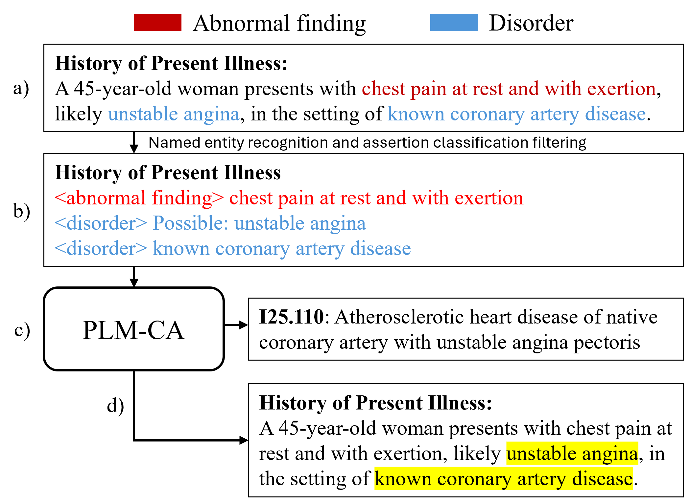

## 一、研究问题与方法概览 {#method-overview}

### 1.1 ICD 编码任务与长病历问题

医院需要把病历中记录的诊断和医疗操作转换成标准编码，用于统计、管理和结算。国际疾病分类（ICD）提供了相应的编码体系；自动 ICD 编码研究怎样根据病历文字预测这些编码。

输入是一份出院小结，输出是一组诊断和操作编码。同一份病历可能记录多种疾病、接受过多项操作，所以模型需要同时预测多个编码。它还可以为每个编码给出预测分数，并标出病历中的支持证据，供人核查。

困难在于，出院小结往往很长。除了疾病、症状和操作，它还包含正常查体、否定描述和重复记录。全文输入模型，会增加计算量，也要求模型从大量内容中寻找真正与编码有关的部分。

Less is More 研究的是：先把病历压缩成与编码有关的短文本，能否减少计算，同时保留大部分预测能力？

### 1.2 从病历到编码的处理流程

作者先找出疾病、症状、药物和操作等医学短语，这些短语在文中称为临床实体。实体识别（NER）负责找到它们，断言分类（AC）负责判断它们在上下文中的状态，例如确实存在、被否定或仅是可能。

```text
病历正文
  → 清洗文字并识别章节
  → 找出疾病、症状、药物和操作等信息
  → 判断存在、否定、可能和他人相关等状态
  → 按规则筛选，整理成简短文本
  → 预测 ICD 编码及其概率
  → 标出支持预测的文本证据
```

处理后得到三类结果：**预测的 ICD 编码、对应的概率估计，以及支持预测的文本证据。** “实体版病历”是中间输入，最终目标仍是编码预测。

### 1.3 实体筛选与上下文保留

找到疾病名称还不够。“没有肺炎”“可能是肺炎”“母亲患过肺炎”都提到了肺炎，编码含义却不同。AC 根据上下文区分这些状态，再按实体类别决定保留什么；部分可能诊断和家族史仍然有编码用途，具体规则见[断言分类](#assertion-filtering)。

压缩时还保留三类信息：

- **实体顺序**：保留相邻信息之间的联系，便于模型结合多个实体判断。
- **章节标题**：说明信息属于既往史、现病史或其他病历部分。
- **类型标签**：区分疾病、药物和操作等不同角色。

因此，缩短后的输入仍有一定的上下文和结构，模型能够在整份实体文本中学习编码关系。

### 1.4 主要结果与成本取舍

在论文的 MIMIC-IV 实验中，病历中位长度由 **1,627 词降到 353 词**，编码模型训练时间由 **28.8 小时降到 10.9 小时**。衡量总体编码预测效果的 micro-F1（越高越好，按百分制报告）由 **59.6 降到 58.8**，下降 0.8 个百分点。（原文表 5—7）

输入和编码训练成本减少了，预测性能也略有下降。此外，NER 和 AC 增加了前处理：关键实体如果漏掉或被误删，后面的模型就可能失去这条信息。证据映射能保留完整短语，但证据是否准确、是否忠实于模型决策，还需要分别评估。

## 二、论文信息与任务定义

| 项目 | 内容 |
| --- | --- |
| 论文 | *Less is More: Explainable and Efficient ICD Code Prediction with Clinical Entities* |
| 作者 | James C. Douglas、Yidong Gan、Ben Hachey、Jonathan K. Kummerfeld |
| 发表 | ACL 2025 Main，30835—30847 页 |
| 原文 | [ACL Anthology](https://aclanthology.org/2025.acl-long.1489/)；[正式 PDF](https://aclanthology.org/2025.acl-long.1489.pdf) |
| 代码 | [jd4501/entity-coding](https://github.com/jd4501/entity-coding) |

下文的章节和表号以 ACL 2025 正式发表版为准。模型公式按作者实现解释，未将实现补充写成论文原式。

环境安装、样例推理、代码调用链和训练命令见 [Less is More 实验与代码笔记](knowledge:research-experiment-less-is-more)。其他自动编码模型的设计可对照[自动医学编码深度学习综述](knowledge:research-paper-automated-medical-coding-review)。

### 2.1 多标签编码任务的形式化定义

输入是一份出院小结，输出是这次住院对应的诊断与操作编码集合。论文关注 MIMIC-IV 中的 ICD-10-CM 诊断编码和 ICD-10-PCS 操作编码。

设病历为 \(x\)，候选编码数量为 \(L\)，标签向量为 \(y\in\{0,1\}^{L}\)。其中 \(y_\ell=1\) 表示病历具有第 \(\ell\) 个编码。模型为每个编码计算原始得分 \(z_\ell\)，再分别经过 sigmoid，得到概率估计：

\[
p_\ell=\sigma(z_\ell).
\]

给定决策阈值 \(\tau\)，预测标签为：

\[
\hat y_\ell=\mathbf 1(p_\ell>\tau).
\]

\(\mathbf 1(\cdot)\) 表示条件成立时取 1，否则取 0。不同编码可以同时为正，因此这里采用逐标签 sigmoid；所有编码的概率不需要加起来等于 1。上式按仓库推理代码使用严格大于。

### 2.2 方法组成与全文基线的差异



图：论文图 1，使用作者仓库 `img/workflow_diagram.png`。示例为合成病历；[原论文](https://aclanthology.org/2025.acl-long.1489.pdf)第 3 节给出处理过程。

对应实现中，前处理由 NER 和 AC 完成，编码模型为 PLM-CA，证据提取使用 AttnInGrad。各模块的位置如下，后文再分别解释计算过程：

```text
病历全文
  → 清洗、分句、章节识别
  → NER 提取医学实体
  → AC 判断实体状态
  → 过滤并保留章节、类型、顺序
  → 实体版病历
  → PLM-CA 预测编码
  → AttnInGrad 计算贡献，映射回完整实体
```

NER、AC 和编码模型分别训练，推理时依次执行。图中的“端到端流程”表示从病历到结果的完整处理链，不表示三个模型由一个损失联合训练。

全文基线和实体方法采用相同的编码模型结构，改动主要发生在输入端：用贴近编码需要的实体范围保留修饰信息，通过断言判断筛选提及，再按章节和顺序组织短文本。作者另外提供了相应标注数据，并把 token 归因映射到完整实体，供人检查编码依据。这些改动对应输入表示、训练数据和解释方式，编码模型仍使用已有的 PLM-CA。

## 三、临床实体提取与筛选

### 3.1 医学实体识别与标注范围

命名实体识别（Named Entity Recognition，NER）要回答两个问题：哪些文字属于一个实体，以及这个实体是什么类型。

论文使用在医学语料上预训练的 RoBERTa-PM，以 BIO 标注识别六类实体。`B` 是实体起始位置，`I` 是实体内部，`O` 是实体以外的位置。实际模型预测发生在 tokenizer 划分后的 token 上，再还原成文本范围。

| 类型 | 含义 | 下游处理 |
| --- | --- | --- |
| `normal_finding` | 正常发现，如正常查体结果 | 提取后移除 |
| `abnormal_finding` | 异常发现，如症状、异常检查结果 | 按断言状态筛选 |
| `disorder` | 疾病或病理状态 | 按断言状态筛选 |
| `procedure` | 诊断、治疗操作 | 只保留存在状态 |
| `health_context` | 影响编码的健康背景，如过敏、社会因素 | 按断言状态筛选 |
| `medication` | 药物 | 只保留存在状态 |

实体范围会包含有关部位、侧别、急慢性等修饰信息。比如“左肩冻结肩”与单独的“冻结肩”，能够支持的编码精细程度不同。若 NER 只保留疾病名，压缩时就可能把编码需要的信息一起删掉。（原文 §3.3、§4.2）

作者为此标注了 400 份 MIMIC-IV 出院小结，共有 85,328 个实体标注，另有 10,922 个断言标注。断言标签只覆盖其中一部分实体，不能把两个数相加当作实体总量。（原文表 1）

### 3.2 断言分类与实体保留规则 {#assertion-filtering}

断言分类（Assertion Classification，AC）判断实体在上下文中处于什么状态。下面用几句示例区分这些状态：

| 表述 | 断言状态 | 区别 |
| --- | --- | --- |
| 患者有肺炎 | `present`，存在 | 描述患者当前具有的情况 |
| 未见肺炎 | `absent`，否定 | 提到了肺炎，但是否定 |
| 考虑肺炎 | `possible`，可能 | 存在不确定性 |
| 若出现肺炎，则调整治疗 | `hypothetical`，假设 | 讨论一种假设情形 |
| 母亲有肺癌病史 | 与患者本人无直接关联 | 可能提供家族史信息 |

NER 可以在这些句子里都找到疾病实体，单靠实体类型无法区分它们。AC 将目标实体用 `<entity>` 标记放回上下文，再用另一个 RoBERTa-PM 分类。

论文的保留规则与实体类型有关：

| 实体类型 | 存在 | 可能 | 他人相关 | 否定、假设 |
| --- | --- | --- | --- | --- |
| 疾病、异常发现 | 保留 | 保留，并标记不确定性 | 保留，按家族史处理 | 删除 |
| 健康背景 | 保留 | 保留，并标记不确定性 | 删除 | 删除 |
| 操作、药物 | 保留 | 删除 | 删除 | 删除 |
| 正常发现 | 删除 | 删除 | 删除 | 删除 |

这解释了为什么不能简单地“只保留确定存在的疾病”：作者按照住院编码场景保留部分可能诊断，也保留可用于家族史编码的信息。“他人相关”被写成家族史是该方法采用的处理约定，不代表两者在所有文本里完全等价。（原文 §3.3.2—§3.4）

### 3.3 实体文本的结构化组织

剩下的实体按原文位置排列，每个实体前添加类型 token，并保留标准化章节标题。可能状态添加 `Possible:`，家族史添加 `Family history:`。

以流程图中的内容为例，整理后的形式类似：

```text
history_of_present_illness
<abnormal_finding> chest pain at rest and with exertion
<disorder> Possible: unstable angina
<disorder> known coronary artery disease
```

这是根据图 1 表达的格式示意，具体输出由仓库的章节和实体处理代码决定。

顺序保留相邻内容之间的联系，章节说明信息出现的场景，类型 token 区分疾病、操作和药物等角色。编码模型读到的是一份缩短的序列，仍能结合多个实体进行判断；它没有把每个实体独立查表后直接合并编码。

整理到这一步，病历已经变成可输入语言模型的短文本。下一步仍需要学习整份文本与编码集合之间的对应关系，NER 和 AC 本身并不负责分配 ICD 编码。

## 四、ICD 编码预测与证据提取

### 4.1 PLM-CA 的标签交叉注意力 {#label-cross-attention}

PLM-CA 来自已有研究，本文主要改变它的输入。模型先用 RoBERTa-PM 形成 token 表示，再让不同编码分别关注相关内容。（原文 §3.5）

下面按公开实现整理计算过程，便于说明维度，不是论文中的原编号公式。省略 batch 维，设输入有 \(T\) 个 token，隐藏维度为 \(d\)，编码器输出：

\[
H\in\mathbb R^{T\times d}.
\]

每个编码对应一个可学习向量。把 \(L\) 个编码向量放在一起，得到查询矩阵 \(Q\in\mathbb R^{L\times d}\)。设键和值的投影矩阵均为 \(d\times d\)，token 表示分别经线性变换得到键：

\[
K=HW_K\in\mathbb R^{T\times d}.
\]

值的投影带偏置。设 \(b_V\in\mathbb R^d\)，并按 token 位置广播，则：

\[
V=HW_V+b_V\in\mathbb R^{T\times d}.
\]

查询与键匹配，得到编码对各 token 的注意力：

\[
A=\operatorname{softmax}_{\text{token}}\left(\frac{QK^\top}{s}\right),
\qquad A\in\mathbb R^{L\times T}.
\]

\(s>0\) 是实现中的缩放参数，当前配置取 1；padding 位置在 softmax 前被屏蔽。softmax 沿 token 维计算，所以每个编码各自得到一组对文本位置的权重，同一编码对有效位置的权重之和为 1。这里不额外套用常见 Transformer 的 \(\sqrt d\) 缩放。

每行注意力对应一个编码，对 token 表示加权后得到编码专属表示：

\[
U=AV\in\mathbb R^{L\times d}.
\]

随后对每个编码的隐藏维度进行层归一化：

\[
\widetilde U=\operatorname{LayerNorm}(U).
\]

实现使用共享线性层将每个编码的表示变成 logit。设输出权重为 \(w\in\mathbb R^d\)，偏置为标量 \(b\)，则：

\[
z_\ell=w^\top\widetilde U_\ell+b.
\]

即使输出投影共享，不同编码仍有不同的查询向量和注意力分布。比如疾病编码与操作编码，可以分别聚合病历中的不同部分。源代码仍把模型类命名为 `PLMICD`，启用 `cross_attention=True` 时使用 `LabelCrossAttention`，这也是读代码时容易混淆的地方。

### 4.2 AttnInGrad 与实体级证据 {#entity-attribution}

预测出编码后，还需要找出哪些文字与这个预测相关。本文采用的 AttnInGrad 结合标签注意力和输入乘梯度（Input×Gradient）：注意力提供编码对 token 的权重，输入乘梯度提供相应的贡献量。

按代码整理，设第 \(t\) 个 token 的输入嵌入为 \(e_t\in\mathbb R^d\)，对应编码 logit 为 \(z_\ell\)。实现对嵌入与梯度的逐元素乘积取二范数，压成 token 级贡献：

\[
g_{t\ell}=\left\|e_t\odot\frac{\partial z_\ell}{\partial e_t}\right\|_2.
\]

其中 \(\odot\) 表示逐元素相乘。再与该编码的标签注意力相乘：

\[
r_{t\ell}=A_{\ell t}\,g_{t\ell}.
\]

上式表示归一化前的贡献。代码随后对本次选中编码与 token 构成的贡献张量做 L1 归一化，再筛选、聚合证据。这里的梯度来自输入表示，求导对象与“对注意力权重求梯度”的方法不同。具体调用及实现位置见[编码与证据聚合](knowledge:research-experiment-less-is-more#coding-and-evidence)。

最终展示时，贡献高的 token 会映射到它所在的完整实体。例如只高亮 `heart` 信息不够，映射到包含心衰类型和修饰语的完整实体，更便于检查预测依据。（原文 §3.6）

需要区分两件事：证据与人工标注看起来是否合理，叫作合理性（plausibility）；证据是否忠实反映模型实际的决策机制，叫作忠实性（faithfulness）。实体映射改变了证据的展示范围，后续重叠实验检查的主要是它与人工参考的对应程度。

## 五、实验设置与结果分析

主表比较整套实体流程与全文基线，消融则改变实体流程中的单个设计。两类实验回答的问题不同：前者看整体取舍，后者看组件在当前设置下的作用。

### 5.1 数据划分与对照设置

主实验采用 MIMIC-IV 2.2，沿用既有研究的训练、验证和测试划分。两组都训练 PLM-CA，一组读全文，一组读实体文本。除显存需要的批处理调整外，作者沿用上游训练配方，在验证集 MAP 收敛后测试。（原文 §4.1、§4.3）

NER 和 AC 单独做五折交叉验证。NER 的疾病、异常发现 F1 分别为 83.5、85.7，健康背景为 69.5；AC 的存在、否定 F1 为 96.7、96.5，可能状态为 85.1。前处理仍会犯错，尤其不能把“实体抽取已经解决”作为后续分析的前提。（原文表 3—4，数值为百分制均值）

### 5.2 文档压缩、训练效率与编码性能

| 项目 | 全文 PLM-CA | 实体 PLM-CA |
| --- | --- | --- |
| 病历中位长度，词 | 1,627 | 353 |
| 每轮训练时间，小时 | 3.20 | 1.36 |
| 收敛轮数 | 9 | 8 |
| 编码模型总训练时间，小时 | 28.8 | 10.9 |
| micro-F1 | 59.6 | 58.8 |
| macro-F1 | 26.1 | 24.8 |
| MAP | 63.4 | 62.3 |
| P@8 | 70.9 | 70.3 |

来源：原文表 5—7；训练时间在单张 NVIDIA L4 上统计，性能为百分制。

micro-F1 下降 0.8 个百分点，macro-F1 下降 1.3 个百分点。后者给每个标签相同的平均权重，说明只看整体表现还不够，需要进一步检查低频编码。指标定义与聚合方式见[分类模型评价指标](knowledge:research-experiment-metrics-laat)。

表 7 中两组的 macro-F1、micro-F1 和 MAP 等差异经过置换检验，达到论文采用的显著性标准。因而“性能接近”应理解为差距相对有限，不能写成“性能没有差异”。

训练时间统计针对编码模型。完整使用成本还包括 NER、AC 的训练或下载、逐病历抽取以及证据计算，不能把表中的 10.9 小时直接当成整条流程的耗时。实体可以预先计算并复用，多次训练时更容易摊薄这部分成本。

### 5.3 组件消融与实体类别对照 {#ablation-evidence}

| 消融设置 | Δ micro-F1 | Δ macro-F1 | Δ MAP |
| --- | --- | --- | --- |
| 不做断言过滤 | -0.1 | -1.2 | -0.2 |
| 去掉实体类型 token | -0.2 | -1.2 | -0.2 |
| 类型 token 改成普通文字 | -0.1 | -1.5 | -0.2 |
| 打乱实体与章节顺序 | -1.5 | -3.0 | -1.7 |

来源：原文表 10，相对于完整实体模型的百分点变化。

打乱顺序影响最大，说明提取实体后仍要保留上下文组织。去掉 AC 或类型标签对 micro-F1 的影响小于对 macro-F1 的影响，也说明不能只凭一个总体指标认定这些组件无用。

这张表没有单独给出“去掉章节”的对照，所以不能据此量化章节标题本身的收益。顺序与章节一起参与打乱，结论也应保留这个条件。

实体类别的对照进一步说明，仅保留疾病和操作并不够：

| 输入实体 | 中位词数 | Δ micro-F1 | Δ MAP |
| --- | --- | --- | --- |
| 疾病、操作 | 112 | -6.7 | -8.7 |
| 再加异常发现 | 241 | -3.6 | -4.5 |
| 再加健康背景 | 173 | -3.5 | -4.5 |
| 再加药物 | 160 | -5.5 | -7.0 |

来源：原文表 11，各行均相对于完整五类实体模型，不是相对于上一行。后三行分别只加一种类别。

健康背景与异常发现带来了相近的分数恢复，但输入更短。药物在这组设置下的增益较小，不能由此推广成所有医学编码任务都不需要药物信息。

### 5.4 实体证据与人工标注的匹配评估 {#evidence-evaluation}

论文使用 MDACE 人工证据标注评估解释。对正确预测的编码，规范化文本后采用位置无关匹配，将证据分为完全匹配、超集、子集和无重叠。

| 证据关系 | 全文 | 实体 |
| --- | --- | --- |
| 完全匹配 | 65.4% | 65.3% |
| 超集，预测证据包含参考证据 | 9.7% | 20.4% |
| 子集，预测证据只覆盖参考证据的一部分 | 19.5% | 6.9% |
| 无重叠 | 5.4% | 7.4% |

来源：原文表 8，仅统计真阳性预测。

实体方法减少了不完整的子集证据，增加了包含修饰语的超集证据；完全匹配比例基本不变，无重叠比例则有所增加。结果支持“证据范围更完整”，并不表示每项证据指标都更好。

评估还有几个条件：MDACE 来自 MIMIC-III，与主实验的 MIMIC-IV 不同；证据阈值在 MDACE 验证集上按部分匹配 F2 选择；最终证据分析合并了未用于模型训练的 MDACE 训练、测试部分。只对真阳性做重叠评估，也无法说明误报和漏报都具有可靠解释。（原文 §5.5）

实际运行时，编码概率阈值与证据评分阈值分别控制不同对象，具体设置见[实验篇的阈值说明](knowledge:research-experiment-less-is-more#coding-and-evidence-thresholds)。

## 六、局限与后续验证

### 6.1 现有证据的范围

作者指出，NER 错误可能造成上下文丢失；实体解释的忠实性尚未直接验证；标注方案还缺少专业编码员验证；数据主要来自单一机构，在其他医疗环境中的泛化仍需检验。（原文 §8）

两组编码模型各训练一次。对固定预测做置换检验，可以检验这两组预测的差异，但不能替代多随机种子实验，也不能给出重新初始化、重新训练后的波动范围。

### 6.2 后续验证设计

输入压缩、实体错误和证据映射发生在不同环节，可以分别设计对照：

- 被 AC 误删的实体，后面的编码模型还能从剩余上下文补回来吗？可以比较人工实体与预测实体的编码结果。
- 能否保留低置信度实体附近的一小段原句，减少压缩造成的信息损失？需要同时报告长度和性能，避免只增加文本换分数。
- 表 8 的完整实体是否更忠实？可以设计删除证据与删除无关片段的对照，观察对应编码分数的变化，再检查删除操作是否引入了分布变化。
- 在新医院或不同文书类型上，哪些实体和断言规则需要调整？仅靠当前数据集的测试分数还无法回答。

这些对照都需要额外实验，原文没有报告相应结果。

## 七、综合讨论

### 7.1 实体压缩后的上下文依赖

编码往往取决于修饰语、断言状态以及多个实体的组合。实体范围保存局部细节，AC 区分否定、可能和家族史，章节与顺序则保留文本组织。打乱实体与章节顺序后性能下降，支持了保留组织信息的必要性；其中章节本身的独立收益还需要单独对照。

### 7.2 输入侧改动与已有模型的分工

改动集中在输入表示和解释映射：先抽取并筛选实体，再让原有 PLM-CA 学习实体文本到编码的关系，最后把 token 贡献扩展到完整实体。理解这项贡献时，需要把实体标注、过滤与格式化方案同已有的编码器、交叉注意力和归因方法分开。

### 7.3 效率与解释结论的适用范围

要看使用目标。主实验支持以小幅编码性能损失换取更短输入和更少的编码训练时间；证据实验支持减少参考证据的子集、保留更多完整短语。成本比较还需要计入前处理，解释比较还需要忠实性验证，部署到新机构也需要重新评估。因此，这项工作提供了一种有实验依据的取舍，还没有同时解决准确性、解释和泛化 的全部问题。

## 参考资料

- Douglas et al. [Less is More: Explainable and Efficient ICD Code Prediction with Clinical Entities](https://aclanthology.org/2025.acl-long.1489/)，ACL 2025，正式发表版。
- 作者实现：[jd4501/entity-coding](https://github.com/jd4501/entity-coding)，方法公式与源码位置可通过[配套代码笔记](knowledge:research-experiment-less-is-more)核对；涉及 `LabelCrossAttention`、`get_grad_attention_callable()` 和 token 贡献归并函数。
- [Less is More：ICD 编码推理、代码调用链与训练复现](knowledge:research-experiment-less-is-more)，对应运行步骤、参数和评估口径。
